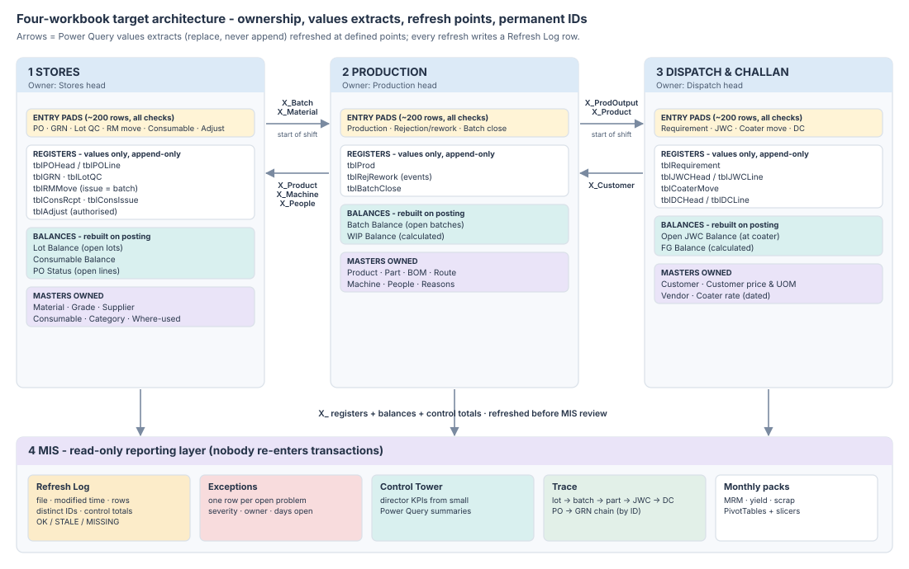
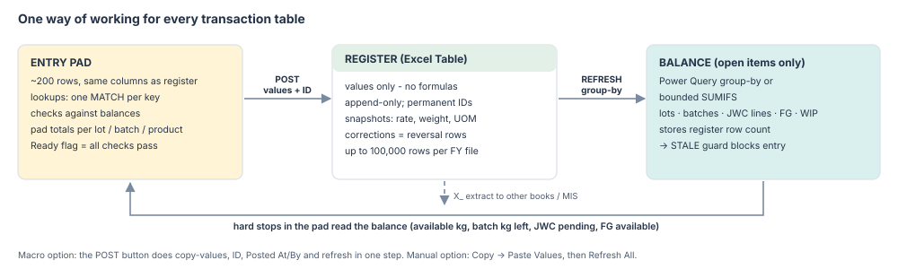
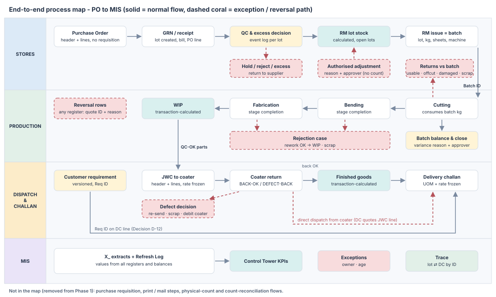
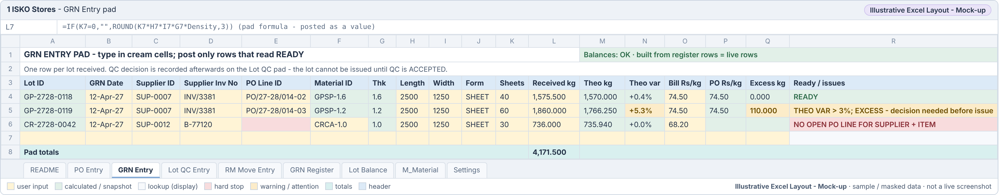
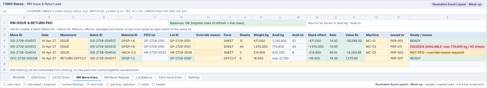
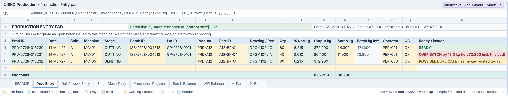
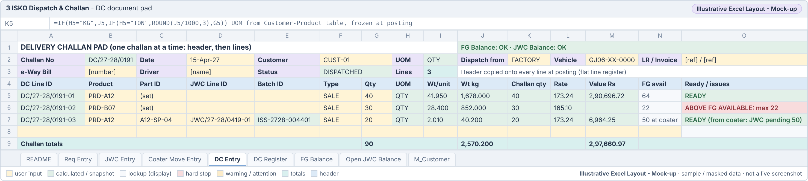
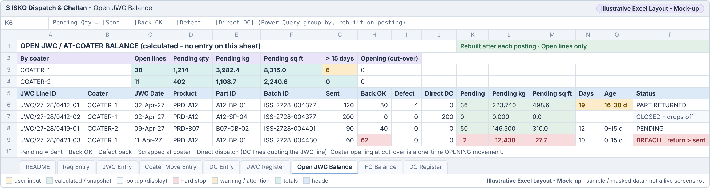
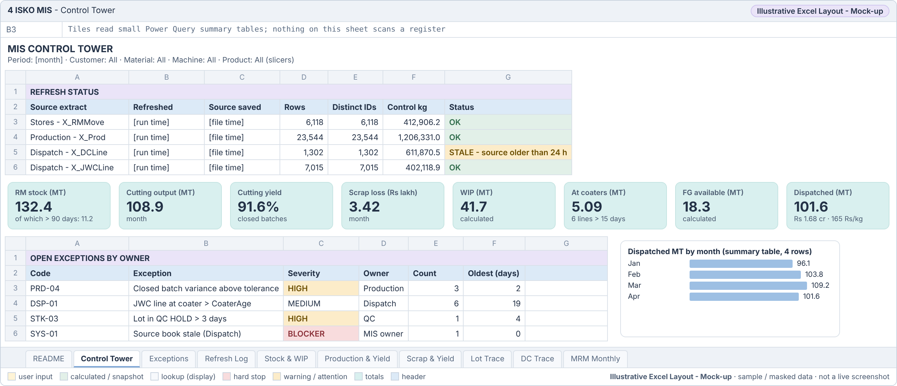

ISKO Engineering - Excel ERP

<h1 class="cover-title">Excel ERP Rebuild Plan</h1>

100,000-Row Resilience Blueprint

<table class="cover-meta">
<tr><td>Prepared for</td><td>Managing Director and department heads (Stores, Production, Dispatch, Finance)</td></tr>
<tr><td>Scope</td><td>Four workbooks: 1 Stores, 2 Production, 3 Dispatch &amp; Challan, 4 MIS (2026 files)</td></tr>
<tr><td>Version / date</td><td>1.0 - 27 October 2026</td></tr>
<tr><td>Status</td><td>Planning blueprint for approval. No production workbook has been rebuilt or overwritten.</td></tr>
<tr><td>Performance status</td><td><b>Not yet benchmark-tested in Excel.</b> Targets in Section 17 are provisional.</td></tr>
</table>

Current State
Recommendation
Removed from Phase 1
Risk
Decision Required
Not Yet Tested

<h2 class="no-num">Contents</h2>
<table class="toc">
<tr><td class="toc-n">1.</td><td>Cover page</td><td class="toc-p">1</td></tr>
<tr><td class="toc-n">2.</td><td><a href="#executive-summary">Executive summary</a></td><td class="toc-p">3</td></tr>
<tr><td class="toc-n">3.</td><td><a href="#what-the-current-workbooks-tell-us">What the current workbooks tell us</a></td><td class="toc-p">5</td></tr>
<tr><td class="toc-n">4.</td><td><a href="#design-principles-and-scope">Design principles and scope</a></td><td class="toc-p">8</td></tr>
<tr><td class="toc-n">5.</td><td><a href="#four-workbook-target-architecture">Four-workbook target architecture</a></td><td class="toc-p">10</td></tr>
<tr><td class="toc-n">6.</td><td><a href="#end-to-end-process-map">End-to-end process map</a></td><td class="toc-p">12</td></tr>
<tr><td class="toc-n">7.</td><td><a href="#workbook-responsibility-matrix">Workbook responsibility matrix</a></td><td class="toc-p">13</td></tr>
<tr><td class="toc-n">8.</td><td><a href="#sheet-by-sheet-rebuild-decision-register">Sheet-by-sheet rebuild decision register</a></td><td class="toc-p">16</td></tr>
<tr><td class="toc-n">9.</td><td><a href="#column-by-column-design-blueprint">Column-by-column design blueprint</a></td><td class="toc-p">27</td></tr>
<tr><td class="toc-n">10.</td><td><a href="#master-data-and-unique-id-standards">Master data and unique-ID standards</a></td><td class="toc-p">45</td></tr>
<tr><td class="toc-n">11.</td><td><a href="#formula-and-performance-architecture">Formula and performance architecture</a></td><td class="toc-p">47</td></tr>
<tr><td class="toc-n">12.</td><td><a href="#cross-workbook-integration-and-mis-refresh-design">Cross-workbook integration and MIS refresh design</a></td><td class="toc-p">49</td></tr>
<tr><td class="toc-n">13.</td><td><a href="#inventory-and-production-control-design">Inventory and production control design</a></td><td class="toc-p">51</td></tr>
<tr><td class="toc-n">14.</td><td><a href="#jwc-subcontractor-and-dispatch-controls">JWC, subcontractor and dispatch controls</a></td><td class="toc-p">52</td></tr>
<tr><td class="toc-n">15.</td><td><a href="#management-dashboards-and-exception-reporting">Management dashboards and exception reporting</a></td><td class="toc-p">53</td></tr>
<tr><td class="toc-n">16.</td><td><a href="#data-migration-archival-and-go-live">Data migration, archival and go-live</a></td><td class="toc-p">56</td></tr>
<tr><td class="toc-n">17.</td><td><a href="#stress-test-and-acceptance-plan">Stress-test and acceptance plan</a></td><td class="toc-p">57</td></tr>
<tr><td class="toc-n">18.</td><td><a href="#risk-register">Risk register</a></td><td class="toc-p">59</td></tr>
<tr><td class="toc-n">19.</td><td><a href="#implementation-roadmap">Implementation roadmap</a></td><td class="toc-p">60</td></tr>
<tr><td class="toc-n">20.</td><td><a href="#management-decisions-required">Management decisions required</a></td><td class="toc-p">61</td></tr>
<tr><td class="toc-n">21.</td><td><a href="#appendices">Appendices</a></td><td class="toc-p">64</td></tr>
</table>

## 2. Executive summary

::: {.callout .current}
**Current State - observed in the attached files.** The four 2026 workbooks contain **120 sheets** and **430,095 formula cells** (Stores 91,698; Production 217,775; Dispatch & Challan 119,138; MIS 1,484). Three sheets hold **81%** of all formulas: *2.1 Production Entry* (203,113), *3.3 JWC Lines* (88,661) and *1.6 RM Issue & Return* (57,683). The books hold about six months of history (April-September 2026): 11,406 production lines, 3,023 RM movements, 3,508 JWC lines and 626 DC lines.
:::

**Key findings**

1. **The present design cannot reach 100,000 rows.** 53,011 formulas sum their own table on every row and 47,369 use expanding "first row to this row" ranges. That work grows with the *square* of the row count: taking *2.1 Production Entry* from 12,538 to 100,000 rows multiplies rows by 8 but this calculation work by about 64. Today the book is usable because it is small.
2. **Record IDs are not permanent.** Issue, production, JWC-line, DC-line, PO-line and consumable IDs are built from `ROW()`; RM lot IDs and batch IDs from running counts. Sorting or inserting a row renumbers them, and every link that quotes them breaks silently.
3. **History can change when a master changes.** Coater rate and basis, customer sale rate, set weight, part weight per piece and dispatch UOM are live lookups on posted rows. Editing a master re-prices or re-weighs old transactions.
4. **About 61% of formulas (≈264,000) depend on functions added in Excel 2019 or later**, mostly Excel 2021 / Microsoft 365 (`XLOOKUP`, `LET`, `FILTER`, `SORTBY`, `UNIQUE`, `SEQUENCE`), and 109 defined names use spill references. The installed Excel version is not recorded in the files and must be confirmed (Decision D-01).
5. **Numbers already disagree between books.** There are three product masters (Stores 249, Production 269, Dispatch 278 rows). MIS was last refreshed on 06-Oct-2026: it shows 2 PO lines where Stores has 3, and reports 442 RM issues with a lot problem where Stores now shows 72.
6. **Controls exist on paper but are weak in practice.** All 217 stock adjustments (net −97,471 kg) have no reason code and no approver; QC status is blank on all 187 lots; validation is bypassed by pasting (form values `SHET`, `SHEE`; 33 DC lines with unit `0`).
7. **The four scope removals touch every book**: purchase requisition (1 sheet, 5 PO columns, 6 names, list columns, MIS import and 3 checks), print (5 print sheets, 15 print areas, 19 printer-settings parts), mail (Gmail links on 10 sheets, 4 contact masters, mail names, the *Mail Coater* and *Mail the team* columns), and physical counts (3 count sheets, 3 MIS imports, count tiles and count-driven adjustments).

::: {.callout .rec}
**Recommendation - target architecture.** Keep four Excel books and the same business flow, but change *how* each transaction table works:

- **Entry pad → append-only values register → bounded balance.** Users type into a small entry pad (about 200 rows) that holds all lookups and checks. Posting copies valid rows into the register **as values** with a permanent ID. Registers contain no formulas, so 100,000 rows cost little to recalculate.
- **Balances only for open items** (open lots, open batches, open JWC lines, FG by product), rebuilt on posting with Power Query or bounded `SUMIFS`. Every hard stop reads these balances.
- **Excel 2016 function set** (`INDEX`/`MATCH`, `SUMIFS`, `COUNTIFS`), Excel Tables, data validation, PivotTables and Power Query. No volatile functions, no spill formulas, no sheet protection, no freeze panes, light pastel styling.
- **Controlled transfer:** each book publishes values-only extracts; consumers refresh at defined points; every refresh writes a **Refresh Log** row (file, modified time, rows, distinct IDs, control totals, status).
- **MIS is read-only:** director KPIs from small Power Query summaries, an exception table with owners, and parameter-driven trace queries.
- **FY-wise files** keep each live register inside the tested volume; open balances carry forward.
:::

**Decisions required before build** (full list in Section 20): (1) Excel version on every PC and whether a signed "Post" macro is allowed (D-01, D-02); (2) how the statutory delivery challan and job-work challan documents will be produced once print is removed (D-03); (3) the stage/route and FG rules that make WIP and FG transaction-calculated, and the approved cut-over opening balances (D-05, D-06, D-08).

::: {.callout .decision}
**Do not build until agreed:** the posting mechanism (depends on D-01/D-02), the WIP and FG balances (D-05/D-06), the opening-balance load (D-08) and any document-number sequence for DC/JWC (D-03). Masters, IDs and the Stores pilot can start once D-01 and D-02 are taken.
:::

::: {.callout .untested}
**Not Yet Tested.** No Excel benchmark has been run. The 100,000-row figure is a design target to be proven with the test plan in Section 17 on the company's own PCs.
:::

## 3. What the current workbooks tell us

All figures in this section were measured from the attached files by reading the workbook XML (every cell, formula, table, defined name, validation and Power Query definition). They describe the files as received.

### 3.1 Inventory

| Workbook | Sheets | Formula cells | File MB | Excel Tables | Defined names | Protected / freeze-pane sheets | Largest formula sheet |
|----------------|----------------|----------|-------|-------|------------|------------|------------------------|
| 1 Stores | 28 (27 visible / 1 hidden) | 91,698 | 2.79 | 18 | 92 (35 spill) | 28 / 18 | 1.6 RM Issue & Return (57,683) |
| 2 Production | 23 (19 visible / 4 hidden) | 217,775 | 7.23 | 16 | 48 (19 spill) | 20 / 12 | 2.1 Production Entry (203,113) |
| 3 Dispatch & Challan | 23 (20 visible / 3 hidden) | 119,138 | 2.44 | 15 | 73 (29 spill) | 21 / 12 | 3.3 JWC Lines (88,661) |
| 4 MIS | 46 (14 visible / 32 hidden) | 1,484 | 3.91 | 32 | 114 (26 spill) | 15 / 2 | Lists (582) |
| **Total** | **120** | **430,095** | **16.37** | **81** | **327 (109 spill)** | **84 / 44** |  |

### 3.2 Where the formulas are

| Workbook | Sheet | Formula cells | % of all | Data rows | Table rows (incl. pre-filled) | Formulas per data row | Used range |
|--------------|----------------------|---------|-------|--------|------------|---------|-----------|
| 2 Production | 2.1 Production Entry | 203,113 | 47.2% | 11,406 | 12,538 | 17.8 | A1:AK12542 |
| 3 Dispatch & Challan | 3.3 JWC Lines | 88,661 | 20.6% | 3,508 | 4,030 | 25.3 | A1:AG4034 |
| 1 Stores | 1.6 RM Issue & Return | 57,683 | 13.4% | 3,023 | 3,393 | 19.1 | A1:AD3397 |
| 3 Dispatch & Challan | 3.10 DC Lines | 21,329 | 5.0% | 626 | 1,292 | 34.1 | A1:Y1296 |
| 1 Stores | 1.7 Consumable Issue | 10,346 | 2.4% | 128 | 862 | 80.8 | A1:V866 |
| 2 Production | M_Part | 6,630 | 1.5% | 122 | 3,315 | 54.3 | A1:I3319 |
| 1 Stores | 1.4 RM Receipt GRN | 5,918 | 1.4% | 187 | 348 | 31.6 | A1:AN352 |
| 1 Stores | 1.2 Purchase Order | 5,632 | 1.3% | 3 | 202 | 1877.3 | A1:AH206 |
| 1 Stores | 1.5 Consumable Receipt | 3,305 | 0.8% | 202 | 413 | 16.4 | A1:S417 |
| 3 Dispatch & Challan | 3.9 DC Header | 3,159 | 0.7% | 184 | 451 | 17.2 | A1:Q455 |
| 1 Stores | M_Consumable | 2,684 | 0.6% | 97 | 244 | 27.7 | A1:O248 |
| 3 Dispatch & Challan | 3.2 JWC Header | 2,617 | 0.6% | 152 | 327 | 17.2 | A1:Q331 |

### 3.3 Formula patterns that limit scale

| Workbook | Formula cells | Post-2016 functions | Dynamic-array functions | Expanding ranges | Self-table aggregates | Position-dependent (ROW()) | Volatile | Reads Power Query tables |
|--------------|---------|---------|---------|---------|---------|----------|--------|----------|
| 1 Stores | 91,698 | 60,607 | 4,111 | 17,271 | 15,397 | 10,455 | 5,571 | 0 |
| 2 Production | 217,775 | 154,699 | 40 | 25,076 | 37,614 | 38,077 | 3 | 103,080 |
| 3 Dispatch & Challan | 119,138 | 48,747 | 163 | 5,022 | 0 | 6,200 | 3 | 16,123 |
| 4 MIS | 1,484 | 128 | 126 | 0 | 0 | 0 | 3 | 589 |
| **Total** | **430,095** | **264,181** | **4,440** | **47,369** | **53,011** | **54,732** | **5,580** | **119,792** |

*Self-table aggregate* = a row formula that runs `SUMIFS`/`COUNTIFS` over its own table. *Expanding range* = `INDEX(col,1):[this row]`. *Position-dependent* = formula uses `ROW()` (IDs and running ranges). *Reads imports* = formula reads a Power Query table that refreshes on open and every 5 minutes.

### 3.4 Growth and calculation load

| Table | Data rows now | Period | Rows / month | Rows / year (est.) | Years to 100,000 (est.) | Formula cells now | Formulas per row |
|--------------------|---------|----------|--------|---------|----------|---------|--------|
| 2.1 Production Entry | 11,406 | Apr-Sep 2026 | 1,901 | 22,812 | 4.4 | 203,113 | 17.8 |
| 1.6 RM Issue & Return | 3,023 | Apr-Sep 2026 | 504 | 6,046 | 16.5 | 57,683 | 19.1 |
| 3.3 JWC Lines | 3,508 | Apr-Sep 2026 | 585 | 7,016 | 14.3 | 88,661 | 25.3 |
| 3.10 DC Lines | 626 | Apr-Sep 2026 | 104 | 1,252 | >50 | 21,329 | 34.1 |
| 1.4 RM Receipt GRN | 187 | Apr-Sep 2026 | 31 | 374 | >50 | 5,918 | 31.6 |
| 1.7 Consumable Issue | 128 | Aug-Sep 2026 | 64 | 768 | >50 | 10,346 | 80.8 |

::: {.callout .current}
**Calculation-load estimate (analytical, not a benchmark).** For a row formula that aggregates its own table, a full recalculation evaluates roughly *rows²* comparisons per aggregate. Moving *2.1* from 12,538 to 100,000 rows multiplies that by (100,000 / 12,538)² ≈ **64**; *1.6* from 3,393 to 100,000 rows by ≈ **869**; *3.3* from 4,030 by ≈ **616**. Whatever the time is today, the same design at 100,000 rows is far slower. This is why the plan removes per-row aggregates instead of simply extending formulas.
:::

### 3.5 Compatibility, duplication and design issues observed

- **Excel version:** files were last saved by Excel 16.x and contain calculation features for `LET` and dynamic arrays. About 264,000 formula cells use post-2016 functions; 109 names use `ANCHORARRAY` spill references. These books will show `#NAME?` in Excel 2016/2019.
- **Power Query in use:** Production reads Stores (3 queries), Dispatch reads Production (2), MIS reads all three (31 query tables). Production and Dispatch queries refresh on open and every 5 minutes; MIS refreshes on open. The source folder is an absolute path (`D:\Claude code folder\ISKO ERP\...`) held in *Settings*.
- **Duplicated data:** production history is stored in Production and again in MIS (296,551 cells); RM movements in Stores, Production (52,091 cells) and MIS (79,943 cells); JWC lines in Dispatch and MIS (102,388 cells). MIS imports pre-filled blank rows (3,393 rows for 3,023 issues).
- **Duplicated logic:** batch balance is computed in Production (*2.8*) and again inside MIS (*qBatch*); product, people and contact lists exist in several books.
- **Sheet protection and freeze panes:** 84 of 120 sheets are protected and 44 have freeze panes; all four books lock workbook structure. The target removes both, as instructed, and replaces protection with values-only registers and visible checks.
- **No VBA:** all four files are `.xlsx`; no macro project exists. Print and mail features are formula hyperlinks (Gmail compose links built with `ENCODEURL`) and print areas.
- **Migrated history:** most history was loaded from older registers (Source text such as "Part Production sheet"); 3 production rows are balancing lines ("Yield sheet says ... not itemised"), and MIS reports 190,137 kg of production not itemised. Shift and QC status are blank on all production history.

### 3.6 Measured facts versus assumptions

| Statement | Basis |
|---|---|
| Sheet, formula, table, name, validation and query counts | **Observed in the attached files** |
| Data-row counts and monthly volumes (Apr-Sep 2026) | **Observed** (non-blank date cells in each table) |
| Growth projections (rows per year, years to 100,000) | **Assumption requiring confirmation** - straight-line from six months |
| Calculation-load multipliers | **Analytical estimate** - not measured in Excel |
| Installed Excel version and bitness | **Unknown** - go-live check (D-01) |
| File size of a 100,000-row values register (14.8 MB) | **Measured** with a synthetic file written by Python/openpyxl, not by Excel |
| Open/save/recalculation times | **Not Yet Tested** |

## 4. Design principles and scope

### 4.1 Phase 1 scope

Phase 1 covers **Purchase Order → RM receipt/GRN → RM lot stock → RM issue/return → Cutting → Bending → Fabrication → Rejection/rework → transaction-calculated WIP → Powder coating/job work → Finished goods → Dispatch/challan → Management MIS**, across the four existing books.

::: {.callout .removed}
**Removed from Phase 1 (explicit exclusions)**

- **Purchase requisition** - no sheet, table, field, ID, approval queue, KPI or link. A PO is created on its own; purchase need is shown by the MIS RM Requirement report and re-order flags. Removed: *1.1 Requisition*; PO columns *Req No, Req Item, Req Line, Req kg, Req left kg*; names *ReqFrom, TolReqPO, RqItem, RqLen, RqWid, RqLine, ReqFirst, ReqNoList, ReqOpenList, ReqItemByReq, ReqItmId, ReqItmKey*; *Lists* columns AL:AR; MIS *D_Requisition* and query; checks "Requisitions waiting", "PO lines without a requisition", "PO lines ordering more than their requisition"; the requisition step in *4.7 DC Trace* and the START pages.
- **All print functionality** - *1.3 Print PO, 1.6b Print RM Issue Slip, 1.8 Print Issue Slip, 3.4 Print JWC, 3.11 Print DC*; all 15 print areas and 6 print-title names; 19 printer-settings parts; "Copy page" links; print-only settings (company address/email/GST print fields). No replacement templates.
- **All mailing / email-sending functionality** - "Gmail to" and "Open Gmail" links on 1.3, 1.8, 1.12, 1.13, 2.5, 3.4, 3.11, 4.1, 4.2, 4.8; *M_Contacts* in all four books; *MailTo/MailPick/POMailTo/DCMailTo/JWCMailTo* names; mail list columns; *Mail Coater* (3.6) and *Mail the team* (4.10). Supplier, customer and vendor email fields stay only as optional plain reference text.
- **All physical-count and count-reconciliation features** - *1.10 Stock Count, 2.4 WIP Count, 3.8 FG Count*; MIS *D_Count, D_WIPCount, D_FGCount*; "latest physical count" (4.3), "FG counted" (4.1) and "Counted (kg)" (4.8); count-difference adjustment reasons. RM, consumable, WIP and FG balances are calculated from valid transactions only. A necessary correction uses the **authorised stock-adjustment movement** (reason, reference, requester, independent approver, value).
- **Machine log and utilisation** (recommended for Phase 2, Decision D-09).
:::

### 4.2 Design principles

1. **Enter once, at source.** Each record has one owning book; others import values.
2. **Registers are values.** A posted row never recalculates; corrections are reversal rows.
3. **Permanent IDs** written at posting: prefix + financial year + sequence.
4. **Snapshot what history needs** (rates, weights, UOM, names on documents); look up only what may follow the current master.
5. **Bounded calculation:** formulas in pads and open-item balances only; no whole-column ranges, no volatile functions, no spill formulas.
6. **Controls at entry, exceptions in MIS.** Hard stops in the pad; MIS lists what slipped through and who owns it.
7. **Calm, readable sheets:** light pastel palette, one header row, no merged cells in tables, no freeze panes, no protected sheets.
8. **Version-safe:** Excel 2016 functions unless D-01 approves more.

### 4.3 Assumptions

- Windows desktop Excel, one editor per book at a time, books in one shared folder on a local network or PC.
- Power Query (Get & Transform) is available in the installed Excel - it is already used by three of the books, which is evidence but not proof for every PC.
- Typical office PC: 4-core CPU, 8-16 GB RAM, SSD, 64-bit Excel recommended (go-live check).

### 4.4 Non-negotiable transaction controls

Unique permanent IDs; no negative stock through ordinary issue; QC-accepted lots only; return only against a batch; cutting cannot exceed batch kg; dispatch cannot exceed FG or JWC pending; customer UOM mandatory; no posted-row editing (reversal only); period lock; every adjustment reasoned and independently approved.

## 5. Four-workbook target architecture

{.fig-wide}

**How a transaction flows.** A user fills the entry pad in the owning book. The pad shows lookups, available balances and a *Ready* flag. *Post* copies ready rows into the register as values with a permanent ID, then the book's balances are refreshed. At defined points the downstream book refreshes its import (X_ tables) and MIS refreshes everything, writing the Refresh Log.

{.fig-mid}

| Layer | What it holds | Formulas? | Size |
|---|---|---|---|
| Entry pad | Today's unposted rows, lookups, checks, Ready flag | Yes - all entry logic | ~200 rows |
| Register | Posted transactions, values only, append-only | **None** | up to 100,000 rows per FY file |
| Balance | Open lots / batches / JWC lines / FG / WIP | Power Query group-by or bounded SUMIFS | open items only |
| Extract (X_) | Values from another book + lineage columns | None (Power Query output) | as source, needed columns only |
| Report | KPIs, exceptions, trace | PivotTables / small summaries | hundreds of rows |

## 6. End-to-end process map

{.fig-wide}

**Exception and reversal pathways**

- **GRN:** excess over PO → *Excess decision* (accept / return) in the QC log before the lot can be issued; QC HOLD/REJECTED → lot not issue-eligible; supplier return → *RETURN-TO-SUPPLIER* movement.
- **RM movement:** wrong issue → reversal row quoting the Move ID, then a correct row; usable material back → *RETURN-USABLE* / *RETURN-OFFCUT* against the batch; damaged → *RETURN-DAMAGED* (separate bucket, not issue-eligible); stores scrap → *STORES-SCRAP* against the batch.
- **Production:** over-consumption is blocked; wrong line → reversal; rejection → REJECT case → REWORK-OK (back to WIP) or REWORK-SCRAP; batch closes only through a Batch Close row with reason/approver above tolerance.
- **Coater:** defects back → DEFECT-BACK with decision (re-send, scrap, debit coater); direct dispatch from coater → DC line quoting the JWC line.
- **Dispatch:** cancelled challan → DC status line CANCELLED plus reversal lines; FG cannot go negative.
- **Corrections to stock** outside these paths → authorised stock-adjustment movement only.

Purchase requisition, print/mail steps and physical-count/reconciliation flows are not part of the map.

## 7. Workbook responsibility matrix

| Workbook | Purpose | Owns (system of record) | Imports (values) | Must not do |
|---|---|---|---|---|
| **1 Stores** | Purchase, receipt, QC, RM and consumable stock | PO header/line, GRN/lot, Lot QC, RM movements, consumable receipts/issues, adjustments; masters: Material, Grade, Supplier, Consumable, Category, Where-used | X_Product, X_Machine, X_People (from Production) | Hold production, dispatch or KPI history |
| **2 Production** | Make parts, consume batches, control yield | Production lines, rejection/rework events, batch close; Batch Balance, WIP Balance; masters: Product, Part, BOM, Stage/Route, Machine, People, Reasons | X_Batch, X_Material (from Stores); X_Customer (from Dispatch) | Re-key stores issues; compute dispatch |
| **3 Dispatch & Challan** | Requirements, job work, coaters, FG, delivery | Requirements, JWC header/lines, coater movements, DC header/lines; Open JWC Balance, FG Balance; masters: Customer, Customer price & UOM, Vendor, Coater rate | X_ProdOutput, X_Product, X_People (from Production) | Hold production history |
| **4 MIS** | Director reporting and cross-book checks | KPI summaries, exception table, Refresh Log, trace queries | X_ extracts from all three books | Accept transaction entry |

### 7.1 Source-of-truth matrix (one row per data entity)

| Entity | System of record | Entered / imported | Primary key | Key foreign keys | Maintained by | Consumed by | Type |
|----------------|------------|------------|--------------|------------------|------------|------------------|-----------|
| PO header | Stores | Entered once (pad) | PO No | Supplier ID | Purchase / Stores | Stores (GRN), MIS | Operational |
| PO line | Stores | Entered once (pad) | PO Line ID | PO No, Item ID | Purchase / Stores | Stores (GRN), MIS (RM Requirement, PO status) | Operational |
| GRN / RM lot | Stores | Entered once (pad) | Lot ID | PO Line ID, Supplier ID, Material ID | Stores | Stores (issue), Production (via batch), MIS (trace, stock) | Operational |
| Lot QC / excess decision | Stores | Entered once (event) | QC Event ID | Lot ID | QC / Purchase | Stores (eligibility), MIS | Operational |
| RM issue / return movement | Stores | Entered once (pad) | Move ID (issue Move ID = Batch ID) | Lot ID, Batch ID, Machine ID, Person ID | Stores | Production (X_Batch), MIS | Operational |
| Consumable movement | Stores | Entered once (pad) | Receipt ID / Cons Move ID | Item ID, Supplier ID, Person ID | Stores | MIS | Operational |
| Authorised stock adjustment | Stores | Entered once (pad, approved) | Adj ID | Lot ID / Item ID | Stores + approver | Stores balances, MIS | Operational |
| Production record | Production | Entered once (pad) | Prod ID | Batch ID, Lot ID, Product ID, Part ID, Machine ID | Production supervisors | Dispatch (X_ProdOutput), MIS | Operational |
| Rejection / rework event | Production | Entered once (pad) | Event ID (Case ID) | Source Prod ID, Batch ID, Lot ID | QC / Production | Production (QC OK), MIS | Operational |
| Batch close | Production | Entered once (event) | Batch ID | Batch ID | Production + Stores | MIS | Operational |
| Batch balance | Production | Calculated | Batch ID | Lot ID, Machine ID | System | MIS (X_BatchBal) | Reporting-only (calculated) |
| WIP balance | Production (in-book stages) / MIS (with JWC & FG) | Calculated | Product ID\|Part ID\|Stage | Route | System | MIS, Dispatch | Reporting-only (calculated) |
| Customer requirement | Dispatch | Entered once (pad) | Req ID + Version | Customer ID, Product ID | Dispatch / Sales | MIS (RM Requirement), Dispatch | Operational |
| JWC header | Dispatch | Entered once (document pad) | JWC No | Vendor ID | Dispatch | MIS | Operational |
| JWC line | Dispatch | Entered once (document pad) | JWC Line ID | JWC No, Product ID, Part ID, Batch ID | Dispatch | MIS, Dispatch balances | Operational |
| Coater movement (opening, return, defect) | Dispatch | Entered once (pad) | Coater Move ID | JWC Line ID, Coater ID | Dispatch | Dispatch balances, MIS | Operational |
| FG balance | Dispatch | Calculated | Product ID (\|Part ID) | - | System | Dispatch (DC hard stop), MIS | Reporting-only (calculated) |
| DC header | Dispatch | Entered once (document pad) | Challan No | Customer ID, Dispatch From | Dispatch | MIS | Operational |
| DC line | Dispatch | Entered once (document pad) | DC Line ID | Challan No, Product ID, JWC Line ID, Req ID, Batch ID | Dispatch | MIS, Dispatch balances | Operational |
| BOM (edition + lines) | Production | Master (direct) | BOM Model + Edition + SR No | Product ID, Part ID, Material ID | Production engineering | MIS (RM Requirement) | Master |
| Customer | Dispatch | Master (direct) | Customer ID | - | Dispatch / Accounts | Production (product), MIS | Master |
| Customer price & UOM | Dispatch | Master (effective-dated) | Customer ID\|Product ID\|Effective From | Customer ID, Product ID | Dispatch / Accounts | Dispatch (DC snapshot) | Master |
| Supplier (RM / consumables) | Stores | Master (direct) | Supplier ID | - | Purchase | MIS | Master |
| Vendor / coater + rate | Dispatch | Master (effective-dated rate) | Vendor ID; Vendor ID\|Effective From | - | Dispatch / Accounts | Dispatch (JWC snapshot), MIS | Master |
| Product / part | Production | Master (direct) | Product ID; Part ID | Customer ID, Material ID | Production engineering | Stores, Dispatch, MIS (imports) | Master |
| Material / grade | Stores | Master (direct) | Material ID; Grade code | - | Stores | Production, MIS (imports) | Master |
| Machine | Production | Master (direct) | Machine ID | - | Production | Stores, MIS (imports) | Master |
| People | Production | Master (direct) | Person ID | - | HR / Production | Stores, Dispatch (imports) | Master |
| KPI / summary | MIS | Calculated on refresh | KPI code + period | - | MIS owner | Directors | Reporting-only |
| Refresh log / exceptions | Each book (log) / MIS (exceptions) | Written by refresh | Run ID; Exception ID | Source Row ID | MIS owner | All owners | Control |

## 8. Sheet-by-sheet rebuild decision register

Every one of the 120 current sheets is listed with its measured size and the recommended action. *Rows* = non-blank records in the sheet's table (where a table exists); *Formulas* = formula cells; *Used range* = the sheet's dimension. Decisions: **Keep / Simplify / Combine / Removed from Phase 1 / Convert to report**. The full register with inputs/outputs is also in the decision-register workbook.

**Decision summary across all 120 sheets** - Keep: 16, Simplify: 61, Combine: 19, Convert to report: 4, Removed from Phase 1: 20.

#### 1 Stores (28 sheets)

| Current sheet | Apparent purpose | Used range; rows; formulas | Decision | Reason and control impact | Proposed final sheet / table | Target rows | Inputs / outputs | Dependencies | Main risks / controls |
|------------|----------------|----------|--------|----------------------|------------|-------|-----------|------------|--------------|
| START | Navigation page with hyperlinks to every sheet and a process description. | A1:E55; 26 f | **Simplify** | Keep a plain README; remove links to removed sheets (requisition, print, count) and the print area. | README | n/a | Out: navigation only | None | Stale instructions if not updated with each release; version the README. |
| 1.1 Requisition | Purchase requisition register (requested by, item, kg, stores decision, PO link). 0 data rows; 2,401 formula cells pre-filled. | A1:AB154; 0 rows; 2,401 f | **Removed from Phase 1** | Scope override 1. PO is raised directly from need shown in MIS RM Requirement and the re-order flags. Control impact: purchase authorisation moves to the PO approval field; no PO depends on a requisition reference. | None | 0 | None | Referenced by 1.2 (Req No/Item/Line, Req kg), Lists AL:AR, names ReqFrom/RqItem/RqLen/RqWid/RqLine/TolReqPO, MIS D_Requisition, 4.10 Checks rows 36 and 38, 4.7 DC Trace chain. | All dependants must be deleted in the same release or #REF! errors will appear. |
| 1.2 Purchase Order | PO lines with header fields repeated on the first line, requisition link, received/pending progress. | A1:AH206; 3 rows; 5,632 f | **Simplify** | Split into PO header and PO line registers; remove requisition columns and the 'Add to PO' mechanic; received/pending become a bounded PO Status view. | S-PO Entry (pad) + tblPOHead + tblPOLine + PO Status (open lines) | 100,000 lines design limit (actual ~1-2k/yr expected) | In: supplier, item, qty, rate, dates. Out: open PO lines to GRN; PO status to MIS. | M_Supplier, M_Material, M_Consumable; GRN register for receipts. | TODAY() in 202 rows and 1,597 running-range formulas today; target: no volatile functions, PO Line ID permanent. |
| 1.3 Print PO | PO print layout with Gmail compose link and 'Copy page' link. | A1:K500; 31 f | **Removed from Phase 1** | Scope overrides 2 and 3 (print and mail). Control impact: none on stock; the PO register remains the record. Management decides how a PO document reaches the supplier outside the ERP. | None | 0 | None | Lists P:AA mail lists, MailTo4, POMailTo, Print_Area name, printerSettings part. | Remove print area, printer settings, Gmail hyperlinks and mail names together. |
| 1.4 RM Receipt GRN | One row per received lot: size, sheets, kg, theoretical kg, rate, PO link, QC, excess, accepted kg/sheets. | A1:AN352; 187 rows; 5,918 f | **Simplify** | Keep receipt facts; move QC and excess decisions to an append-only QC decision log so decisions after receipt do not overwrite history; Lot ID becomes permanent. | S-GRN Entry (pad) + tblGRN + tblLotQC + Lot Balance | 100,000 lots design limit | In: receipt, bill, QC. Out: issue-eligible lots, PO receipt progress, lot rate. | tblPOLine, M_Material, M_Supplier, Settings tolerances. | RM ID built with a running COUNTIF (changes if rows are sorted/inserted); 696 running-range formulas; QC Status blank on all 187 lots. |
| 1.5 Consumable Receipt | Consumable receipts (item, qty, bill rate, supplier, opening lines). | A1:S417; 202 rows; 3,305 f | **Simplify** | Entry pad + values register; opening balances posted once as OPENING movements. | S-Cons Receipt (pad) + tblConsRcpt | 100,000 | In: item, qty, rate, bill. Out: consumable balance and average rate. | M_Consumable, M_Supplier | 413 self-table aggregate formulas today; target none in the register. |
| 1.6 RM Issue & Return | RM issue, return, offcut return, scrap and sample movements with FIFO lot auto-pick, availability and checks. | A1:AD3397; 3,023 rows; 57,683 f | **Simplify** | Largest Stores hotspot. Rebuild as entry pad + values-only movement register + bounded lot balance. Hard stops retained at entry; historic rows never recalculate. | S-RM Move Entry (pad) + tblRMMove + Lot Balance + Batch list | 100,000 movements (actual ~6k/yr) | In: material, lot, kg, sheets, machine, person, product. Out: batches to Production; lot balances; issue value. | tblGRN, tblLotQC, tblAdjust, M_Machine (imported), M_Person. | 57,683 formula cells; 13,572 running-range and 13,572 self-table SUMIFS formulas (grow with the square of row count); TODAY() in 3,393 rows; FIFO lot pick recalculated for history. |
| 1.6b Print RM Issue Slip | Printable RM issue slip (batch slip) with NOW() and copy-page link. | A1:H30; 31 f | **Removed from Phase 1** | Scope override 2. Control impact: the batch number is no longer carried on paper; Production picks the batch from the imported open-batch list by machine. | None | 0 | None | SlipIssue name, RMSlipList, Print_Area. | Shop-floor must confirm batch identification without a slip (Decision D-07). |
| 1.7 Consumable Issue | Consumable issues/returns with BOM qty, variance, stock check, value. | A1:V866; 128 rows; 10,346 f | **Simplify** | Entry pad + values register; BOM vs actual moves to MIS; stock check becomes a hard stop at entry against the consumable balance. | S-Cons Issue (pad) + tblConsIssue | 100,000 | In: item, qty, returned qty, person, where used. Out: consumable balance, cost by where-used. | M_Consumable, M_WhereUsed, M_Person | 1,724 TODAY() cells and 862 running-range formulas today; 734 pre-filled blank rows. |
| 1.8 Print Issue Slip | Consumable issue slip print layout with Gmail link. | A1:H413; 79 f | **Removed from Phase 1** | Scope overrides 2 and 3. Control impact: none; the issue register is the record. | None | 0 | None | IssuePick, MailTo1, Print_Area, printerSettings. | Remove with its names and list columns. |
| 1.9 Stock Adjustment | RM and consumable adjustments; current lines are count-driven corrections (217 lines, net -97,471 kg, no reason code or entered-by on any line). | A1:P251; 217 rows; 1,483 f | **Simplify** | Redesign as an Authorised Stock-Adjustment movement (reason code, reference, requester, approver, value). Count-difference reasons are removed; this is not a count module. | S-Adjust Entry (pad) + tblAdjust | 100,000 (expected low) | In: lot/item, +/- qty, reason, approver. Out: lot and consumable balances. | tblGRN, M_Consumable, M_Reason | Today none of the 217 adjustments has a reason code or an approver; target makes both hard stops. |
| 1.10 Stock Count | Physical stock count entry (273 lines) compared with book stock on the dashboard. | A1:I450; 273 rows; 447 f | **Removed from Phase 1** | Scope override 5. Control impact: stock is controlled through movement validation, QC eligibility and authorised adjustments only. | None | 0 | None | MIS D_Count/qCount, 4.3 Stock Summary, 4.8 MRM 'Counted (kg)', adjustment text. | Historic count rows are archived read-only with the 2026-27 files, not migrated. |
| 1.11 RM Stock | Lot-by-lot balance, value, ageing and grade summary (spill formulas). | A1:U407; 395 f | **Simplify** | Keep as the operational Lot Balance (needed for availability). Calculated for open lots only, refreshed on posting. | Lot Balance (calculated) | Open lots only (~300-1,000) | In: GRN, QC, movements, adjustments. Out: available kg/sheets by lot; ageing. | tblGRN, tblLotQC, tblRMMove, tblAdjust | ANCHORARRAY/FILTER/SORT spill formulas need Excel 2021/365; replace with Power Query output or bounded SUMIFS. |
| 1.12 Consumable Stock | Consumable stock, value, reorder status; Gmail/Copy page. | A1:K406; 19 f | **Simplify** | Keep as Consumable Balance with reorder and negative flags; remove mail and print area. | Consumable Balance (calculated) | Active items (~250-500) | Out: stock, value, reorder flag. | tblConsRcpt, tblConsIssue, tblAdjust, M_Consumable | Negative stock possible today (2 items); target hard stop at issue. |
| 1.13 Re-order Alert | List of RM and consumables below minimum, with Gmail 'send alert'. | A1:H500; 7 f | **Combine** | Reorder flags live on the two balance tables and on the MIS exception list; separate alert sheet and mail removed. | Flags on Lot/Consumable Balance; MIS exception | n/a | Out: reorder exceptions | Balances | Mail-based alert removed (scope override 3). |
| 1.14 Stores Dashboard | Monthly Stores KPIs (stock, received, issued, turnover, ageing). | A1:L433; 180 f | **Convert to report** | Move KPIs to the MIS Control Tower so there is one stock number; Stores keeps operational balances only. | MIS Control Tower (Stores tiles) | n/a | Out: KPIs | MIS extracts | Duplicate KPI definitions removed. |
| M_Supplier | Supplier master (Tally ledger mapping, GSTIN, terms, email). | A1:L88; 49 rows; 0 f | **Keep** | Add a stable Supplier ID and Active flag; email kept only as an optional plain reference field (no hyperlink, no mail use). | M_Supplier | <1,000 | Out: supplier dropdowns, PO/GRN snapshots | None | Name edits must not change history: PO/GRN store Supplier ID and a name snapshot. |
| M_Material | Material master with grade, thickness, standard size/weight, average issue, min level, live stock. | A1:M128; 69 rows; 992 f | **Simplify** | Keep identity and standards; remove live stock/avg/reorder formula columns (moved to Lot Balance and MIS). | M_Material | <2,000 | Out: material IDs, standard sheet weight, min level | M_Grade | 992 formula cells today on 69 materials. |
| M_Grade | Grade codes used as the prefix of RM IDs. | A1:C34; 10 rows; 0 f | **Keep** | Small stable list. | M_Grade | <100 | Out: grade code | None | Code changes must never re-key existing lots. |
| M_Consumable | Consumable item master with live received/issued/stock formulas. | A1:O248; 97 rows; 2,684 f | **Simplify** | Keep identity, unit, category, min level; live quantities move to Consumable Balance. | M_Consumable | <5,000 | Out: item list | M_Cons_Category | 2,684 formula cells on 97 items today. |
| M_Cons_Category | Consumable categories and code prefixes. | A1:B40; 16 rows; 0 f | **Keep** | Small list. | M_Cons_Category | <100 | Out: category | None | None |
| M_Product | Stores copy of products/jobs (249 rows; manual copy from Production on 03-Oct-2026). | A1:C403; 249 rows; 0 f | **Combine** | Product master has three diverging copies (Stores 249, Production 269, Dispatch 278). Stores imports the Production-owned master. | X_Product (import) | <5,000 | In: Production product master | Production M_Product | 24 products exist in Production but not in Stores today. |
| M_WhereUsed | Machines and departments a consumable can be issued to. | A1:B51; 17 rows; 0 f | **Keep** | Keep as the cost-centre list; machine names come from the imported Machine master to avoid a second spelling. | M_WhereUsed | <200 | Out: where-used list | X_Machine | Machine spelling drift between books. |
| M_Person | People who receive issues. | A1:C78; 24 rows; 0 f | **Combine** | One People master (owned by Production, imported into Stores and Dispatch) with Person ID and Active flag. | X_People (import) | <500 | In: Production M_Worker | Production | Person names typed differently in each book today. |
| M_Reason | Reason list for rate, adjustment and other dropdowns. | A1:C64; 14 rows; 0 f | **Simplify** | Keep rate and adjustment reasons; remove count-difference reasons. | M_Reason | <200 | Out: reason codes | None | Reason codes must be codes, not free text, for MIS grouping. |
| M_Contacts | Email contacts and groups for Gmail links. | A1:F44; 10 rows; 0 f | **Removed from Phase 1** | Scope override 3 (mail). | None | 0 | None | MailTo/MailPick names and Lists columns | Delete together with all mail names. |
| Settings | Thresholds, dates, prefixes, company print details, requisition settings. | A1:C37; 4 f | **Simplify** | Keep tolerances, FY, prefixes, LockDate and a typed AsOnDate; remove print/mail fields (CoAddr, CoEmail), ReqFrom, TolReqPO and TODAY()-based cells. | Settings | <100 | Out: named parameters | None | Settings edits must be logged in the Change Log. |
| Lists (hidden) | Hidden helper lists built with spill formulas (open lots, POs, mail lists, requisition lists). | A1:AU3026; 35 f | **Simplify** | Replace spill formulas with master-table columns and Power Query outputs; keep the sheet visible and labelled. | Lists (visible, no spill formulas) | <5,000 | Out: dropdown sources | Masters, balances | 35 ANCHORARRAY-based names fail in Excel 2016/2019. |

#### 2 Production (23 sheets)

| Current sheet | Apparent purpose | Used range; rows; formulas | Decision | Reason and control impact | Proposed final sheet / table | Target rows | Inputs / outputs | Dependencies | Main risks / controls |
|------------|----------------|----------|--------|----------------------|------------|-------|-----------|------------|--------------|
| START | Navigation page. | A1:E43; 18 f | **Simplify** | Plain README; remove links to removed sheets. | README | n/a | Navigation | None | Keep in step with releases. |
| 2.1 Production Entry | Every production line: stage, machine, batch, lot, product, part, qty, weight, scrap, batch status, QC. | A1:AK12542; 11,406 rows; 203,113 f | **Simplify** | Largest hotspot in the system (203,113 formula cells). Rebuild as entry pad + values-only register + bounded batch balance. Snapshot Wt/pc and lot at posting. | P-Prod Entry (pad) + tblProd + Batch Balance | 100,000 lines (actual ~23k/yr) | In: shift, machine, batch, product, part, qty, scrap. Out: output kg, batch consumption, WIP movements, JWC availability. | X_Batch (Stores), M_Part, M_Product, M_Machine | 37,614 self-table SUMIFS + 25,076 running-range formulas; 102,808 formulas read Power Query tables that refresh every 5 minutes; 1,132 pre-filled blank rows. |
| 2.2 Rejection & Rework | In-process rejections with reason, action, rework lot/kg/OK qty. | A1:AA267; 68 rows; 1,842 f | **Simplify** | Event register: REJECT, REWORK-OK, REWORK-SCRAP lines linked to the original Prod ID; original never overwritten. | P-Rej Entry (pad) + tblRejRework | 100,000 | In: source Prod ID, qty, reason, disposition. Out: QC OK qty, WIP reduction, scrap. | tblProd, M_Reason, M_Stage | Only 13 of 68 rejections reference a Prod ID today; target makes it mandatory for in-process rejections. |
| 2.3 Machine Log | Breakdown/maintenance log with hours. | A1:K204; 0 rows; 601 f | **Removed from Phase 1** | 0 rows entered in six months and capacity figures are marked ASSUMED. Recommend Phase 2 unless Management requires downtime KPIs now (Decision D-09). | None (Phase 2: tblDowntime) | 0 | None | MIS D_MachineLog, 2.6, 2.7 downtime tiles | Downtime KPIs disappear from dashboards until Phase 2. |
| 2.4 WIP Count | WIP physical count at month end (1,503 lines). | A1:I2100; 1,503 rows; 2,097 f | **Removed from Phase 1** | Scope override 4. WIP becomes transaction-calculated from posted production, rejection and JWC movements. | WIP Balance (calculated) - see Section 13 | n/a | None | MIS D_WIPCount, 4.3 Stock Summary | Historic count lines archived, not migrated. |
| 2.5 Daily Production | Output by machine for a picked date plus every line of that day; Gmail/Copy page. | A1:U3000; 10 f | **Simplify** | Keep as a simple daily view (PivotTable on the register filtered by date); remove mail and print area. | Daily Output (PivotTable) | n/a | Out: daily view | tblProd | Spill formulas replaced with a PivotTable refreshed on demand. |
| 2.6 Machine Report | Machine output by month and utilisation against capacity. | A1:N420; 47 f | **Removed from Phase 1** | Utilisation depends on assumed capacities; machine output by month is kept in MIS Production report. Utilisation returns in Phase 2 with real capacity data. | MIS Production & Yield (output by machine) | n/a | None | M_Machine capacity | Decision D-09. |
| 2.7 Production Dashboard | Monthly stage output, rejection, downtime, utilisation tiles. | A1:L431; 77 f | **Convert to report** | Move to MIS so production KPIs have one definition. | MIS Control Tower / Production & Yield | n/a | KPIs | MIS extracts | Duplicate definitions removed. |
| 2.8 Batch Balance | Per batch: issued, returned, output, scrap, variance, status; batch drill-down. | A1:AF2000; 19 f | **Keep** | Keep as the single owner of batch balance; add an append-only Batch Close register with variance reason and approver. | Batch Balance (calculated) + tblBatchClose | Open batches (~500-2,000) | In: X_Batch, tblProd, tblBatchClose. Out: batch status to MIS. | X_Batch (Stores), tblProd | MIS currently recomputes batches separately (qBatch) - two versions of the same number. |
| M_Machine | Machines, process (stage), capacity, status. | A1:G32; 8 rows; 0 f | **Keep** | Machine ID and process drive Stage; capacity optional until Phase 2. | M_Machine (owner for all books) | <100 | Out: machine list to Stores, MIS | None | Single machine spelling across books. |
| M_Worker | Operators, helpers, QC, maintenance. | A1:D77; 24 rows; 0 f | **Keep** | Becomes the single People master (Person ID, role, active), imported by Stores and Dispatch. | M_People | <1,000 | Out: people list | None | Never delete; set Active = No. |
| M_Product | Products/models with customer, category, BOM model, set weight, made kg. | A1:G400; 269 rows; 792 f | **Keep** | Single Product master for all books (Product ID, Customer ID, category, coating route flag, BOM model, active). Remove 'Made kg' formula (report). | M_Product (owner) | <5,000 | Out: product list to Stores, Dispatch, MIS | M_BOM_Model | Three copies today with different row counts. |
| M_Part | Weight per piece by Product + Part, drawing, material. | A1:I3319; 122 rows; 6,630 f | **Simplify** | Part master with Part ID, drawing no, revision, material, thickness, Wt/pc and effective date; weight snapshot taken at posting. | M_Part | <20,000 | Out: Wt/pc, drawing | M_Product, M_Material (import) | 6,630 formula cells in the master today; Wt/pc edits currently change historic output kg. |
| M_BOM | BOM lines: drawing, revision, material, size, blank weight, qty/set, costable, variant. | A1:V577; 246 rows; 2,292 f | **Keep** | Keep with revision and effective date; 'Data Fix' migration column folded into Remarks. | M_BOM | <20,000 | Out: set weight, RM requirement | M_Product, M_Material | BOM revisions must be added, not overwritten. |
| M_BOM_Model | BOM editions and review dates. | A1:I47; 13 rows; 215 f | **Keep** | Edition header with effective-from; review date typed, status a flag. | M_BOM_Model | <500 | Out: edition | M_BOM | 10 models overdue for review today (MIS check). |
| M_Reason | Rejection reasons and groups. | A1:C84; 27 rows; 0 f | **Keep** | Coded list. | M_Reason | <300 | Out: reasons | None | None |
| M_Stage | Places a rejection can be found besides machines. | A1:B44; 7 rows; 0 f | **Combine** | Merge into a Stage & Route master (stage sequence per part family, FG/coating flag) needed for calculated WIP. | M_Stage_Route | <500 | Out: stage sequence | M_Part | Route master is new and needs Production sign-off (Decision D-05). |
| M_Contacts | Mail contacts. | A1:F42; 8 rows; 0 f | **Removed from Phase 1** | Scope override 3. | None | 0 | None | MailTo1, Lists I:J | Delete with mail names. |
| Settings | AsOnDate, density, LockDate, CheckFrom, BatchFrom; CELL('filename') path. | A1:C16; 3 f | **Simplify** | Keep density, tolerances, LockDate; replace CELL()/TODAY() with typed values; source path typed once. | Settings | <100 | Out: parameters | None | CELL() and TODAY() are volatile. |
| D_Material (hidden) | Hidden Power Query copy of Stores material master. | A1:F70; 69 rows; 0 f | **Simplify** | Keep as controlled import X_Material (visible, labelled, read-only by convention). | X_Material | <2,000 | In: Stores export | Stores tblMaterial | Refresh on open/every 5 minutes today; target manual controlled refresh. |
| D_Lots (hidden) | Hidden Power Query lot list with issued kg. | A1:K188; 187 rows; 0 f | **Combine** | Replaced by X_Batch (batch carries lot); lot detail not needed separately in Production. | X_Batch | n/a | In: Stores export | Stores | None |
| D_Issues (hidden) | Hidden Power Query issue/batch list with returns and batch kg. | A1:T3023; 3,022 rows; 0 f | **Simplify** | Keep as X_Batch: open and recently closed batches only (not full history), with issued/returned/scrap kg. | X_Batch | Open + last 90 days (~2,000) | In: Stores export | Stores tblRMMove | Full-history import grows without limit today (3,022 rows). |
| Lists (hidden) | Hidden dropdown lists (spill formulas, mail lists). | A1:Z3269; 19 f | **Simplify** | Visible list sheet without spill formulas or mail lists. | Lists | <5,000 | Dropdown sources | Masters | FILTER/SORTBY/UNIQUE need Excel 2021/365. |

#### 3 Dispatch & Challan (23 sheets)

| Current sheet | Apparent purpose | Used range; rows; formulas | Decision | Reason and control impact | Proposed final sheet / table | Target rows | Inputs / outputs | Dependencies | Main risks / controls |
|------------|----------------|----------|--------|----------------------|------------|-------|-----------|------------|--------------|
| START | Navigation page. | A1:E41; 19 f | **Simplify** | Plain README. | README | n/a | Navigation | None | None |
| 3.1 Customer Requirement | Customer schedules with versions, priority, status, dispatched and pending qty. | A1:O111; 7 rows; 643 f | **Keep** | Keep version/revises logic; dispatched qty computed from DC lines carrying Req ID (new optional link). | D-Req Entry (pad) + tblRequirement | 100,000 | In: customer, product, qty, date, priority. Out: pending requirement to MIS RM Requirement. | M_Customer, X_Product, tblDCLine | Dispatched qty is matched by customer+product today, not by requirement (Decision D-12). |
| 3.2 JWC Header | Job-work challan header (vendor, vehicle, e-way bill, purpose, shade, status, coater bill). | A1:Q331; 152 rows; 2,617 f | **Simplify** | Document pad (header + lines) posting to header and line registers; JWC number permanent and sequential per FY. | D-JWC Entry (pad) + tblJWCHead | 100,000 | In: vendor, date, vehicle, purpose. Out: JWC totals. | M_Vendor | 2,617 formula cells for 152 headers today. |
| 3.3 JWC Lines | Parts sent to coaters: product, drawing, batch, lot, qty, kg, sq ft, rate, cost, returns, pending, ageing. | A1:AG4034; 3,508 rows; 88,661 f | **Simplify** | Second-largest hotspot (88,661 formula cells). Lines register stores snapshots (rate, sq ft, lot); returns/pending move to the bounded Open JWC Balance. | tblJWCLine + Open JWC Balance | 100,000 lines (actual ~7k/yr) | In: product, part, batch, qty, kg, sq ft/pc. Out: pending at coater, PC cost. | X_ProdOutput (Production), M_Vendor rates, tblCoaterReturn, tblDCLine | Coater rate and basis looked up live from M_Vendor today (history changes when the rate changes). |
| 3.4 Print JWC | Job-work challan print layout with Gmail link. | A1:K1000; 33 f | **Removed from Phase 1** | Scope overrides 2 and 3. Statutory job-work challan document must be produced outside the ERP (Decision D-03). | None | 0 | None | JWCMailTo, MailTo2, Print_Area | Statutory document risk - see Risk R-14. |
| 3.5 Coater Opening | One-time opening quantities at each coater on go-live (empty). | A1:H104; 0 rows; 100 f | **Simplify** | Keep as a one-time cut-over Opening Balance movement confirmed from coater statements; not a recurring count. | tblCoaterMove (type OPENING) | <1,000 | In: coater, product, part, qty, kg. Out: opening at coater. | M_Vendor, X_Product | Must be entered before go-live or at-coater balances start wrong. |
| 3.6 Coater Return | Coated parts back OK / defects, fault, decision, re-sent JWC, debit, status, Mail Coater link. | A1:X104; 0 rows; 1,201 f | **Simplify** | Keep as coater movement register (BACK-OK, DEFECT-BACK, DIRECT-DISPATCH via DC); debit/claim and closure fields kept; Mail Coater removed. | D-Coater Return (pad) + tblCoaterMove | 100,000 | In: JWC line, qty, kg, type, decision. Out: pending at coater, FG receipts, debit notes. | tblJWCLine | Mail Coater (100 formula cells) removed. |
| 3.7 At Coater | Material at each coater, pending by age (spill formulas). | A1:AE3000; 27 f | **Simplify** | Keep as Open JWC Balance by coater and line with ageing buckets; transaction-calculated. | Open JWC Balance (calculated) | Open lines only | Out: pending qty/kg/sq ft by coater, age | tblJWCLine, tblCoaterMove, tblDCLine | Spill formulas replaced. |
| 3.8 FG Count | Finished goods physical count (450 lines). | A1:G742; 450 rows; 739 f | **Removed from Phase 1** | Scope override 5. Replacement: transaction-calculated FG Balance (Add replacement). | FG Balance (calculated) | Products (~300-1,000) | None | MIS D_FGCount, 4.1 'FG counted' tile | FG receipt rule needs sign-off (Decision D-06). |
| 3.9 DC Header | Delivery challan header (customer, dispatch from, vehicle, driver, LR, invoice, e-way bill, status). | A1:Q455; 184 rows; 3,159 f | **Simplify** | Document pad posting header + lines; DC number permanent and sequential per FY. | D-DC Entry (pad) + tblDCHead | 100,000 | In: customer, from, transport refs. Out: DC totals. | M_Customer, M_Vendor (dispatch-from coater) | None |
| 3.10 DC Lines | Delivery lines: JWC link, product, part, batch, qty, unit, challan qty, weight, rate, value. | A1:Y1296; 626 rows; 21,329 f | **Simplify** | Lines register with UOM, weight and rate snapshots; FG availability hard stop at entry. | tblDCLine + FG Balance | 100,000 lines | In: product, qty, JWC line (if from coater). Out: dispatch qty/kg/value, FG reduction. | M_Customer UOM, Customer Price table, FG Balance, Open JWC Balance | Sale rate and set weight looked up live from M_Product today; 33 lines show Unit '0'. |
| 3.11 Print DC | Delivery challan print layout with Gmail link. | A1:K1000; 33 f | **Removed from Phase 1** | Scope overrides 2 and 3. Statutory delivery challan document must be produced outside the ERP (Decision D-03). | None | 0 | None | DCMailTo, MailTo1, Print_Area | Statutory document risk - see Risk R-14. |
| 3.12 Customer Summary | Dispatch kg by customer and month. | A1:N420; 52 f | **Convert to report** | Move to MIS. | MIS Dispatch report | n/a | KPIs | MIS | None |
| 3.13 Dispatch Dashboard | Dispatch and powder-coating KPIs. | A1:L435; 95 f | **Convert to report** | Move to MIS Control Tower. | MIS Control Tower | n/a | KPIs | MIS | None |
| M_Customer | Customers with GSTIN, Tally ledger, dispatch UOM, email. | A1:L40; 15 rows; 0 f | **Keep** | Add Customer ID and Active; Dispatch UOM mandatory (8 of 15 blank today); email optional plain reference only. | M_Customer (owner) | <1,000 | Out: customer list, UOM | None | Blank UOM must be completed before go-live. |
| M_Vendor | Powder coaters with basis and rates. | A1:K28; 5 rows; 0 f | **Simplify** | Keep vendor identity; move rates to an effective-dated Coater Rate table so a rate change never alters posted JWC cost. | M_Vendor + tblCoaterRate | <200 / <2,000 | Out: vendor list, rate at JWC date | None | Live rate lookup today. |
| M_Product | Dispatch copy of products with HSN, unit, set weight, sale rate, dispatched kg. | A1:I400; 278 rows; 396 f | **Combine** | Use the Production-owned product master (import) plus a Dispatch-owned Customer Price & UOM table (effective-dated). | X_Product + tblCustPrice | <5,000 | In: Production master | Production M_Product | 9 products exist only here (scrap sale items). |
| M_Worker | Dispatch people (0 rows). | A1:C44; 0 rows; 0 f | **Combine** | Import the single People master. | X_People | n/a | In: Production | Production | None |
| M_Contacts | Mail contacts. | A1:F43; 9 rows; 0 f | **Removed from Phase 1** | Scope override 3. | None | 0 | None | Mail names | Delete with mail names. |
| Settings | AsOnDate, FY, DC/JWC prefixes and next numbers, GST print fields. | A1:C29; 5 f | **Simplify** | Keep FY, prefixes and counters, tolerances, LockDate; remove print-only GST fields and CELL()/TODAY(). | Settings | <100 | Parameters | None | Counter edits must be logged. |
| D_ProdLots (hidden) | Hidden Power Query: cut kg by product/part/lot from Production. | A1:G4321; 4,320 rows; 0 f | **Combine** | Replace with X_ProdOutput (QC-OK quantity available to send by Batch, Product, Part). | X_ProdOutput | Open items | In: Production export | Production | Full history import today (4,320 rows). |
| D_ProdBatch (hidden) | Hidden Power Query: batch output and QC OK by product/part (1 header row, no data). | A1:M2; 0 rows; 0 f | **Combine** | Merged into X_ProdOutput. | X_ProdOutput | n/a | In: Production export | Production | Currently returns no rows - JWC 'sent > produced' check cannot work. |
| Lists (hidden) | Hidden dropdown lists incl. mail lists. | A1:AM892; 29 f | **Simplify** | Visible lists without spill formulas or mail columns. | Lists | <5,000 | Dropdown sources | Masters | None |

#### 4 MIS - report sheets (15)

| Current sheet | Apparent purpose | Used range; rows; formulas | Decision | Reason and control impact | Proposed final sheet / table | Target rows | Inputs / outputs | Dependencies | Main risks / controls |
|------------|----------------|----------|--------|----------------------|------------|-------|-----------|------------|--------------|
| START | Navigation and refresh instructions. | A1:E31; 13 f | **Simplify** | README with the refresh procedure and a link to the Refresh Log. | README | n/a | Navigation | None | None |
| 4.1 Control Tower | Five-filter KPI tiles, charts and tables; Gmail/Copy page. | A1:R479; 131 f | **Simplify** | Rebuild as one director dashboard fed by small Power Query summary tables and PivotTables; refresh status panel; 'FG counted' tile replaced by calculated FG. | MIS Control Tower | n/a | Out: KPIs, exceptions | X_ extracts, Refresh Log | 51 spill references and FILTER formulas need Excel 2021/365. |
| 4.2 RM Requirement | Open requirements x BOM set weight less stock and on-order = what to buy. | A1:S407; 23 f | **Keep** | Keep as the purchase-need report that replaces the requisition step; computed in Power Query; no mail. | MIS RM Requirement | n/a | Out: buy list by material/thickness | X_Requirement, X_BOM, X_LotBal, X_POStatus | 2 requirement lines with no BOM today. |
| 4.3 Stock Summary | RM, consumables, WIP and FG summary incl. 'latest physical count'. | A1:G450; 23 f | **Simplify** | All balances transaction-calculated (RM, consumables, WIP, at coater, FG); physical-count block removed. | MIS Stock & WIP Summary | n/a | Out: stock positions | X_LotBal, X_ConsBal, X_WIP, X_AtCoater, X_FGBal | Physical-count dependency removed. |
| 4.4 Consumables | Consumable use by category/where/person and BOM vs actual. | A1:AA500; 19 f | **Simplify** | PivotTable over X_ConsMove; BOM vs actual kept as optional report. | MIS Consumables | n/a | Out: usage | X_ConsMove | None |
| 4.5 Production & Yield | Output by stage by month, yield, rejection by reason. | A1:L423; 81 f | **Keep** | Power Query monthly summary + PivotTable; adds output by machine (from 2.6). | MIS Production & Yield | n/a | Out: yield KPIs | X_Prod, X_RejRework, X_BatchBal | None |
| 4.6 Lot Trace | Trace one lot from PO to customer. | A1:AN190; 43 f | **Simplify** | Parameter-driven Power Query (pick Lot ID, Refresh) returning the chain; no FILTER formulas; no requisition link. | MIS Lot Trace | n/a | Out: trace chain | X_ extracts | Trace limited to data captured (batch links mandatory from go-live). |
| 4.7 DC Trace | Trace a delivery challan back to JWC, batch, lot, GRN, PO and requisition. | A1:AP187; 44 f | **Simplify** | Parameter-driven Power Query; chain ends at PO (requisition removed). | MIS DC Trace | n/a | Out: trace chain | X_ extracts | None |
| 4.8 MRM Monthly | Monthly review pack; Gmail/Copy page; 'Counted (kg)'. | A1:H503; 103 f | **Simplify** | Keep the pack without mail, print area or count columns. | MIS MRM Monthly | n/a | Out: monthly pack | MIS summaries | None |
| 4.9 MIS Dashboard | Second monthly KPI dashboard duplicating Control Tower tiles. | A1:R33; 234 f | **Combine** | Merged into the Control Tower (one KPI definition each). | MIS Control Tower | n/a | KPIs | MIS | Duplicate tiles removed. |
| 4.10 Checks | Cross-book checks with result, status, where-to-fix and 'Mail the team'. | A1:E49; 113 f | **Keep** | Rebuild as the Exception table (one row per open exception, owner, age); mail column, requisition and count checks removed. | MIS Exceptions (tblException) | Open exceptions (<5,000) | Out: exceptions by owner | X_ extracts, Refresh Log | MIS last refreshed 06-Oct-2026 while Stores holds later PO lines - stale numbers today. |
| 4.11 Scrap Dashboard | Scrap and loss by month, customer, model, part, material, process, batch. | A1:R110; 72 f | **Simplify** | Keep as PivotTable with slicers over a Power Query material-flow table. | MIS Scrap & Yield | n/a | Out: scrap KPIs | Q_MaterialFlow | 60 spill references today. |
| M_Contacts | Mail contacts. | A1:F45; 11 rows; 0 f | **Removed from Phase 1** | Scope override 3. | None | 0 | None | MailTo names, Checks 'Mail the team' | Delete with mail names. |
| Settings | DataFolder (absolute path), file names, AsOnDate, months. | A1:E22; 3 f | **Simplify** | Typed DataFolder and file names, period parameters; no CELL()/TODAY(). | Settings | <100 | Parameters | None | Absolute D:\ path breaks when the folder moves. |
| Lists (hidden) | Hidden lists for Control Tower dropdowns and mail. | A1:AC2191; 582 f | **Simplify** | Visible lists without spill formulas or mail. | Lists | <5,000 | Dropdowns | X_ extracts | None |

#### 4 MIS - hidden Power Query import sheets (31)

| Current sheet | Apparent purpose | Used range; rows; formulas | Decision | Reason | Proposed | Target rows | Source |
|------------|----------------------|------------|--------|----------------------|----------|--------|----------|
| D_RMReceipt (hidden) | Import of Stores GRN table (all 38 columns). Hidden. | A1:AL188; 187 rows; 0 f | **Simplify** | X_GRN with the columns MIS needs only. | X_GRN | Matches source | Stores workbook table |
| D_RMIssue (hidden) | Import of Stores RM issue table (all 30 columns). Hidden. | A1:AD3394; 3,023 rows; 0 f | **Simplify** | X_RMMove (values register export). | X_RMMove | Matches source | Stores workbook table |
| D_ConsReceipt (hidden) | Import of consumable receipts. Hidden. | A1:P203; 202 rows; 0 f | **Combine** | X_ConsMove (receipts and issues in one extract). | X_ConsMove | Matches source | Stores workbook table |
| D_ConsIssue (hidden) | Import of consumable issues. Hidden. | A1:U129; 128 rows; 0 f | **Combine** | X_ConsMove. | X_ConsMove | Matches source | Stores workbook table |
| D_Adjust (hidden) | Import of stock adjustments. Hidden. | A1:P218; 217 rows; 0 f | **Simplify** | X_Adjust (authorised adjustments). | X_Adjust | Matches source | Stores workbook table |
| D_Count (hidden) | Import of physical stock count. Hidden. | A1:I274; 273 rows; 0 f | **Removed from Phase 1** | Scope override 5. | None | 0 | Stores workbook table |
| D_Material (hidden) | Import of material master. Hidden. | A1:M125; 69 rows; 0 f | **Simplify** | X_Material. | X_Material | Matches source | Stores workbook table |
| D_Consumable (hidden) | Import of consumable master. Hidden. | A1:O245; 97 rows; 0 f | **Simplify** | X_ConsItem. | X_ConsItem | Matches source | Stores workbook table |
| D_POLine (hidden) | Import of PO lines (2 rows while Stores holds 3 - stale). Hidden. | A1:AH203; 2 rows; 0 f | **Simplify** | X_POStatus (open PO lines with received/pending). | X_POStatus | Matches source | Stores workbook table |
| D_Production (hidden) | Import of all production lines (11,406 rows x 38 columns). Hidden. | A1:AL11407; 11,406 rows; 0 f | **Simplify** | X_Prod with required columns only; monthly summary built in Power Query. | X_Prod | Matches source | Production workbook table |
| D_MachineLog (hidden) | Import of machine log (empty). Hidden. | A1:K2; 0 rows; 0 f | **Removed from Phase 1** | Machine log deferred to Phase 2. | None | 0 | Production workbook table |
| D_Rejection (hidden) | Import of rejections. Hidden. | A1:AB69; 68 rows; 0 f | **Simplify** | X_RejRework. | X_RejRework | Matches source | Production workbook table |
| D_WIPCount (hidden) | Import of WIP physical count. Hidden. | A1:I1504; 1,503 rows; 0 f | **Removed from Phase 1** | Scope override 4. | None | 0 | Production workbook table |
| D_Machine (hidden) | Import of machine master. Hidden. | A1:G9; 8 rows; 0 f | **Simplify** | X_Machine. | X_Machine | Matches source | Production workbook table |
| D_BOM (hidden) | Import of BOM lines. Hidden. | A1:V574; 246 rows; 0 f | **Combine** | X_BOM (lines with edition). | X_BOM | Matches source | Production workbook table |
| D_BOMModel (hidden) | Import of BOM editions. Hidden. | A1:I44; 13 rows; 0 f | **Combine** | X_BOM. | X_BOM | Matches source | Production workbook table |
| D_ProductP (hidden) | Import of Production product master. Hidden. | A1:G397; 269 rows; 0 f | **Combine** | X_Product (single master). | X_Product | Matches source | Production workbook table |
| D_DCHead (hidden) | Import of DC headers. Hidden. | A1:Q185; 184 rows; 0 f | **Simplify** | X_DCHead. | X_DCHead | Matches source | Dispatch workbook table |
| D_DCLine (hidden) | Import of DC lines. Hidden. | A1:Y627; 626 rows; 0 f | **Simplify** | X_DCLine. | X_DCLine | Matches source | Dispatch workbook table |
| D_JWCHead (hidden) | Import of JWC headers. Hidden. | A1:Q153; 152 rows; 0 f | **Simplify** | X_JWCHead. | X_JWCHead | Matches source | Dispatch workbook table |
| D_JWCLine (hidden) | Import of JWC lines (3,508 x 34). Hidden. | A1:AH3509; 3,508 rows; 0 f | **Simplify** | X_JWCLine. | X_JWCLine | Matches source | Dispatch workbook table |
| D_Requirement (hidden) | Import of customer requirements. Hidden. | A1:O8; 7 rows; 0 f | **Simplify** | X_Requirement. | X_Requirement | Matches source | Dispatch workbook table |
| D_FGCount (hidden) | Import of FG physical count. Hidden. | A1:H451; 450 rows; 0 f | **Removed from Phase 1** | Scope override 5; replaced by X_FGBal (calculated in Dispatch). | X_FGBal | Matches source | Dispatch workbook table |
| D_CoaterReturn (hidden) | Import of coater returns (empty). Hidden. | A1:Y2; 0 rows; 0 f | **Combine** | X_CoaterMove. | X_CoaterMove | Matches source | Dispatch workbook table |
| D_CoaterOpening (hidden) | Import of coater opening (empty). Hidden. | A1:I2; 0 rows; 0 f | **Combine** | X_CoaterMove (type OPENING). | X_CoaterMove | Matches source | Dispatch workbook table |
| D_Customer (hidden) | Import of customer master. Hidden. | A1:L16; 15 rows; 0 f | **Simplify** | X_Customer. | X_Customer | Matches source | Dispatch workbook table |
| D_Vendor (hidden) | Import of vendor master. Hidden. | A1:K6; 5 rows; 0 f | **Simplify** | X_Vendor. | X_Vendor | Matches source | Dispatch workbook table |
| D_ProductD (hidden) | Import of Dispatch product master. Hidden. | A1:I397; 278 rows; 0 f | **Combine** | X_Product (single master) + X_CustPrice. | X_Product | Matches source | Dispatch workbook table |
| D_Requisition (hidden) | Import of requisitions (empty). Hidden. | A1:AB2; 0 rows; 0 f | **Removed from Phase 1** | Scope override 1. | None | 0 | Stores workbook table |
| D_Flow (hidden) | Power Query material-flow table built from production, rejection and stores scrap (11,474 rows). Hidden. | A1:Q11475; 11,474 rows; 0 f | **Simplify** | Keep as Q_MaterialFlow (staging query feeding Scrap & Yield); load to the Data Model or a summary only. | Q_MaterialFlow | Matches source | MIS (derived) workbook table |
| D_Batch (hidden) | Power Query batch balance recomputed inside MIS (413 rows). Hidden. | A1:W414; 413 rows; 0 f | **Combine** | Import Production's Batch Balance (X_BatchBal) instead of recomputing - one owner for batch variance. | X_BatchBal | Matches source | Production workbook table |

## 9. Column-by-column design blueprint

**Legend.** Class: **IN** user input · **DD** dropdown / master selection · **SN** transaction-time snapshot · **CE** calculated at entry (posted as value) · **LK** lookup / display only (pad) · **CF** exception / control flag · **IM** imported / read-only · **RP** report-only. Mandatory: **M** mandatory · **O** optional · **C** conditional. Validation: **H** hard stop · **W** warning (post with authorised explanation).

**Standard audit columns** appended to every register (marked "+ audit" below):

| # | Column | Type / unit | Class | M/O | Source or rule | Validation | Why needed |
|---|--------------|------------|-----|----|------------------------------|------------------|----------------|
| A1 | Posted At | Date-time (value) | SN | M | Stamped at posting (macro) or typed by the poster (manual fallback); never a formula. | H: required | Audit trail; replaces formula dates. |
| A2 | Posted By | Person ID | DD | M | M_People. | H: required, active person | Accountability. |
| A3 | Entry Source | Code | SN | M | PAD / OPENING / MIGRATION. | H: list | Separates migrated history from live entries. |
| A4 | Reverses ID | ID | DD | O | ID of the posted row being reversed (same register). | H: must exist, not already reversed, same type | Corrections without editing history. |
| A5 | Correction Reason | Code | DD | C | M_Reason (Correction). Mandatory when Reverses ID is filled. | H: required with Reverses ID | Explains every reversal. |
| A6 | Remarks | Text | IN | O | Free text, 250 characters. | - | Context. |

#### 9.1 PO header - `tblPOHead`

*Book:* 1 Stores · *Sheet:* PO Register · *Target volume:* 100,000 design limit + audit columns A1-A6. One row per purchase order. Created independently - there is no requisition reference.

| # | Final column (in order) | Type / unit | Class | M/O | Source or calculation rule | Validation (H / W) | Why needed in Phase 1 |
|---|----------------|-----------|-----|----|------------------------------|--------------------|--------------|
| 1 | PO No | ID text PO/26-27/nnn | SN | M | Settings prefix + next number (COUNTA of register + 1, FY-wise file). | H: unique | Commercial reference, permanent. |
| 2 | PO Date | Date | IN | M |  | H: > LockDate and <= As-on date | Ageing, period. |
| 3 | Supplier ID | ID | DD | M | M_Supplier (active). | H: active supplier | Stable key. |
| 4 | Supplier Name | Text | SN | M | Copied from M_Supplier at posting. | - | History unchanged if master renamed. |
| 5 | Delivery By | Date | IN | M |  | W: earlier than PO Date | Overdue tracking. |
| 6 | Payment Terms (days) | Integer | DD | M | Default from supplier; editable. | H: 0-365 | Commercial term. |
| 7 | Delivery Location | Code | DD | M | List in Settings (e.g. ISKO Factory). | H: list | Receiving point. |
| 8 | Approved By | Person ID | DD | M | Purchase approver list. | H: required; W: same as Posted By | Replaces the authorisation the requisition gave. |
| 9 | PO Status | Code | DD | M | OPEN at posting; CLOSED/CANCELLED only through a status-change line (never edited in place). | H: list | Open PO list. |

#### 9.2 PO line - `tblPOLine`

*Book:* 1 Stores · *Sheet:* PO Register · *Target volume:* 100,000 + audit columns A1-A6. One row per item on a PO. Received and pending are not stored here; they are calculated in PO Status.

| # | Final column (in order) | Type / unit | Class | M/O | Source or calculation rule | Validation (H / W) | Why needed in Phase 1 |
|---|----------------|-----------|-----|----|------------------------------|--------------------|--------------|
| 1 | PO Line ID | ID PO No-nn | SN | M | PO No & '-' & line number in the pad. | H: unique | GRN links to this key. |
| 2 | PO No | ID | SN | M | From pad header. | H: exists in tblPOHead | Header link. |
| 3 | Item Type | Code | DD | M | RM / CONSUMABLE / OTHER. | H: list | Routes the line to GRN or consumable receipt. |
| 4 | Item ID | ID | DD | M | M_Material or M_Consumable by Item Type. | H: active item | Stable key. |
| 5 | Item Description | Text | SN | M | Copied at posting. | - | History. |
| 6 | Grade | Code | SN | C | From material (RM). | - | Lot compatibility. |
| 7 | Thk mm | Decimal mm | SN | C | From material (RM). | - | Lot compatibility. |
| 8 | Length mm | Integer mm | IN | C | Default standard length. | H: >0 for sheet RM | Theoretical weight. |
| 9 | Width mm | Integer mm | IN | C | Default standard width. | H: >0 for sheet RM | Theoretical weight. |
| 10 | HSN | Text | SN | O | From item master. | - | Reference for accounts. |
| 11 | Ordered Qty | Decimal | IN | M |  | H: > 0 | Pending calculation. |
| 12 | Unit | Code KG/NOS/SHEETS/... | SN | M | From item master. | H: list | UOM control. |
| 13 | Rate Rs/unit | Decimal Rs | IN | M |  | H: > 0; W: differs from last GRN rate by > TolRate | Valuation reference. |
| 14 | Line Value Rs | Decimal Rs | CE | M | Ordered Qty x Rate. | - | PO value. |
| 15 | Due Date | Date | IN | M | Default = header Delivery By. | W: < PO Date | Overdue by line. |

#### 9.3 PO Status (calculated view - not a register) - `POStatus`

*Book:* 1 Stores · *Sheet:* PO Status · *Target volume:* Open lines only. Open PO lines only. Built by Power Query (or bounded SUMIFS) on posting; feeds the GRN dropdown and MIS.

| # | Final column (in order) | Type / unit | Class | M/O | Source or calculation rule | Validation (H / W) | Why needed in Phase 1 |
|---|----------------|-----------|-----|----|------------------------------|--------------------|--------------|
| 1 | PO Line ID | ID | IM | M | Open lines from tblPOLine. | - | Key. |
| 2 | Supplier ID / Item ID | ID | IM | M |  | - | Dropdown filters. |
| 3 | Ordered Qty | Decimal | IM | M |  | - |  |
| 4 | Received Accepted Qty | Decimal | CE | M | Sum of accepted kg/qty on tblGRN by PO Line ID. | - | Progress. |
| 5 | Pending Qty | Decimal | CE | M | Ordered - received accepted (min 0). | - | Chasing. |
| 6 | Last Receipt Date | Date | CE | O | Latest GRN date. | - |  |
| 7 | Overdue Days | Integer | CF | O | As-on date - Due Date when pending > 0. | W: > 0 | Exception to MIS. |

{.shot}

#### 9.4 RM receipt / GRN (one row per lot) - `tblGRN`

*Book:* 1 Stores · *Sheet:* GRN Register · *Target volume:* 100,000 lots + audit columns A1-A6. Receipt facts only. QC and excess decisions are separate events in tblLotQC, so a later decision never overwrites the receipt.

| # | Final column (in order) | Type / unit | Class | M/O | Source or calculation rule | Validation (H / W) | Why needed in Phase 1 |
|---|----------------|-----------|-----|----|------------------------------|--------------------|--------------|
| 1 | Lot ID | ID e.g. GP-2728-0118 | SN | M | Grade code + FY + (COUNTIF of grade code in register + 1). Safe because the register is append-only. | H: unique | Permanent lot identity (replaces sort-sensitive RM ID). |
| 2 | GRN Date | Date | IN | M |  | H: > LockDate, <= As-on date | Period. |
| 3 | Supplier ID | ID | DD | M |  | H: active; must equal PO supplier | Traceability. |
| 4 | Supplier Invoice No | Text | IN | M |  | H: required; W: same supplier + invoice already posted | Bill matching, duplicate guard. |
| 5 | Invoice Date | Date | IN | M |  | W: > GRN Date |  |
| 6 | PO Line ID | ID | DD | M | Open PO lines of the supplier (PO Status). | H: open line, same supplier and item; opening/migration lots use 'NO-PO' with reason | PO-to-GRN completeness. |
| 7 | Material ID | ID | SN | M | From PO line. | H: equals PO line item | Compatibility. |
| 8 | Grade | Code | SN | M | From material. | - |  |
| 9 | Thk mm | Decimal mm | SN | M | From material. | - |  |
| 10 | Length mm | Integer mm | IN | M | Default from PO line. | W: differs from PO line | Size control. |
| 11 | Width mm | Integer mm | IN | M | Default from PO line. | W: differs from PO line |  |
| 12 | Form | Code | DD | M | SHEET / COIL / STRIP / OFFCUT. | H: list |  |
| 13 | Received Sheets | Integer sheets | IN | C | Mandatory when Form = SHEET. | H: integer >= 0 | Sheet stock. |
| 14 | Received kg | Decimal kg (3 dp) | IN | M | Weighbridge / bill weight. | H: > 0 | Stock basis. |
| 15 | Theoretical kg | Decimal kg | CE | C | Sheets x L x W x T x density (Settings). | - | Weight check. |
| 16 | Theo Variance % | Percent | CE | C | Received / theoretical - 1. | W: \|var\| > TolTheo | Short-weight detection. |
| 17 | Bill Rate Rs/kg | Decimal Rs | IN | M |  | H: > 0 | Lot valuation. |
| 18 | PO Rate Rs/kg | Decimal Rs | SN | M | From PO line. | - | Rate check. |
| 19 | Rate Variance Reason | Code | DD | C | Required when \|bill - PO\| > TolRate. | H: required above tolerance | Price control. |
| 20 | PO Pending Before (kg) | Decimal kg | SN | M | Pending Qty from PO Status at entry. | - | Evidence for excess. |
| 21 | Excess over PO kg | Decimal kg | CE | M | max(0, Received kg - PO Pending Before). | W: > 0 (decision needed in tblLotQC before issue) | Excess control. |
| 22 | Lot Value Rs (received) | Decimal Rs | CE | M | Received kg x Bill Rate. | - | Valuation before QC. |

#### 9.5 Lot QC and excess decision log - `tblLotQC`

*Book:* 1 Stores · *Sheet:* Lot QC Register · *Target volume:* 100,000 + audit columns A1-A6. Append-only decisions per lot. The latest row per lot decides issue eligibility.

| # | Final column (in order) | Type / unit | Class | M/O | Source or calculation rule | Validation (H / W) | Why needed in Phase 1 |
|---|----------------|-----------|-----|----|------------------------------|--------------------|--------------|
| 1 | QC Event ID | ID QC-2728-nnnnnn | SN | M | Sequence. | H: unique | Audit. |
| 2 | Lot ID | ID | DD | M | Lots in QC PENDING / HOLD / excess-pending state. | H: exists |  |
| 3 | QC Date | Date | IN | M |  | H: >= GRN Date |  |
| 4 | QC Status | Code | DD | M | ACCEPTED / ACCEPTED WITH REJECTION / HOLD / REJECTED. | H: list | Issue eligibility. |
| 5 | QC Rejected kg | Decimal kg | IN | C | Required for ACCEPTED WITH REJECTION / REJECTED. | H: <= received kg | Accepted kg. |
| 6 | QC Rejected Sheets | Integer | IN | C |  | H: <= received sheets |  |
| 7 | Excess Decision | Code | DD | C | ACCEPT EXCESS / RETURN EXCESS; required when excess > 0. | H: required before issue | Excess control. |
| 8 | Decided By | Person ID | DD | M | QC / Purchase approver list. | H: required | Accountability. |
| 9 | Accepted kg (after decision) | Decimal kg | CE | M | Received - QC rejected - (excess if RETURN EXCESS). | - | Lot stock basis. |
| 10 | Accepted Sheets | Integer | CE | C | Received sheets - rejected sheets. | - |  |

#### 9.6 Lot Balance (calculated, open lots only) - `LotBal`

*Book:* 1 Stores · *Sheet:* Lot Balance · *Target volume:* Open lots (~300-1,000). Recalculated on posting (Power Query group-by, or bounded SUMIFS for open lots). Drives every issue hard stop.

| # | Final column (in order) | Type / unit | Class | M/O | Source or calculation rule | Validation (H / W) | Why needed in Phase 1 |
|---|----------------|-----------|-----|----|------------------------------|--------------------|--------------|
| 1 | Lot ID | ID | IM | M | Lots with balance <> 0 or activity in last 90 days. | - |  |
| 2 | Material ID / Grade / Thk / Size | Mixed | IM | M | From tblGRN. | - | Dropdown filters. |
| 3 | Issue Eligible | Yes/No | CF | M | Yes only if latest QC = ACCEPTED or ACCEPTED WITH REJECTION and excess decided. | H: issue blocked when No | QC before issue. |
| 4 | Accepted kg | Decimal kg | CE | M | Latest tblLotQC accepted kg (0 until QC). | - |  |
| 5 | Net Movement kg | Decimal kg | CE | M | Sum of Stock Effect kg on tblRMMove. | - |  |
| 6 | Adjustment kg | Decimal kg | CE | M | Sum of approved tblAdjust kg. | - |  |
| 7 | Available kg | Decimal kg | CE | M | Accepted + adjustments + net movement. | H: issue > available; CF: < 0 = BREACH | Stock control. |
| 8 | Available Sheets | Integer | CE | C | Same logic on sheets. | H: sheets > available | Sheet control. |
| 9 | Rate Rs/kg | Decimal Rs | IM | M | Bill rate of the lot. | - | Valuation. |
| 10 | Value Rs | Decimal Rs | CE | M | Available kg x rate. | - |  |
| 11 | Age Days / Age Bucket | Integer / code | CE | M | As-on date - GRN date; 0-30/31-60/61-90/>90. | W: > 90 days | Ageing. |
| 12 | Register Rows at Refresh | Integer | CF | M | Row count of tblRMMove when balance was built. | H: <> live count = BALANCES STALE (entry blocked) | Stale-balance guard. |

{.shot}

#### 9.7 RM issue and return movement register - `tblRMMove`

*Book:* 1 Stores · *Sheet:* RM Movement Register · *Target volume:* 100,000 movements + audit columns A1-A6. Values only. One ISSUE line = one batch (Batch ID = its Move ID). Returns, offcut returns and stores scrap must quote the batch.

| # | Final column (in order) | Type / unit | Class | M/O | Source or calculation rule | Validation (H / W) | Why needed in Phase 1 |
|---|----------------|-----------|-----|----|------------------------------|--------------------|--------------|
| 1 | Move ID | ID ISS-/RET-/OFC-/DMG-/SCR-/RTS-2728-nnnnnn | SN | M | Type prefix + FY + (COUNTA of register + pad row). | H: unique | Permanent key; no ROW() dependency. |
| 2 | Move Date | Date | IN | M |  | H: > LockDate, <= As-on date |  |
| 3 | Movement Type | Code | DD | M | ISSUE / RETURN-USABLE / RETURN-OFFCUT / RETURN-DAMAGED / STORES-SCRAP / RETURN-TO-SUPPLIER. | H: list | Signed stock effect. |
| 4 | Batch ID | ID | CE/DD | M | ISSUE: own Move ID. Others: pick an open batch. | H: return/scrap must quote an open batch of the same lot | Batch balance. |
| 5 | Material ID | ID | DD | M | Materials with issue-eligible stock (ISSUE) or from batch (others). | H: exists, active |  |
| 6 | Lot ID | ID | DD | M | Eligible lots of the material, oldest first; FIFO suggestion shown. | H: Issue Eligible = Yes; available > 0; lot material = Material ID | Lot control. |
| 7 | FIFO Suggested Lot | ID | LK | - | Oldest eligible lot with stock (pad display only). | - | Guides the pick. |
| 8 | Lot Override Reason | Code | DD | C | Required when Lot ID <> FIFO suggestion. | W: required | Explains non-FIFO. |
| 9 | Grade / Thk mm / Size | Mixed | SN | M | From lot at posting. | H: thickness/grade must match machine-material rule if defined | Compatibility snapshot. |
| 10 | Form | Code | DD | M | SHEET / OFFCUT / COIL / STRIP. | H: list |  |
| 11 | Sheets | Integer sheets | IN | C | Required when Form = SHEET. | H: integer; issue <= available sheets | Sheet control. |
| 12 | Weight kg | Decimal kg (3 dp) | IN | M | Absolute quantity, always positive. | H: > 0; ISSUE <= available kg; return <= batch returnable kg | No negative stock. |
| 13 | Stock Effect kg | Decimal kg signed | CE | M | ISSUE, RETURN-TO-SUPPLIER = -kg; RETURN-USABLE, RETURN-OFFCUT = +kg; RETURN-DAMAGED = +kg to DAMAGED bucket only; STORES-SCRAP = 0 to lot. | - | Single signed field for balances. |
| 14 | Stock Effect Sheets | Integer signed | CE | C | ISSUE -sheets; RETURN-USABLE +sheets; others 0. | - |  |
| 15 | Rate Rs/kg | Decimal Rs | SN | M | Lot rate at posting. | - | Issue valuation frozen. |
| 16 | Value Rs | Decimal Rs signed | CE | M | Stock Effect kg x rate. | - |  |
| 17 | Machine ID | ID | DD | C | Required for ISSUE. | H: active machine | Batch destination. |
| 18 | Issued To | Person ID | DD | M | M_People. | H: active person |  |
| 19 | Issued By | Person ID | DD | M | Stores staff list. | H: required |  |
| 20 | Purpose / Product ID | ID or code | DD | C | Product ID, or SAMPLE / MAINTENANCE / OTHER. Required for ISSUE. | W: blank for ISSUE | Costing link. |
| 21 | Available kg Before | Decimal kg | SN | M | Lot available kg shown at entry, frozen at posting. | - | Evidence for audit. |
| 22 | Batch Returnable kg Before | Decimal kg | SN | C | For returns: batch kg not yet returned/consumed. | - | Evidence. |

#### 9.8 Consumable receipt register - `tblConsRcpt`

*Book:* 1 Stores · *Sheet:* Consumable Receipt Register · *Target volume:* 100,000 + audit columns A1-A6. Values only.

| # | Final column (in order) | Type / unit | Class | M/O | Source or calculation rule | Validation (H / W) | Why needed in Phase 1 |
|---|----------------|-----------|-----|----|------------------------------|--------------------|--------------|
| 1 | Receipt ID | ID CR-2728-nnnnnn | SN | M | Sequence. | H: unique |  |
| 2 | Receipt Date | Date | IN | M |  | H: > LockDate |  |
| 3 | Item ID | ID | DD | M | M_Consumable (active). | H: active |  |
| 4 | Item Name / Category / Unit | Text / code | SN | M | From master. | - | History. |
| 5 | Qty | Decimal (unit) | IN | M |  | H: > 0 |  |
| 6 | Bill Rate Rs | Decimal Rs | IN | M |  | H: >= 0; W: 0 |  |
| 7 | Value Rs | Decimal Rs | CE | M | Qty x rate. | - |  |
| 8 | Receipt Type | Code | DD | M | PURCHASE / OPENING (floor returns are RETURN rows in the issue register). | H: list |  |
| 9 | Supplier ID | ID | DD | C | Required for PURCHASE. | H: required for PURCHASE |  |
| 10 | PO Line ID | ID | DD | O | Consumable PO lines if used. | W: blank for PURCHASE | Optional PO link. |
| 11 | Supplier Bill No | Text | IN | C |  | W: duplicate supplier + bill |  |

#### 9.9 Consumable issue / return register - `tblConsIssue`

*Book:* 1 Stores · *Sheet:* Consumable Issue Register · *Target volume:* 100,000 + audit columns A1-A6. Values only. Returns are separate rows with Movement = RETURN.

| # | Final column (in order) | Type / unit | Class | M/O | Source or calculation rule | Validation (H / W) | Why needed in Phase 1 |
|---|----------------|-----------|-----|----|------------------------------|--------------------|--------------|
| 1 | Cons Move ID | ID CI-2728-nnnnnn | SN | M | Sequence. | H: unique |  |
| 2 | Move Date | Date | IN | M |  | H: > LockDate |  |
| 3 | Movement | Code | DD | M | ISSUE / RETURN. | H: list |  |
| 4 | Item ID | ID | DD | M |  | H: active |  |
| 5 | Item Name / Unit | Text | SN | M |  | - |  |
| 6 | Qty | Decimal | IN | M | Positive. | H: > 0; ISSUE <= consumable balance | No negative stock. |
| 7 | Stock Effect Qty | Decimal signed | CE | M | -qty issue, +qty return. | - |  |
| 8 | Rate Rs (avg at posting) | Decimal Rs | SN | M | Moving average from Consumable Balance at posting. | - | Valuation frozen. |
| 9 | Value Rs | Decimal Rs signed | CE | M |  | - |  |
| 10 | Issued To | Person ID | DD | M |  | H: active |  |
| 11 | Where Used | Code | DD | M | M_WhereUsed. | H: list | Cost centre. |
| 12 | Product ID / Job | ID | DD | O |  | - | Costing (optional). |
| 13 | Balance Before | Decimal | SN | M | Shown at entry. | - | Evidence. |

#### 9.10 Authorised stock-adjustment movement (not a count module) - `tblAdjust`

*Book:* 1 Stores · *Sheet:* Adjustment Register · *Target volume:* 100,000 (expected low) + audit columns A1-A6. Only for operationally necessary corrections. No count entry, no count-versus-book comparison.

| # | Final column (in order) | Type / unit | Class | M/O | Source or calculation rule | Validation (H / W) | Why needed in Phase 1 |
|---|----------------|-----------|-----|----|------------------------------|--------------------|--------------|
| 1 | Adj ID | ID ADJ-2728-nnnnn | SN | M | Sequence. | H: unique |  |
| 2 | Adj Date | Date | IN | M |  | H: > LockDate |  |
| 3 | Stock Type | Code | DD | M | RM-LOT / CONSUMABLE. | H: list |  |
| 4 | Lot ID / Item ID | ID | DD | M |  | H: exists |  |
| 5 | Direction | Code | DD | M | INCREASE / DECREASE. | H: list |  |
| 6 | Qty / kg | Decimal | IN | M | Positive. | H: > 0; DECREASE <= available | No negative stock. |
| 7 | Sheets | Integer | IN | C | RM sheet lots. | H: integer |  |
| 8 | Rate Rs | Decimal Rs | SN | M | Lot rate / average rate. | - |  |
| 9 | Value Rs | Decimal Rs signed | CE | M |  | W: above Settings AdjValueLimit needs MD approval | Materiality. |
| 10 | Reason Code | Code | DD | M | WEIGHING ERROR / ENTRY ERROR (with reference) / DAMAGE WRITE-OFF / SUPPLIER CREDIT NOTE / OPENING MIGRATION. | H: required; count-difference codes do not exist | Every correction explained. |
| 11 | Reference ID | Text/ID | IN | M | Source document or posted ID being corrected. | H: required | Traceability. |
| 12 | Requested By | Person ID | DD | M |  | H: required |  |
| 13 | Approved By | Person ID | DD | M | Approver list. | H: required and <> Requested By | Segregation of duties. |
| 14 | Approval Date | Date | IN | M |  | H: >= Adj Date |  |

{.shot}

#### 9.11 Production entry register - `tblProd`

*Book:* 2 Production · *Sheet:* Production Register · *Target volume:* 100,000 lines + audit columns A1-A6. Values only. Cutting lines consume a Stores batch; later stages move WIP between stages.

| # | Final column (in order) | Type / unit | Class | M/O | Source or calculation rule | Validation (H / W) | Why needed in Phase 1 |
|---|----------------|-----------|-----|----|------------------------------|--------------------|--------------|
| 1 | Prod ID | ID PRD-2728-nnnnnn | SN | M | Sequence (COUNTA of register + pad row). | H: unique | Permanent; replaces ROW()-based PRD-nnnnn. |
| 2 | Prod Date | Date | IN | M |  | H: > LockDate, <= As-on date |  |
| 3 | Shift | Code | DD | M | A / B / C / GENERAL. | H: list | Blank on all 11,406 history rows today. |
| 4 | Machine ID | ID | DD | M | M_Machine (active). | H: active |  |
| 5 | Stage | Code | SN | M | Machine process (CUTTING/BENDING/FABRICATION...). | - | WIP stage. |
| 6 | Batch ID | ID | DD | C | CUTTING: open batches issued to this machine (X_Batch). Later stages: per Decision D-04. | H: CUTTING requires an open batch of this machine | Lot traceability. |
| 7 | Lot ID | ID | SN | C | From batch. | - | Trace. |
| 8 | Material ID / Grade / Thk / Size | Mixed | SN | C | From batch lot. | H: part material/thickness must equal lot (where part master defines it) | Compatibility. |
| 9 | Product ID | ID | DD | M | M_Product (active). | H: active |  |
| 10 | Part ID | ID | DD | M | Parts of the product (M_Part). | H: belongs to product |  |
| 11 | Drawing No / Rev | Text | SN | M | From part master. | - | Revision at time of make. |
| 12 | Qty (nos) | Integer nos | IN | M |  | H: integer > 0 |  |
| 13 | Wt/pc kg | Decimal kg | SN | M | Part master weight at posting. | - | Output kg frozen. |
| 14 | Wt/pc Override kg | Decimal kg | IN | O | Only with reason. | W: differs > 10% from master | Real weight when known. |
| 15 | Output kg | Decimal kg | CE | M | Qty x (override or master Wt/pc). | H (CUTTING): output + scrap <= batch kg left + tolerance | Batch consumption. |
| 16 | RM Sheets Used | Integer | IN | O | Cutting from sheets. | H: <= batch sheets left | Sheet reconciliation. |
| 17 | Offcut Size Used | Text LxW mm | IN | O | When cutting from offcut. | - |  |
| 18 | Scrap kg | Decimal kg | IN | C | Required for CUTTING (0 allowed). | H: >= 0 | Yield. |
| 19 | Batch kg Left Before | Decimal kg | SN | C | From Batch Balance at entry. | - | Evidence. |
| 20 | Operator | Person ID | DD | M | M_People. | H: active |  |
| 21 | QC Status | Code | DD | M | OK / HOLD (rejections recorded in tblRejRework). | H: list | HOLD blocks next stage and JWC. |
| 22 | QC By | Person ID | DD | C | Required when HOLD. | - |  |
| 23 | Dup Key | Text | CE | M | Date\|Shift\|Machine\|Batch\|Part\|Qty. | W: key already posted (split/rework rule) | Duplicate posting guard. |

#### 9.12 Rejection and rework event register - `tblRejRework`

*Book:* 2 Production · *Sheet:* Rejection & Rework Register · *Target volume:* 100,000 + audit columns A1-A6. Event lines: REJECT creates the case; REWORK-OK and REWORK-SCRAP close it. The original production row is never edited.

| # | Final column (in order) | Type / unit | Class | M/O | Source or calculation rule | Validation (H / W) | Why needed in Phase 1 |
|---|----------------|-----------|-----|----|------------------------------|--------------------|--------------|
| 1 | Event ID | ID REJ-/RWK-2728-nnnnn | SN | M |  | H: unique |  |
| 2 | Event Date | Date | IN | M |  | H: > LockDate |  |
| 3 | Event Type | Code | DD | M | REJECT / REWORK-OK / REWORK-SCRAP. | H: list |  |
| 4 | Case ID | ID | CE/DD | M | REJECT: own Event ID. Rework events: open cases. | H: rework must quote an open case | Closure. |
| 5 | Source Prod ID | ID | DD | M | Production line where the parts were made. | H: required for in-process rejections; W: QC-inspection finds without source need reason | Links to batch and lot. |
| 6 | Detected at Stage / Place | Code | DD | M | M_Stage_Route + machines. | H: list |  |
| 7 | Product ID / Part ID / Drawing | IDs | SN | M | From Source Prod ID. | - |  |
| 8 | Batch ID / Lot ID / Material | IDs | SN | C | From Source Prod ID. | - | Traceability. |
| 9 | Qty | Integer nos | IN | M |  | H: REJECT qty <= source qty - already rejected; rework qty <= case open qty | No over-rejection. |
| 10 | kg | Decimal kg | CE | M | Qty x Wt/pc snapshot of source. | - | Scrap kg. |
| 11 | Reason Group / Reason | Code | DD | C | Required for REJECT. | H: list | Pareto. |
| 12 | Responsibility | Code | DD | C | IN-HOUSE / SUPPLIER / COATER / CUSTOMER. | H: list |  |
| 13 | Disposition | Code | DD | C | REWORK / SCRAP / RETURN-TO-STORES / USE-AS-IS (concession). | H: list; USE-AS-IS needs approver |  |
| 14 | Approved By | Person ID | DD | C | Required for USE-AS-IS and SCRAP above limit. | H |  |
| 15 | Operator | Person ID | DD | O |  | - |  |

#### 9.13 Batch Balance (calculated) and batch close logic - `BatchBal`

*Book:* 2 Production · *Sheet:* Batch Balance · *Target volume:* Open batches (~500-2,000). One row per open batch, rebuilt on posting or refresh. A batch closes only through a tblBatchClose row.

| # | Final column (in order) | Type / unit | Class | M/O | Source or calculation rule | Validation (H / W) | Why needed in Phase 1 |
|---|----------------|-----------|-----|----|------------------------------|--------------------|--------------|
| 1 | Batch ID | ID | IM | M | From X_Batch (Stores ISSUE lines). | - |  |
| 2 | Issue Date / Machine / Lot / Material / Size | Mixed | IM | M | From X_Batch. | - |  |
| 3 | Issued kg / Sheets | Decimal / integer | IM | M | Stores issue. | - |  |
| 4 | Returned kg (usable + offcut) | Decimal kg | IM | M | Stores returns quoting the batch. | - |  |
| 5 | Stores Scrap kg | Decimal kg | IM | M | STORES-SCRAP lines quoting the batch. | - |  |
| 6 | Net Batch kg | Decimal kg | CE | M | Issued - returned. | - |  |
| 7 | Cut Output kg | Decimal kg | CE | M | Sum Output kg of CUTTING lines on the batch. | - |  |
| 8 | Cut Scrap kg | Decimal kg | CE | M | Sum Scrap kg of CUTTING lines. | - |  |
| 9 | kg Left | Decimal kg | CE | M | Net - output - cut scrap - stores scrap. | H (entry): new cutting line cannot exceed kg Left + tolerance | Over-consumption block. |
| 10 | Variance kg / Var % | Decimal / % | CE | M | kg Left at close; % of net. | W: \|var\| > Settings tolerance (2%, min 1 kg) | Yield control. |
| 11 | Variance Value Rs | Decimal Rs | CE | M | Variance kg x lot rate. | - | Loss value. |
| 12 | Lines / Last Prod Date / Days Open | Integer / date | CE | M |  | W: open > 7 days | Ageing. |
| 13 | Status | Code | CF | M | NOT STARTED / IN PROGRESS / READY TO CLOSE / OVER-CONSUMED / CLOSED. | CF: OVER-CONSUMED | Batch control. |
| 14 | tblBatchClose: Batch ID, Close Date, Closed By, Variance kg (SN), Var % (SN), Variance Reason (DD), Approved By (DD) | Register | SN/DD | M | Posted when production and Stores agree the batch is finished; values frozen. | H: reason + approver when \|var\| > tolerance | Batch closure audit. |

#### 9.14 WIP Balance (transaction-calculated - no count) - `WIPBal`

*Book:* 2 Production · *Sheet:* WIP Balance · *Target volume:* Product x part x stage (~5-20k). WIP by Product, Part and Stage from posted movements only (see Section 13 rule). Built by Power Query on refresh.

| # | Final column (in order) | Type / unit | Class | M/O | Source or calculation rule | Validation (H / W) | Why needed in Phase 1 |
|---|----------------|-----------|-----|----|------------------------------|--------------------|--------------|
| 1 | Product ID / Part ID | IDs | IM | M |  | - |  |
| 2 | Stage | Code | IM | M | Route stage. | - |  |
| 3 | Qty In | Integer | CE | M | Qty completed at this stage (tblProd). | - |  |
| 4 | Qty Moved On | Integer | CE | M | Qty completed at the next route stage, sent on JWC from this stage, or transferred to FG. | - |  |
| 5 | Qty Rejected | Integer | CE | M | REJECT events detected at this stage (net of REWORK-OK returned). | - |  |
| 6 | WIP Qty | Integer | CE | M | In - moved on - rejected. | CF: < 0 = route/posting error | Never 'corrected' by a count. |
| 7 | WIP kg / Value Rs | Decimal | CE | M | WIP qty x Wt/pc; x average lot rate. | - | Valuation. |
| 8 | Oldest Open Date | Date | CE | O |  | W: > Settings WIPAge days | Ageing. |

#### 9.15 Product / model master (single owner: Production) - `M_Product`

*Book:* 2 Production · *Sheet:* M_Product · *Target volume:* <5,000. Imported read-only by Stores, Dispatch, MIS.

| # | Final column (in order) | Type / unit | Class | M/O | Source or calculation rule | Validation (H / W) | Why needed in Phase 1 |
|---|----------------|-----------|-----|----|------------------------------|--------------------|--------------|
| 1 | Product ID | ID | IN | M | Short code, never reused. | H: unique | Stable key. |
| 2 | Product Name | Text | IN | M | Display name. | H: unique |  |
| 3 | Customer ID | ID | DD | M | M_Customer (imported from Dispatch). | H: exists |  |
| 4 | Category / Class | Code | DD | M | ODU / IDU / PLENUM / ... | H: list |  |
| 5 | BOM Model | ID | DD | O | M_BOM_Model. | - |  |
| 6 | Coating Route | Code | DD | M | POWDER COAT / NO COATING / MIXED (by part). | H: list | FG receipt rule. |
| 7 | Active | Yes/No | DD | M |  | - | Never delete. |
| 8 | Effective From | Date | IN | M |  | - |  |

#### 9.16 Part master - `M_Part`

*Book:* 2 Production · *Sheet:* M_Part · *Target volume:* <20,000. One row per Part ID and revision.

| # | Final column (in order) | Type / unit | Class | M/O | Source or calculation rule | Validation (H / W) | Why needed in Phase 1 |
|---|----------------|-----------|-----|----|------------------------------|--------------------|--------------|
| 1 | Part ID | ID | IN | M | Product code + part code. | H: unique | Replaces 'Product\|Part' text key. |
| 2 | Product ID | ID | DD | M |  | H: exists |  |
| 3 | Part Name | Text | IN | M |  | - |  |
| 4 | Drawing No / Rev / Rev Date | Text / date | IN | M |  | W: new revision must be a new row | Revision control. |
| 5 | Material ID / Thk mm | ID / decimal | DD | M | M_Material (import). | H: exists | Lot compatibility. |
| 6 | Blank L x W mm | Integer | IN | O |  | - |  |
| 7 | Wt/pc kg | Decimal kg | IN | M | Blank or finished weight per piece. | H: > 0 | Output kg. |
| 8 | Sq ft / pc | Decimal | IN | O | Coating area. | - | JWC cost. |
| 9 | Route | Code list | DD | M | Stage sequence (M_Stage_Route). | H: exists | Calculated WIP. |
| 10 | Active / Effective From | Yes/No / date | DD/IN | M |  | - |  |

#### 9.17 BOM lines and editions - `M_BOM`

*Book:* 2 Production · *Sheet:* M_BOM / M_BOM_Model · *Target volume:* <20,000. Edition header (M_BOM_Model) + lines (M_BOM).

| # | Final column (in order) | Type / unit | Class | M/O | Source or calculation rule | Validation (H / W) | Why needed in Phase 1 |
|---|----------------|-----------|-----|----|------------------------------|--------------------|--------------|
| 1 | BOM Model / Edition | ID | DD | M |  | H: exists |  |
| 2 | Product ID | ID | SN | M |  | - |  |
| 3 | SR No / Level / Parent SR | Integer | IN | M |  | H: parent exists | Structure. |
| 4 | Part ID / Drawing No / Rev | IDs | DD | M |  | H: exists |  |
| 5 | Material ID / Thk / Width / Length | Mixed | SN | M | From part. | - |  |
| 6 | Blank Wt kg / Qty per Set / Wt per Set kg | Decimal | IN/CE | M | Wt per set = blank wt x qty. | - | RM requirement. |
| 7 | Costable / Variant | Code | DD | M |  | - |  |
| 8 | Effective From / Review Due | Date | IN | M | Typed dates (no TODAY()). | W: review overdue | BOM governance. |

#### 9.18 Customer requirement (versioned) - `tblRequirement`

*Book:* 3 Dispatch & Challan · *Sheet:* Requirement Register · *Target volume:* 100,000 + audit columns A1-A6. A revision is a new row that quotes the row it revises.

| # | Final column (in order) | Type / unit | Class | M/O | Source or calculation rule | Validation (H / W) | Why needed in Phase 1 |
|---|----------------|-----------|-----|----|------------------------------|--------------------|--------------|
| 1 | Req ID | ID REQ-2728-nnnnn | SN | M |  | H: unique |  |
| 2 | Version / Revises Req ID | Integer / ID | CE/DD | M | Version = revised version + 1. | H: revised row must be latest | Version control. |
| 3 | Entry Date | Date | IN | M |  | - |  |
| 4 | Customer ID / Product ID | IDs | DD | M |  | H: product belongs to customer |  |
| 5 | Required Qty / Unit | Decimal / code | IN/SN | M | Unit from customer UOM. | H: > 0 |  |
| 6 | Required Date / Priority | Date / integer | IN | M |  | - |  |
| 7 | Status | Code | DD | M | OPEN / ON HOLD / SUPERSEDED / CLOSED. | H: list |  |
| 8 | Dispatched Qty / Pending Qty | Decimal | RP | - | Calculated in Requirement Status from DC lines quoting Req ID. | - | Not stored. |

#### 9.19 Job Work Challan header - `tblJWCHead`

*Book:* 3 Dispatch & Challan · *Sheet:* JWC Register · *Target volume:* 100,000 + audit columns A1-A6. Posted from the JWC document pad together with its lines.

| # | Final column (in order) | Type / unit | Class | M/O | Source or calculation rule | Validation (H / W) | Why needed in Phase 1 |
|---|----------------|-----------|-----|----|------------------------------|--------------------|--------------|
| 1 | JWC No | ID JWC/26-27/nnnn | SN | M | Prefix + next number, sequential per FY. | H: unique, no gaps | Statutory serial. |
| 2 | JWC Date | Date | IN | M |  | H: > LockDate |  |
| 3 | Vendor ID | ID | DD | M | M_Vendor (active coater/sub-contractor). | H: active |  |
| 4 | Vendor Name | Text | SN | M |  | - |  |
| 5 | Vehicle No / e-Way Bill No | Text | IN | C | e-Way bill when value above threshold. | W: blank above threshold | Transport reference. |
| 6 | Purpose / Shade | Code / text | DD/IN | M |  | H: list |  |
| 7 | JWC Status | Code | DD | M | OPEN at posting; CLOSED/CANCELLED by status line. | H: list |  |
| 8 | Coater Bill No | Text | IN | O | Added via status line when billed. | - | Cost matching. |

#### 9.20 Job Work Challan lines - `tblJWCLine`

*Book:* 3 Dispatch & Challan · *Sheet:* JWC Register · *Target volume:* 100,000 lines + audit columns A1-A6. Values only; returns and pending are calculated in Open JWC Balance.

| # | Final column (in order) | Type / unit | Class | M/O | Source or calculation rule | Validation (H / W) | Why needed in Phase 1 |
|---|----------------|-----------|-----|----|------------------------------|--------------------|--------------|
| 1 | JWC Line ID | ID JWC No-nn | SN | M |  | H: unique | Return/dispatch key. |
| 2 | JWC No / JWC Date / Vendor ID | IDs / date | SN | M | From header (snapshot on every line). | - | Flat line register. |
| 3 | Product ID / Part ID / Drawing No | IDs | DD/SN | M |  | H: active |  |
| 4 | Batch ID | ID | DD | C | Batches with QC-OK quantity of this part available to send (X_ProdOutput). | H: required from go-live; qty <= available to send | Trace to lot. |
| 5 | Lot ID / Lot Material / Lot Size | IDs | SN | C | From batch. | - |  |
| 6 | Coating | Code | DD | M | POWDER COAT / NO COATING / OTHER. | H: list |  |
| 7 | Qty NOS | Integer | IN | M |  | H: > 0 |  |
| 8 | Wt kg | Decimal kg | CE | M | Qty x Wt/pc (or typed weighbridge kg). | W: differs > 5% from Qty x Wt/pc |  |
| 9 | Sq ft / pc | Decimal | SN | C | From part master. | W: 0 for SQFT basis |  |
| 10 | Sq ft | Decimal | CE | C | Qty x sq ft/pc, or kg / conversion when not defined. | - |  |
| 11 | Rate Basis | Code | SN | M | From tblCoaterRate effective on JWC date. | - | Frozen. |
| 12 | PC Rate | Decimal Rs | SN | M | Effective rate; override needs reason. | W: override | Frozen. |
| 13 | PC Cost Rs | Decimal Rs | CE | M | Basis qty x rate. | - | Cost frozen. |
| 14 | Goods Value Rs | Decimal Rs | CE | O | Qty x goods rate (for challan value / e-way bill). | - |  |

#### 9.21 Coater movement register (opening, returns, defects, re-send) - `tblCoaterMove`

*Book:* 3 Dispatch & Challan · *Sheet:* Coater Movement Register · *Target volume:* 100,000 + audit columns A1-A6. Every change to material at a coater other than the JWC itself and direct dispatch (which is a DC line).

| # | Final column (in order) | Type / unit | Class | M/O | Source or calculation rule | Validation (H / W) | Why needed in Phase 1 |
|---|----------------|-----------|-----|----|------------------------------|--------------------|--------------|
| 1 | Coater Move ID | ID CRT-2728-nnnnn | SN | M |  | H: unique |  |
| 2 | Move Date | Date | IN | M |  | H: > LockDate |  |
| 3 | Move Type | Code | DD | M | OPENING (cut-over only) / BACK-OK / DEFECT-BACK / DEFECT-AT-COATER-SCRAP. | H: list; OPENING only before go-live date |  |
| 4 | Coater ID | ID | DD | M |  | H: active |  |
| 5 | JWC Line ID | ID | DD | C | Open JWC lines of the coater. Not used for OPENING. | H: qty <= line pending | No over-return. |
| 6 | Coater Challan No | Text | IN | C | Coater's return document. | W: blank |  |
| 7 | Product ID / Part ID / Batch ID | IDs | SN | M | From JWC line. | - |  |
| 8 | Qty NOS / Wt kg | Integer / decimal | IN/CE | M | kg = qty x line kg/qty. | H: > 0 |  |
| 9 | Defect Description / Whose Fault | Text / code | IN/DD | C | Required for DEFECT types. | H |  |
| 10 | Decision | Code | DD | C | REWORK AT COATER / RE-SEND / SCRAP / DEBIT COATER. | H: required for defects |  |
| 11 | Re-sent on JWC Line ID | ID | DD | O | When re-sent. | - | Closure. |
| 12 | Debit to Coater Rs | Decimal Rs | IN | C | Required when DEBIT COATER. | H: > 0 | Claim. |
| 13 | Case Status | Code | DD | M | OPEN / CLOSED (closed by a later line quoting this ID). | - |  |

#### 9.22 Open JWC / at-coater balance (calculated) - `JWCBal`

*Book:* 3 Dispatch & Challan · *Sheet:* Open JWC Balance · *Target volume:* Open lines. Open JWC lines only, rebuilt on posting.

| # | Final column (in order) | Type / unit | Class | M/O | Source or calculation rule | Validation (H / W) | Why needed in Phase 1 |
|---|----------------|-----------|-----|----|------------------------------|--------------------|--------------|
| 1 | JWC Line ID / Coater / Product / Part / Batch | IDs | IM | M |  | - |  |
| 2 | Sent Qty / kg / Sq ft | Decimal | IM | M |  | - |  |
| 3 | Back OK Qty | Integer | CE | M | BACK-OK moves. | - |  |
| 4 | Defect Back Qty | Integer | CE | M | DEFECT-BACK moves. | - |  |
| 5 | Direct Dispatch Qty | Integer | CE | M | DC lines quoting the JWC line. | - |  |
| 6 | Scrapped at Coater Qty | Integer | CE | M |  | - |  |
| 7 | Pending Qty / kg / Sq ft | Decimal | CE | M | Sent - back OK - defect back - direct dispatch - scrapped. | CF: < 0 = BREACH | Material at coater. |
| 8 | Days Pending / Age Bucket | Integer | CE | M | As-on date - JWC date. | W: > Settings CoaterAge days | Chasing. |
| 9 | Coater opening (cut-over) is a separate block by coater/product |  | IM |  | From OPENING moves. |  | Opening balance. |

#### 9.23 Finished-goods balance (transaction-calculated - no count) - `FGBal`

*Book:* 3 Dispatch & Challan · *Sheet:* FG Balance · *Target volume:* Products (~300-1,000). By Product (and Part where sold as parts).

| # | Final column (in order) | Type / unit | Class | M/O | Source or calculation rule | Validation (H / W) | Why needed in Phase 1 |
|---|----------------|-----------|-----|----|------------------------------|--------------------|--------------|
| 1 | Product ID / Part ID | IDs | IM | M |  | - |  |
| 2 | FG Opening (cut-over) | Decimal | IM | M | One-time migration opening, approved (not a count module). | - | Start point. |
| 3 | FG In - coater BACK-OK | Decimal | CE | M | tblCoaterMove BACK-OK. | - |  |
| 4 | FG In - uncoated completion | Decimal | CE | M | Final-route-stage production for NO COATING items (Decision D-06). | - |  |
| 5 | FG Out - dispatched from factory | Decimal | CE | M | DC lines with Dispatch From = factory. | - |  |
| 6 | FG Out - rejected at final QC | Decimal | CE | M | tblRejRework at stage FINAL. | - |  |
| 7 | FG Adjustments (authorised) | Decimal | CE | M | Approved FG adjustment lines only. | - |  |
| 8 | FG Available | Decimal | CE | M | Opening + in - out + adjustments. | H (DC entry): dispatch qty <= FG Available; CF: < 0 | No dispatch above FG. |

{.shot}

#### 9.24 Delivery Challan header - `tblDCHead`

*Book:* 3 Dispatch & Challan · *Sheet:* DC Register · *Target volume:* 100,000 + audit columns A1-A6. Posted from the DC document pad with its lines.

| # | Final column (in order) | Type / unit | Class | M/O | Source or calculation rule | Validation (H / W) | Why needed in Phase 1 |
|---|----------------|-----------|-----|----|------------------------------|--------------------|--------------|
| 1 | Challan No | ID DC/26-27/nnnn | SN | M | Prefix + next number (Settings DCNext), sequential per FY. | H: unique, no gaps | Statutory serial. |
| 2 | DC Date | Date | IN | M |  | H: > LockDate, <= As-on date |  |
| 3 | Customer ID / Customer Name | ID / text | DD/SN | M |  | H: active |  |
| 4 | Dispatch From | Code | DD | M | FACTORY or a Coater ID. | H: list | FG vs at-coater. |
| 5 | Vehicle No / Driver / LR No | Text | IN | C |  | W: blank |  |
| 6 | Invoice No / e-Way Bill No | Text | IN | C |  | W: blank when value above threshold | Accounts link. |
| 7 | DC Status | Code | DD | M | DISPATCHED / DELIVERED / CANCELLED (status line). | H: list |  |

#### 9.25 Delivery Challan lines - `tblDCLine`

*Book:* 3 Dispatch & Challan · *Sheet:* DC Register · *Target volume:* 100,000 lines + audit columns A1-A6. Values only. UOM and rate frozen at posting.

| # | Final column (in order) | Type / unit | Class | M/O | Source or calculation rule | Validation (H / W) | Why needed in Phase 1 |
|---|----------------|-----------|-----|----|------------------------------|--------------------|--------------|
| 1 | DC Line ID | ID Challan No-nn | SN | M |  | H: unique |  |
| 2 | Challan No / DC Date / Customer ID / Dispatch From | Mixed | SN | M | From header. | - |  |
| 3 | Req ID | ID | DD | O | Open requirement of customer + product. | W: blank (Decision D-12) | Requirement closure. |
| 4 | JWC Line ID | ID | DD | C | Required when Dispatch From is a coater. | H: required from coater; qty <= JWC pending | At-coater reduction. |
| 5 | Product ID / Part ID / Description | IDs | DD/SN | M |  | H: active; product belongs to customer |  |
| 6 | Batch ID | ID | SN/DD | C | From JWC line, or picked for factory stock. | W: blank | Trace. |
| 7 | Dispatch Type | Code | DD | M | SALE / REPLACEMENT / SAMPLE / RETURN-TO-CUSTOMER-OWNED. | H: list |  |
| 8 | Qty | Decimal | IN | M | Pieces/sets. | H: > 0; <= FG available (factory) or JWC pending (coater) | No over-dispatch. |
| 9 | Dispatch UOM | Code QTY/NOS/KG/TON/SET | SN | M | Customer-Product UOM table, else M_Customer Dispatch UOM. | H: blank UOM blocks posting | Customer-specific unit. |
| 10 | Wt per Unit kg | Decimal kg | SN | M | Set weight / part weight at posting. | - | Frozen. |
| 11 | Wt kg | Decimal kg | CE | M | Qty x Wt per unit (or weighbridge override). | W: override |  |
| 12 | Challan Qty | Decimal | CE | M | UOM = KG -> Wt kg; TON -> Wt kg/1000; QTY/NOS/SET -> Qty. | - | What the challan states. |
| 13 | Sq ft | Decimal | CE | O | From JWC line proportion. | - |  |
| 14 | Rate Rs / Rate Basis | Decimal / code | SN | M | Customer Price table effective on DC date. | W: override with reason | Frozen value. |
| 15 | Value Rs | Decimal Rs | CE | M | Challan Qty x rate (per basis). | - |  |
| 16 | FG Available Before | Decimal | SN | M | Shown at entry. | - | Evidence. |

#### 9.26 Controlled import / export (staging) table - standard columns - `X_Extract`

*Book:* All · *Sheet:* X_* tables · *Target volume:* Matches source. Every X_ table is a values-only Power Query output (or pasted values in the fallback). These columns are added to every extract.

| # | Final column (in order) | Type / unit | Class | M/O | Source or calculation rule | Validation (H / W) | Why needed in Phase 1 |
|---|----------------|-----------|-----|----|------------------------------|--------------------|--------------|
| 1 | Source Book | Text | IM | M | File name read. | - | Lineage. |
| 2 | Source Table | Text | IM | M | Register name. | - |  |
| 3 | Source File Modified | Date-time | IM | M | From Folder.Files [Date modified]. | CF: older than Settings MaxAgeHours = STALE | Staleness. |
| 4 | Extract Run ID | ID RUN-yymmdd-hhmm | IM | M | Same for all rows of one refresh. | - | Duplicate import guard. |
| 5 | Source Row ID | ID | IM | M | The register primary key. | H: duplicates in extract = refresh FAILED | Uniqueness. |
| 6 | Business columns | Per table | IM | M | Only columns consumers need (listed in Section 12). | - |  |

#### 9.27 Refresh Log (one row per extract per refresh) - `tblRefreshLog`

*Book:* All · *Sheet:* Refresh Log · *Target volume:* Grows ~50 rows/day. Written by Power Query (or by hand in the fallback).

| # | Final column (in order) | Type / unit | Class | M/O | Source or calculation rule | Validation (H / W) | Why needed in Phase 1 |
|---|----------------|-----------|-----|----|------------------------------|--------------------|--------------|
| 1 | Run ID | ID | IM | M |  | - |  |
| 2 | Refreshed At | Date-time value | IM | M | DateTime.LocalNow() inside Power Query (static value, not a worksheet formula). | - | Visible refresh time. |
| 3 | Source File / Version | Text | IM | M | File name + Settings version cell of the source book. | CF: version mismatch |  |
| 4 | Source Modified | Date-time | IM | M |  | CF: stale |  |
| 5 | Rows Read / Distinct IDs | Integer | IM | M |  | CF: not equal = DUPLICATES |  |
| 6 | Control Total kg / Rs | Decimal | IM | M | Sum of key quantity/value columns. | CF: <> source control total | Reconciliation after refresh. |
| 7 | Period Covered | Date range | IM | M | Min/max business date. | - |  |
| 8 | Status | Code | CF | M | OK / STALE / MISSING FILE / MISMATCH / DUPLICATES. | CF | Shown on every dashboard. |

#### 9.28 MIS exception / check table - `tblException`

*Book:* 4 MIS · *Sheet:* Exceptions · *Target volume:* Open exceptions (<5,000). One row per open exception (not one row per check). Built by Power Query from extracts.

| # | Final column (in order) | Type / unit | Class | M/O | Source or calculation rule | Validation (H / W) | Why needed in Phase 1 |
|---|----------------|-----------|-----|----|------------------------------|--------------------|--------------|
| 1 | Exception ID | Text | IM | M | Check code + source row ID (stable across refreshes). | - | Tracking. |
| 2 | Check Code / Check Name | Code / text | IM | M | From the check catalogue (Section 15). | - |  |
| 3 | Severity | Code | IM | M | BLOCKER / HIGH / MEDIUM / INFO. | - |  |
| 4 | Book / Register / Source Row ID | Text / ID | IM | M |  | - | Drill-through. |
| 5 | Detail | Text | IM | M | Values that triggered it. | - |  |
| 6 | Owner (role) | Code | IM | M | Stores / Production / Dispatch / Finance / MIS. | - | Action owner. |
| 7 | First Seen / Days Open | Date / integer | IM | M | Kept by matching Exception ID with the previous run. | W: > 3 days | Ageing. |
| 8 | Action Note | Text | IN | O | Typed by owner in a side table keyed by Exception ID. | - | Follow-up. |

## 10. Master data and unique-ID standards

### 10.1 Master ownership

| Master | Owner book | Key | Rules |
|---|---|---|---|
| Material, Grade | Stores | Material ID (e.g. GPSP-1.6), Grade code (GP) | Never re-key; Active flag; standard size and sheet weight |
| Supplier | Stores | Supplier ID (SUP-0001) | Tally ledger name kept as reference; email optional text |
| Consumable item, Category | Stores | Item ID (ABR-001) | Category prefix + sequence |
| Product / model | Production | Product ID (short code) | One master for all books (replaces 3 copies); Customer ID; coating route |
| Part | Production | Part ID (product + part code) | Drawing no, revision, material, thickness, Wt/pc, route |
| BOM model / edition / lines | Production | Model + Edition + SR No | New edition = new rows; effective-from dates |
| Stage & route | Production | Stage code; Route ID | Sequence per part family; FG point (D-05) |
| Machine | Production | Machine ID (MC-01) | Process = stage; capacity Phase 2 |
| People | Production | Person ID (PER-001) | Role; Active; used by all books |
| Customer, Customer price & UOM | Dispatch | Customer ID (CUS-001) | Dispatch UOM mandatory; price effective-dated |
| Vendor / coater, Coater rate | Dispatch | Vendor ID (VEN-001) | Rate basis and rate effective-dated |
| Reasons | Owning book | Reason code | Codes, not free text; count reasons deleted |

### 10.2 ID standard

| Record | Format | Example | Generated by |
|---|---|---|---|
| PO / PO line | PO/yy-yy/nnn ; PO No-nn | PO/27-28/014-02 | Settings prefix + next number |
| Lot | Grade code-FY-nnnn | GP-2728-0118 | Grade code + COUNTIF of grade in register + 1 |
| QC event | QC-FY-nnnnnn | QC-2728-000231 | Sequence |
| RM movement / batch | ISS/RET/OFC/DMG/SCR/RTS-FY-nnnnnn | ISS-2728-004512 (= Batch ID) | Sequence shared by the register |
| Consumable receipt / issue | CR-/CI-FY-nnnnnn | CI-2728-000877 | Sequence |
| Adjustment | ADJ-FY-nnnnn | ADJ-2728-00012 | Sequence |
| Production line | PRD-FY-nnnnnn | PRD-2728-018230 | Sequence |
| Rejection / rework | REJ-/RWK-FY-nnnnn | REJ-2728-00341 | Sequence |
| Requirement | REQ-FY-nnnnn + version | REQ-2728-00045 v2 | Sequence |
| JWC / JWC line | JWC/yy-yy/nnnn ; JWC No-nn | JWC/27-28/0412-03 | Settings prefix + next number |
| Coater movement | CRT-FY-nnnnn | CRT-2728-00090 | Sequence |
| DC / DC line | DC/yy-yy/nnnn ; DC No-nn | DC/27-28/0191-01 | Settings prefix + next number (current DCNext = 191) |
| Extract run | RUN-yymmdd-hhmm | RUN-270415-0915 | Power Query |

Rules: IDs are written as values at posting and never recalculated; the FY element prevents collisions after archival; sequences are `COUNTA(register key) + pad row number`, which is safe only because registers are append-only and one person posts at a time; statutory document numbers (DC, JWC) must have no gaps - a cancelled number stays in the register with status CANCELLED.

### 10.3 Naming and revision rules

Names are labels, IDs are keys. A renamed product keeps its ID. A new drawing revision is a new Part row with a new effective date; the old row is set inactive, never overwritten. Master deletions are not allowed; set *Active = No*.

## 11. Formula and performance architecture

### 11.1 What stays a formula

| Location | Formulas | Rule |
|---|---|---|
| Entry pads (≈200 rows) | Lookups (one MATCH per key + INDEX), calculated values, checks, Ready flag | Recalculate on every edit - cheap because small |
| Balance tables | One aggregate per open item (or Power Query) | Rebuilt on posting / refresh |
| Registers | **None** | Values only |
| Masters | Only simple row-local helpers (e.g. sheet weight) | No aggregates over transactions |
| MIS | Small summaries over Power Query outputs, PivotTables | Refresh only |

**Formula budget:** ≤ 40,000 formula cells per book at 100,000 register rows (today: up to 217,775 at 12,538 rows).

### 11.2 Calculated once at posting, not on every edit

IDs; snapshot rates, weights, UOM and names; stock effect; value; available-before evidence; duplicate key. These are pad formulas whose *results* are posted.

### 11.3 Posting mechanism - VBA versus no macros

| | **A. Signed "Post" macro (preferred if D-02 allows)** | **B. Manual paste-values (fallback / no macros)** |
|---|---|---|
| How | Button validates Ready rows, writes values to the register, stamps Posted At/By, clears the pad, refreshes balances | User selects Ready rows, *Copy → Paste Values* into the next register rows, types Posted At/By, clears pad, *Refresh All* |
| Control strength | Hard stops cannot be bypassed; consistent | Depends on procedure; pad control total must equal register delta |
| Security | `.xlsm`, digitally signed, macros enabled only for that signature; one small module (~150 lines) | No macros |
| Backup / audit | Macro writes a posting log row | Poster records the control total in the posting log |
| Compatibility | Excel 2016+ Windows | Any Excel |
| Maintenance | Needs someone able to read VBA | None |

Both use identical pads and registers, so a book can move from B to A later.

### 11.4 Why this scales better

| Aspect | Current design (measured) | Target design |
|------------------|----------------------------------|----------------------------------|
| Formula cells in largest book | 217,775 at 12,538 rows | <= 40,000 at 100,000 rows (pads + balances) |
| Work per new row | ~18-25 formulas, several scanning the whole table | 0 in the register; pad row lookups only |
| Aggregates per edit | Per-row SUMIFS / expanding ranges over the table (grows with rows²) | Balances for open items, rebuilt on posting |
| Volatile triggers | TODAY() in 5,571 cells; CELL(); 5-minute background refresh | None |
| IDs | ROW() / running counts | Values written at posting |
| Imports | Whole tables, all columns, blank rows included | Needed columns, non-blank keys, lineage, logged |
| History volume per file | Unlimited growth | One FY per file (~23k production rows/yr) |

## 12. Cross-workbook integration and MIS refresh design

### 12.1 Method comparison

| Method | Pros | Cons | Use |
|---|---|---|---|
| Live external-link formulas | Instant | Fragile paths, slow, break on rename; recalc chains | **Not used** |
| Copy / paste-as-values export | Works in any Excel | Manual; duplicate risk | Fallback when Power Query unavailable |
| **Power Query from the saved source book** | Already used; replace-not-append; no formulas; lineage columns | Reads last *saved* version; needs Excel with Get & Transform | **Recommended** |
| VBA-assisted refresh | Can add logging and checks | Needs macros | Optional with D-02 |

### 12.2 Extract catalogue

| Extract | From (owner) | To | Columns that travel | Refresh point |
|----------------|----------------------|------------|------------------------------------|--------------|
| X_Batch | Stores tblRMMove (ISSUE lines + returns/scrap per batch) | Production | Batch ID, Move Date, Machine ID, Lot ID, Material ID, Grade, Thk, Size, Issued kg, Issued sheets, Returned kg, Stores scrap kg, Rate | Start of shift; on demand |
| X_Material | Stores M_Material | Production, MIS | Material ID, Grade, Thk, Std L/W, Std sheet kg, Active | Weekly / on change |
| X_Product / X_Part / X_Machine / X_People | Production masters | Stores, Dispatch, MIS | IDs, names, customer, route, Wt/pc, sq ft/pc, active | Weekly / on change |
| X_Customer | Dispatch M_Customer | Production, MIS | Customer ID, name, group, Dispatch UOM, active | Weekly / on change |
| X_ProdOutput | Production register + rejection events | Dispatch | Batch ID, Product ID, Part ID, Stage, QC-OK qty available to send, kg | Start of shift; on demand |
| X_GRN, X_LotQC, X_RMMove, X_Adjust, X_ConsMove, X_POStatus, X_LotBal, X_ConsBal | Stores registers and balances | MIS | Register columns needed for KPIs and trace + lineage | Before MIS review |
| X_Prod, X_RejRework, X_BatchBal, X_WIP, X_BOM | Production registers and balances | MIS | As above | Before MIS review |
| X_Requirement, X_JWCHead, X_JWCLine, X_CoaterMove, X_JWCBal, X_FGBal, X_DCHead, X_DCLine, X_CustPrice | Dispatch registers and balances | MIS | As above | Before MIS review |
| Control Totals | Each book (rows, kg, Rs per register and month) | MIS | Book, register, month, rows, kg, Rs | Every save (formula-free: written at posting) |

Each extract also carries the standard lineage columns (Section 9, *X_ extract*).

### 12.3 Refresh points

| When | Who | What |
|---|---|---|
| Start of shift | Production / Dispatch | Refresh X_Batch, X_ProdOutput (after Stores/Production saved) |
| After each posting | Book owner | Refresh own balances (automatic with macro) |
| End of shift | Each owner | Save, back up, write day control totals |
| Before MIS review (daily 10:00 suggested) | MIS owner | Refresh All in MIS, read Refresh Log, review exceptions |
| Month close | Finance | Lock date, close totals, archive copy |

### 12.4 How a user knows a refresh succeeded

The MIS header and every operational book show a **Refresh status panel**: last run time, each source with *OK / STALE / MISSING FILE / MISMATCH / DUPLICATES*, rows read and control totals. Anything except *OK* turns the panel coral and the Control Tower shows a banner; KPIs from that source are labelled *stale*.

### 12.5 Duplicates, corrections and file problems

- **Duplicates:** extracts *replace* their table on each refresh (never append) and filter on a non-blank primary key; the Refresh Log compares rows with distinct IDs.
- **Corrections:** happen only in the owning book as reversal rows, so the next refresh carries them automatically.
- **File closed / moved / renamed / missing:** Power Query reads the saved file (closed or open); a missing file gives *MISSING FILE* and the previous extract is kept, clearly marked stale.
- **Updated by another person:** only the owner edits a book; a consumer reading during an unsaved edit gets the last saved state and the *Source Modified* time shows it.
- **Reconciliation after refresh:** control totals (rows, kg, Rs) of each extract equal the source register totals written in the source book's *Control Totals* table.
- **Delay tolerance:** KPIs, trends and trace may be up to one shift old. Stock availability, batch kg left, JWC pending and FG available must be validated in the owning book at the moment of entry - never from MIS.

## 13. Inventory and production control design

### 13.1 RM lot balance and availability

Lot available kg = accepted kg (latest QC decision) + approved adjustments + signed stock effect of all movements. Sheets follow the same rule. Balances are rebuilt for open lots only after each posting; the pad subtracts quantities already typed in the pad for the same lot, so two pad rows cannot together exceed stock. A **stale guard** compares the register row count stored in the balance with the live count; a difference blocks entry until refresh.

### 13.2 Issue and return rules

| Movement | Lot effect | Must quote | Hard stops |
|---|---|---|---|
| ISSUE | − kg, − sheets | Machine, person, purpose | Lot eligible; kg ≤ available; sheets ≤ available |
| RETURN-USABLE | + kg, + sheets | Batch | ≤ batch returnable; same lot |
| RETURN-OFFCUT | + kg (sheets 0) | Batch | ≤ batch returnable |
| RETURN-DAMAGED | + kg to DAMAGED bucket (not issue-eligible) | Batch | ≤ batch returnable |
| STORES-SCRAP | 0 to lot; batch consumption | Batch | ≤ batch returnable |
| RETURN-TO-SUPPLIER | − kg | Lot, supplier document | ≤ available |

### 13.3 Batch balance, closure, yield and scrap

Batch kg left = issued − returned − cut output − cut scrap − stores scrap. A cutting line cannot exceed kg left plus tolerance (Settings, today 2% with a 1 kg minimum). Closing a batch posts a *Batch Close* row that freezes variance kg, variance % and variance value; above tolerance it needs a reason and an approver. Yield = cut output / net batch kg on closed batches.

### 13.4 Rework

Rejections are cases: REJECT (from a source Prod ID) → REWORK-OK (quantity returns to WIP at the detection stage) or REWORK-SCRAP. The original production line is never edited; QC-OK quantity = produced − rejected + reworked OK.

### 13.5 Transaction-calculated WIP (no counts)

For each Product + Part + Stage on the part's route: **WIP = completed at this stage − completed at the next route stage − sent on JWC from this stage − transferred to FG − rejected at this stage + rework OK returned to this stage.** Opening WIP at cut-over is a one-time approved migration entry derived from closing book figures (D-08), not a count. Negative WIP is an exception (route or posting error), never a reason to post a count. The route master is new and needs Production sign-off (D-05).

## 14. JWC, subcontractor and dispatch controls

{.shot}

- **Pending at coater** per JWC line = sent − BACK-OK − DEFECT-BACK − scrapped at coater − direct dispatch (DC lines quoting the JWC line). Coater opening at cut-over is a one-time OPENING movement confirmed from the coater's statement (not a count). Returns and direct dispatch above pending are blocked.
- **Return / debit logic:** every defect carries *whose fault* and a *decision* (rework at coater, re-send, scrap, debit coater); a debit needs an amount; a case closes when a later movement quotes it.
- **Cost:** coater rate and basis come from an effective-dated rate table at the JWC date and are frozen on the line (today they re-price history).
- **Customer UOM:** the dispatch UOM comes from a Customer-Product UOM table, else the customer default; QTY / NOS / SET use quantity, KG uses weight, TON uses weight ÷ 1,000. Blank UOM blocks posting (8 of 15 customers are blank today, D-18).
- **FG availability:** FG = opening + coater BACK-OK + uncoated final-stage completion − dispatch from factory − final-QC rejection ± authorised FG adjustment. A DC line from the factory cannot exceed FG available; from a coater it cannot exceed JWC pending.
- **Traceability:** DC line → JWC line → batch → lot → GRN → PO, using IDs on every row.

::: {.callout .risk}
**Risk R-14 - statutory documents.** Removing print removes the only place the ERP produces the delivery challan and job-work challan documents. Goods movements still need those documents. Management must decide how they are produced (Decision D-03) before go-live; the ERP will keep the challan number, lines and status as the record.
:::

## 15. Management dashboards and exception reporting

{.shot}

PivotTables and small summary tables built by Power Query are preferred over formula dashboards: they work in Excel 2016, refresh in one step and do not scan registers on every edit. Charts read only the summaries (hundreds of rows). Filters: period, customer, material, machine, product (slicers).

### 15.1 KPI definitions

| KPI | Definition | Source table | Filters | Action owner |
|------------------|----------------------------------|----------------|--------------|------------|
| RM stock (kg, Rs) and RM > 90 days | Sum of Available kg / Value on open lots; part older than 90 days | X_LotBal (Stores Lot Balance) | Material, grade, thickness | Stores head |
| RM issued (kg) | Sum of -Stock Effect kg on ISSUE minus returns in period | X_RMMove | Month, machine, material | Stores head |
| Cutting output (kg) | Sum Output kg of CUTTING lines | X_Prod | Month, machine, product | Production head |
| Cutting yield % | Cut output kg / net batch kg of closed batches | X_BatchBal | Month, machine, material | Production head |
| Batch variance over tolerance (count, kg, Rs) | Closed batches with \|var\| > tolerance | X_BatchBal | Month, machine | Production head |
| Scrap kg and loss Rs | Cut scrap + stores scrap + rejection scrap; x lot rate | Q_MaterialFlow | Month, process, material | Production head |
| In-process rejection % | REJECT kg / output kg | X_RejRework, X_Prod | Month, stage, reason | QC |
| WIP (kg, Rs) and oldest WIP | Transaction-calculated WIP balance | X_WIP | Product, stage | Production head |
| At coater (kg) and lines > age limit | Pending kg on open JWC lines; count over CoaterAge days | X_JWCBal | Coater | Dispatch head |
| Powder-coating cost (Rs, Rs/kg) | Sum PC Cost Rs / sent kg | X_JWCLine | Month, coater | Dispatch head / Finance |
| FG available (qty, kg) | Transaction-calculated FG balance | X_FGBal | Product, customer | Dispatch head |
| Dispatched (kg, Rs) and realisation Rs/kg | Sum Wt kg / Value Rs of DC lines (SALE) | X_DCLine | Month, customer, product | MD |
| Requirement pending and on-time % | Required - dispatched against Req ID; lines dispatched by required date | X_Requirement, X_DCLine | Customer, product | Dispatch head |
| Overdue PO lines | Pending qty > 0 and due date passed | X_POStatus | Supplier | Purchase |
| Consumable spend (Rs) | Value of consumable issues net of returns | X_ConsMove | Month, where used | Stores head |
| Open exceptions (BLOCKER / HIGH) and age | Count and days open | tblException | Owner, severity | Each owner; MD reviews |
| Data freshness | Refresh Log status per source | tblRefreshLog | - | MIS owner |

### 15.2 Exception catalogue

| Code | Exception | Severity | Owner |
|------|--------------------------------------------------|--------|--------------|
| STK-01 | Lot or consumable with negative available balance | BLOCKER | Stores |
| STK-02 | Issue posted from a lot not issue-eligible (QC / excess) | BLOCKER | Stores |
| STK-03 | Lots in QC PENDING / HOLD more than 3 days | HIGH | QC |
| STK-04 | Excess over PO without decision | HIGH | Purchase |
| STK-05 | Adjustment without reason, reference or independent approver | BLOCKER | Stores / Finance |
| PUR-01 | PO lines past due date with pending quantity | MEDIUM | Purchase |
| PUR-02 | GRN rate differs from PO rate beyond tolerance | MEDIUM | Purchase |
| PRD-01 | Cutting line without batch (from go-live) | BLOCKER | Production |
| PRD-02 | Batch over-consumed (output + scrap > net batch kg + tolerance) | BLOCKER | Production |
| PRD-03 | Batch open more than 7 days | MEDIUM | Production |
| PRD-04 | Closed batch variance above tolerance | HIGH | Production |
| PRD-05 | Part material/thickness differs from batch lot | HIGH | Production |
| PRD-06 | Negative WIP for product/part/stage | HIGH | Production |
| PRD-07 | Rejection rework case open more than 7 days | MEDIUM | QC |
| DSP-01 | JWC line pending at coater beyond CoaterAge days | MEDIUM | Dispatch |
| DSP-02 | Return or direct dispatch above JWC pending (negative pending) | BLOCKER | Dispatch |
| DSP-03 | DC line from factory above FG available (negative FG) | BLOCKER | Dispatch |
| DSP-04 | DC line with blank UOM or customer without dispatch UOM | BLOCKER | Dispatch |
| DSP-05 | JWC line without batch (from go-live) | HIGH | Dispatch |
| DSP-06 | Coater defect case without decision | MEDIUM | Dispatch |
| MST-01 | Posted ID not found in master (product, part, machine, person) | HIGH | Master owner |
| MST-02 | BOM edition overdue for review / requirement product with no BOM | MEDIUM | Production engineering |
| SYS-01 | Source book missing, stale or wrong version | BLOCKER | MIS owner |
| SYS-02 | Duplicate IDs in an extract | BLOCKER | MIS owner |
| SYS-03 | Closed-period control totals changed | BLOCKER | Finance |
| SYS-04 | Reversal quoting a missing or already-reversed ID | HIGH | Book owner |

Exceptions are one row per open problem with an owner and age, rebuilt on each MIS refresh. Hard stops in the books should keep BLOCKER exceptions at zero; any BLOCKER appearing means a control was bypassed and is reviewed the same day.

## 16. Data migration, archival and go-live

### 16.1 History and archival policy

| Option | For | Against |
|---|---|---|
| Keep 100,000+ rows in one live register | Simple search | Slower open/save, larger backups, more risk per file |
| **FY-wise files (recommended)** | Each register holds one year (Production ≈ 23k rows/yr) - well inside the 100,000 target; clean statutory numbering | Needs carry-forward of open balances |
| Half-year files | Fallback if a PC fails the test | More files |

**Policy:** at FY close, archive the four books read-only (file attribute and a separate folder; a checksum is stored in the Close Log). Carry forward as OPENING rows: open lots (kg, sheets, rate), open batches, WIP by product/part/stage, at-coater balances by JWC line, FG by product, open POs, open requirements. IDs include the FY so they never collide. MIS reads current and archived years through a folder query (*Folder.Files*), so history stays searchable and trace queries cross years. Nothing is deleted because it is old.

### 16.2 Migration and go-live steps

1. **Freeze and back up** the current books (read-only archive with checksums).
2. **Clean masters:** one product master (merge 249/269/278 rows), Person IDs, Customer UOM (8 blanks), coater rates with effective dates, route master.
3. **Map** current columns to target columns (Appendix B); history either migrated as values with *Entry Source = MIGRATION* or left in the archived books (D-17).
4. **Opening balances at cut-over** (D-08): RM lots, consumables, WIP, at coater, FG, open POs, open requirements - taken from the closing figures of the current books, reviewed by Finance and posted as OPENING movements. This is a one-time migration, not a count module.
5. **Validate:** totals by lot, batch, coater and product match the approved closing figures; zero BLOCKER exceptions.
6. **Parallel run** one month (March 2027 suggested) with daily comparison of key totals.
7. **Cut-over** on 1 April 2027 (start of FY 2027-28) so numbering, archival and opening balances align.
8. **Hypercare** for two months with daily exception review.

## 17. Stress-test and acceptance plan

::: {.callout .untested}
**Planned Validation - Not Yet Tested.** No Excel timing has been measured. The only measurement made is file size: a synthetic register of 100,000 rows × 32 columns written as values by Python (openpyxl) is **14.8 MB** (10k: 1.5 MB; 25k: 3.7 MB; 50k: 7.4 MB). Today's Production book is 7.2 MB at 12,538 rows; growing the current design linearly would give roughly 58 MB at 100,000 rows (estimate).
:::

**Test environment to record:** PC model, CPU, RAM, disk type, Windows version, Excel version/build and bitness, calculation mode (automatic), add-ins, file location (local / network), file size, row counts per register, elapsed time (median of three), memory/CPU from Task Manager, errors, pass/fail. Run on the **slowest** PC that will be used.

**Volumes:** each major register at 10,000 / 25,000 / 50,000 / 100,000 rows of synthetic or masked data, and a combined system of 400,000+ register rows across the four books with masters and extracts.

### 17.1 Provisional acceptance thresholds

| Operation | Target at 10k-25k rows | Target at 100k rows / 400k system | How measured |
|--------------------------|------------|--------------|----------------------------------|
| Open workbook (largest book) | <= 10 s | <= 20 s | Stopwatch from double-click to ready (status bar 'Ready'). |
| Save workbook | <= 5 s | <= 15 s | Ctrl+S to 'Ready'. |
| Recalculate after typing one pad cell | <= 0.5 s | <= 1 s | No visible 'Calculating' delay; Application.CalculateFull time recorded separately. |
| Full recalculation (Ctrl+Alt+F9) | <= 5 s | <= 15 s | VBA timer or stopwatch (diagnostic only). |
| Filter / search register by ID, batch, material, part, customer, date | <= 2 s | <= 3 s | AutoFilter / Ctrl+F on the Table. |
| Post 20 pad lines (macro) | <= 5 s | <= 10 s | Button click to confirmation. |
| Post 20 pad lines (manual fallback) | <= 2 min user time | <= 2 min user time | Observed user time incl. control-total check. |
| Refresh balances after posting | <= 10 s | <= 20 s | Data > Refresh All on the book. |
| Run stock / batch / dispatch checks | <= 10 s | <= 20 s | Refresh of check queries. |
| Refresh MIS (all extracts, 400k+ source rows) | <= 90 s | <= 180 s | Refresh All to Refresh Log complete. |
| Open / update dashboard after refresh | <= 3 s | <= 5 s | Slicer or period change to redraw. |
| Close and reopen after save - integrity | Totals identical | Totals identical | Control totals before close = after reopen. |
| Detect missing / mismatched source and duplicate import | 100% of seeded faults | 100% of seeded faults | Seeded fault tests in the checklist. |
| File size per book | <= 10 MB | <= 25 MB | File properties. Indicative: a 100,000 x 32 values register written by openpyxl measured 14.8 MB. |

These are **targets requiring validation on the company's computers.** After the pilot, the MIS owner records actual medians; Management keeps or tightens thresholds that pass with margin, and for any that fail chooses: shorter archive period, fewer extract columns, Data Model instead of sheet tables, or a Phase 2 database.

### 17.2 Test matrix

| ID | Operation | Volumes | Steps | Pass condition |
|-----|------------------|------------------|----------------------------------|----------------------|
| T-01 | Open workbook | 10k / 25k / 50k / 100k per register; 400k+ system | Cold start, close other apps, open largest book three times, record median | Within threshold |
| T-02 | Save workbook | Same | Change one pad cell, save three times, record median | Within threshold |
| T-03 | Recalculate after a normal entry | Same | Type 20 pad rows; record any delay; run full recalc diagnostic | Within threshold; no 'Not responding' |
| T-04 | Filter / search | Same | Filter by ID, batch, material, part, customer, date range | Within threshold |
| T-05 | Post a transaction | Same | Post 1, 20 and 200 pad rows (macro and manual) | IDs unique, values frozen, control totals match |
| T-06 | Stock / batch / dispatch checks | Same | Seed 10 over-issue, 10 over-consumption, 10 over-dispatch attempts | 100% blocked at entry; flags shown |
| T-07 | Refresh MIS extracts | 400k+ combined | Refresh All; read Refresh Log | Within threshold; all rows OK; control totals equal |
| T-08 | Open / update dashboard | 400k+ combined | Change period and filters | Within threshold |
| T-09 | Close and reopen after save | Same | Record totals, close, reopen, compare | Identical |
| T-10 | Missing / renamed / moved source file | Any | Rename Stores book; refresh MIS | Refresh Log MISSING FILE; dashboard banner; no silent zeros |
| T-11 | Stale source | Any | Edit Stores without saving; refresh MIS | Refresh Log STALE (modified time older than MaxAgeHours) where applicable |
| T-12 | Duplicate import | Any | Duplicate 5 rows in a source register copy; refresh | SYS-02 raised; extract status DUPLICATES |
| T-13 | Stale balance guard | Any | Paste a posting without refreshing; try to enter an issue | Entry blocked with STALE flag |
| T-14 | Reversal | Any | Reverse an issue, a production line and a DC line | Balances restored; original unchanged; reversal of reversal blocked |
| T-15 | Period lock | Any | Enter a date <= LockDate | Rejected |
| T-16 | Closed-period change detection | Any | Edit a value in a closed month (copy) | SYS-03 raised |
| T-17 | Excel version compatibility | Any | Open pilot books on every target PC version | No #NAME?, no compatibility warnings |

Sign-off: MIS owner (execution), department head of each book (functional), Finance (totals), MD (go-live).

## 18. Risk register

| ID | Risk | Likelihood | Impact | Preventive control | Detection | Owner | Fallback |
|-----|--------------------|-------|------|------------------------|----------------|----------|------------------|
| R-01 | Excel version on some PCs lacks functions or Power Query | Medium | High | Excel 2016 function set; version audit before build (D-01) | Go-live checklist; formula errors in pilot | IT / MIS owner | Install a common Excel version; or manual paste-values transfer |
| R-02 | Macros not permitted | Medium | Medium | Macro-free core design; VBA only for convenience posting | Decision D-02 | MD | Manual paste-values posting procedure with control totals |
| R-03 | Two people edit the same book at once (shared folder) | High | High | One owner per book; open read-only for others; book-in-use note in README | Excel 'locked for editing' message; Refresh Log | Book owners | Restore last backup; re-post from pad copies |
| R-04 | User pastes over validation or formulas (no sheet protection) | High | Medium | Registers hold values; pads small; formula-integrity check; training | Pad FORMULA CHANGED flag; MIS exceptions | Book owners | Rebuild pad from template file |
| R-05 | Balances stale after posting (refresh forgotten) | Medium | High | Row-count stale guard blocks entry until refresh | STALE flag on pad header | Stores / Production owners | Refresh; re-validate pad rows |
| R-06 | 100,000-row target not met on company PCs | Medium | High | Values-only registers; FY archive; stress test before go-live | Benchmark plan Section 17 | MIS owner | Shorter archive period (half-year files) or move registers to Access/SQL Express in Phase 2 |
| R-07 | Migrated history inconsistent (blank QC, lots without PO, balancing lines) | High | Medium | Migrate history as values with Entry Source = MIGRATION; open balances from approved closing figures | Opening balance reconciliation sign-off | Finance | Keep old books read-only as archive |
| R-08 | WIP/FG rules mis-specified (routes, FG point) | Medium | High | Route master and FG rule signed off (D-05, D-06); pilot | Negative WIP/FG flags | Production head | Adjust route; authorised FG adjustment |
| R-09 | Imported file missing, moved or renamed | Medium | Medium | Typed folder parameter; fixed file names; README | Refresh Log MISSING FILE | MIS owner | Re-point parameter; previous extract kept |
| R-10 | Lost or corrupted file | Low | High | Daily dated backups; weekly off-machine copy; registers append-only | Restore test monthly | IT | Restore and re-post day's pad copies |
| R-11 | Masters edited carelessly (renamed or deleted rows) | Medium | Medium | IDs not names; never delete; Active flag; Change Log | Exception: posted ID not in master | Master owners | Re-add master row |
| R-12 | Users resist entry pad + posting | Medium | Medium | Same columns and colours as today; short training; pilot champions | Pilot feedback | Department heads | Adjust pad layout |
| R-13 | Closed-period data changed | Low | High | LockDate; Close Log totals | BLOCKER exception CLOSED PERIOD CHANGED | Finance | Restore period from close copy |
| R-14 | Statutory delivery / job-work challan document no longer produced after print removal | High | High | Decision D-03 before go-live (e.g. from accounting software or pre-numbered books) | Go-live checklist | MD / Accounts | Keep current challan practice outside the ERP |
| R-15 | Exceptions ignored | Medium | Medium | Exception owners and ageing on Control Tower | Days-open on tblException | MD | Weekly exception review in MRM |

## 19. Implementation roadmap

| Gate / phase | When (proposed) | Content | Sign-off |
|--------------------|--------------|--------------------------------------------|----------------|
| Gate 0 - Design approval | Nov 2026 | Approve this plan; take decisions D-01 to D-18; freeze scope. | MD, department heads |
| Build 1 - Templates and masters | Dec 2026 | Masters with IDs; Settings; pad + register templates; synthetic data generator. | MIS owner / implementer |
| Stress test 1 (synthetic data) | Dec 2026 - Jan 2027 | Run Section 17 at 10k-100k on the company's slowest target PC. | MIS owner |
| Pilot 1 - Stores | Jan 2027 | PO, GRN, QC, RM movements, consumables, adjustments with real users on a copy. | Stores head |
| Pilot 2 - Production | Feb 2027 | Production entry, rejection/rework, batch balance and close, WIP calculation. | Production head |
| Pilot 3 - Dispatch | Feb 2027 | Requirement, JWC, coater movements, FG balance, DC. | Dispatch head |
| MIS reconciliation | Mar 2027 | Extracts, Refresh Log, exceptions, Control Tower; numbers reconciled to pilots. | MIS owner / Finance |
| Stress test 2 + parallel run | Mar 2027 | Full-volume test; one month parallel with old books; closing balances agreed. | All heads, Finance |
| Go-live gate | 1 Apr 2027 (FY 2027-28) | Opening balances posted; old books archived read-only. | MD |
| Hypercare | Apr - May 2027 | Daily exception review; weekly performance log. | MIS owner |

Each gate passes only when its tests pass and the department head signs. A failed stress test stops the next pilot, not the whole programme.

## 20. Management decisions required

| ID | Decision required | Why it matters | Area |
|-----|--------------------------------------------------|------------------------------|--------|
| D-01 | Excel version and bitness on every PC that will use the books; whether Excel 2021/365-only functions may be used. | Determines function set and Power Query availability. | Platform |
| D-02 | Are macros (a signed 'Post' button) allowed? | Macro posting is faster and enforces hard stops; fallback is manual paste-values. | Platform |
| D-03 | How will the statutory delivery challan and job-work challan documents be produced once print is removed? | Goods movement documents are still required outside the ERP. | Compliance |
| D-04 | Must bending/fabrication lines carry the Batch ID (full lot traceability) or only cutting? | Affects entry effort and trace depth. | Process |
| D-05 | Approve the Stage & Route master (stage sequence per part; where WIP ends). | Required for transaction-calculated WIP. | Process |
| D-06 | Which event puts goods into FG: coater BACK-OK; final-stage completion for uncoated items; assemblies? | Required for FG balance and the DC hard stop. | Process |
| D-07 | How does the shop floor identify the batch without a printed issue slip? | Print removed; dropdown by machine proposed. | Process |
| D-08 | Cut-over date and approved opening balances (RM lots, WIP, at coater, FG) from closing book figures. | Opening balances are a one-time migration entry, not a count module. | Finance |
| D-09 | Machine downtime and utilisation in Phase 1 or Phase 2? | Machine log unused for six months; capacities assumed. | Scope |
| D-10 | Adjustment approval matrix (value limits, approvers). | Authorised adjustment movement. | Controls |
| D-11 | Tolerances: theoretical weight, rate variance, batch variance, coater age, WIP age. | Hard-stop and warning limits. | Controls |
| D-12 | Must DC lines quote the customer Req ID? | Enables exact requirement closure. | Process |
| D-13 | Archive policy: FY-wise files (recommended) and retention period. | Keeps registers within the tested volume. | Data |
| D-14 | Folder location, single-editor rule per book, backup owner. | Multi-user risk. | IT |
| D-15 | Company legal name to show on books (files say 'ISKO ENGINEERING LIMITED'). | Consistency. | Admin |
| D-16 | Approve provisional performance thresholds (Section 17). | Acceptance criteria. | Platform |
| D-17 | Migrate Apr 2026 - cut-over history into new registers (values, MIGRATION tag) or keep only in archived old books? | Trace and MIS history. | Data |
| D-18 | Dispatch UOM for the 8 customers with a blank UOM. | Hard stop on DC lines. | Master data |

**Top three:** D-01/D-02 (platform: Excel version and macro policy), D-03 (statutory challan documents after print removal), D-05/D-06/D-08 (WIP/FG rules and cut-over opening balances).

### 20.1 Business requirements - decisions

| Area | Requirement | Decision | How |
|------------|--------------------------------------------------|------------|--------------------------|
| A Stores & Purchase | PO created independently (supplier, dates, terms, location, qty/unit/rate/value, receipt progress, pending) - no requisition reference | Simplify | Header + line registers; progress in PO Status view. |
| A Stores & Purchase | No PO print / layout / macro / send-mail | Remove from Phase 1 | 1.3 Print PO, mail lists and names removed. |
| A Stores & Purchase | GRN: sheets, kg, size, bill, PO link, theoretical kg, QC accepted/hold/rejected, rejected kg/sheets, excess, decision tracking | Keep | Receipt + QC decision log. |
| A Stores & Purchase | Issue only after QC accepted; block held/rejected/invalid lots | Keep | Hard stop via Issue Eligible. |
| A Stores & Purchase | RM lots, lot-level valuation, traceability receipt -> issue -> production -> dispatch | Keep | Lot ID permanent; batch carries lot. |
| A Stores & Purchase | RM issue and return by batch/issue ID with lot selection/override, material/grade match, kg and sheets, rate/value, issued-to, machine, purpose, audit notes | Simplify | tblRMMove. |
| A Stores & Purchase | Hard-stop insufficient stock and invalid returns; show max available kg and sheets; no negative stock | Keep | Pad hard stop + stale guard. |
| A Stores & Purchase | Usable returns, offcuts, damaged, scrap, adjustments tracked separately | Simplify | Movement types; DAMAGED bucket; authorised adjustment. |
| A Stores & Purchase | Consumables: receipt, issue, returns, authorised adjustment, reorder alert, value, min level; no count | Simplify | Two registers + Consumable Balance. |
| A Stores & Purchase | Distinguish movements from summaries; reports calculated from transactions | Add | Register / balance / report layers. |
| B Production | Production entry tied to batch and lot with date, shift, machine, stage, product, part, qty, weight, output, scrap, operator, QC | Keep | tblProd. |
| B Production | Stages: cutting, bending, fabrication, rework/rejection (+ confirmed others) | Keep | Stages in files: Cutting, Bending, Fabrication; rejections also at Powder Coating and Final. |
| B Production | Batch balance: issued, returns, output, scrap, variance kg/%/value, status, lines | Keep | Batch Balance + Batch Close. |
| B Production | Prevent duplicated or invalid postings | Add | Dup Key, batch hard stop. |
| B Production | Rejection/rework linked to original record, batch and lot; original auditable | Simplify | Event register. |
| B Production | WIP by item/part/stage from posted transactions only | Add | WIP Balance (replaces 2.4 WIP Count). |
| B Production | Machine downtime/logging | Decide with Management | Default: Phase 2 (D-09). |
| B Production | BOM/product/part masters with drawing, revision, material, size, blank weight, qty/set, variant, effective date | Combine | Single product master; Part ID. |
| C Dispatch & Job Work | Customer requirement with versions, qty, dates, priority, status, dispatched, pending | Keep | Pending via Req ID (D-12). |
| C Dispatch & Job Work | JWC header and lines with full traceability, cost, returns, pending, ageing | Simplify | Lines register + Open JWC Balance. |
| C Dispatch & Job Work | Coater opening, returns/rejections, re-send, responsibility, debit, closure, outstanding | Simplify | tblCoaterMove. |
| C Dispatch & Job Work | FG balance from transactions; no FG count | Add | FG Balance (replaces 3.8). |
| C Dispatch & Job Work | DC header and lines with transport refs, status, product/batch, qty, UOM, weight, rate/value, links to requirement and JWC | Simplify | DC document pad. |
| C Dispatch & Job Work | Customer-specific dispatch UOM (QTY / NOS / KG) | Keep | Customer-Product UOM table; snapshot. |
| C Dispatch & Job Work | No JWC/DC print or mail | Remove from Phase 1 | 3.4, 3.11, Mail Coater, mail lists removed. |
| C Dispatch & Job Work | Prevent duplicate dispatch, dispatch above FG, invalid JWC links | Keep | Hard stops. |
| D MIS | MIS is a reporting layer, no re-entry | Simplify | Only filter/parameter cells are typed in MIS. |
| D MIS | Review Control Tower ... Scrap Dashboard | Simplify | See Section 8 decisions. |
| D MIS | Single source of truth per KPI and refresh mechanism | Add | KPI table Section 15; Refresh Log. |
| D MIS | Visible refresh date/time, source file/version, period, stale/missing warning | Add | Refresh status panel. |
| D MIS | Director KPIs and exceptions only where they support a decision | Simplify | 17 KPIs, exception catalogue. |
| D MIS | Drill-through from summary to source record ID | Simplify | Source Row ID on every extract; trace queries. |

## 21. Appendices

### Appendix A - Full sheet inventory (measured)

| Workbook | Sheet | State | Used range | Cells | Formula cells | Table | Data rows | Validations | CF rules | Protected | Freeze | Decision |
|------------|--------------------|-------|----------|--------|--------|------------|-------|------|-----|------|-----|------------|
| 1 Stores | START | visible | A1:E55 | 132 | 26 | - | - | 0 | 0 | Yes | No | Simplify |
| 1 Stores | 1.1 Requisition | visible | A1:AB154 | 4,263 | 2,401 | tblRequisition | 0 | 9 | 2 | Yes | Yes | Removed from Phase 1 |
| 1 Stores | 1.2 Purchase Order | visible | A1:AH206 | 6,953 | 5,632 | tblPOLine | 3 | 12 | 9 | Yes | Yes | Simplify |
| 1 Stores | 1.3 Print PO | visible | A1:K500 | 2,156 | 31 | - | - | 2 | 0 | Yes | No | Removed from Phase 1 |
| 1 Stores | 1.4 RM Receipt GRN | visible | A1:AN352 | 13,325 | 5,918 | tblRMReceipt | 187 | 15 | 2 | Yes | Yes | Simplify |
| 1 Stores | 1.5 Consumable Receipt | visible | A1:S417 | 6,650 | 3,305 | tblConsReceipt | 202 | 5 | 2 | Yes | Yes | Simplify |
| 1 Stores | 1.6 RM Issue & Return | visible | A1:AD3397 | 101,864 | 57,683 | tblRMIssue | 3,023 | 12 | 2 | Yes | Yes | Simplify |
| 1 Stores | 1.6b Print RM Issue Slip | visible | A1:H30 | 82 | 31 | - | - | 1 | 0 | Yes | No | Removed from Phase 1 |
| 1 Stores | 1.7 Consumable Issue | visible | A1:V866 | 18,152 | 10,346 | tblConsIssue | 128 | 7 | 2 | Yes | Yes | Simplify |
| 1 Stores | 1.8 Print Issue Slip | visible | A1:H413 | 1,217 | 79 | - | - | 2 | 0 | Yes | No | Removed from Phase 1 |
| 1 Stores | 1.9 Stock Adjustment | visible | A1:P251 | 3,987 | 1,483 | tblAdjust | 217 | 7 | 1 | Yes | Yes | Simplify |
| 1 Stores | 1.10 Stock Count | visible | A1:I450 | 4,035 | 447 | tblCount | 273 | 4 | 0 | Yes | Yes | Removed from Phase 1 |
| 1 Stores | 1.11 RM Stock | visible | A1:U407 | 6,202 | 395 | - | - | 1 | 2 | Yes | No | Simplify |
| 1 Stores | 1.12 Consumable Stock | visible | A1:K406 | 3,220 | 19 | - | - | 1 | 2 | Yes | No | Simplify |
| 1 Stores | 1.13 Re-order Alert | visible | A1:H500 | 3,087 | 7 | - | - | 1 | 2 | Yes | Yes | Combine |
| 1 Stores | 1.14 Stores Dashboard | visible | A1:L433 | 2,294 | 180 | - | - | 1 | 2 | Yes | No | Convert to report |
| 1 Stores | M_Supplier | visible | A1:L88 | 1,034 | 0 | tblSupplier | 49 | 2 | 1 | Yes | Yes | Keep |
| 1 Stores | M_Material | visible | A1:M128 | 1,640 | 992 | tblMaterial | 69 | 1 | 0 | Yes | Yes | Simplify |
| 1 Stores | M_Grade | visible | A1:C34 | 98 | 0 | tblGrade | 10 | 0 | 0 | Yes | Yes | Keep |
| 1 Stores | M_Consumable | visible | A1:O248 | 3,692 | 2,684 | tblConsumable | 97 | 3 | 0 | Yes | Yes | Simplify |
| 1 Stores | M_Cons_Category | visible | A1:B40 | 78 | 0 | tblConsCat | 16 | 0 | 0 | Yes | Yes | Keep |
| 1 Stores | M_Product | visible | A1:C403 | 1,205 | 0 | tblJob | 249 | 1 | 0 | Yes | Yes | Combine |
| 1 Stores | M_WhereUsed | visible | A1:B51 | 100 | 0 | tblWhere | 17 | 1 | 0 | Yes | Yes | Keep |
| 1 Stores | M_Person | visible | A1:C78 | 229 | 0 | tblPerson | 24 | 0 | 0 | Yes | Yes | Combine |
| 1 Stores | M_Reason | visible | A1:C64 | 188 | 0 | tblReason | 14 | 2 | 0 | Yes | No | Simplify |
| 1 Stores | M_Contacts | visible | A1:F44 | 254 | 0 | tblContact | 10 | 1 | 1 | Yes | Yes | Removed from Phase 1 |
| 1 Stores | Settings | visible | A1:C37 | 99 | 4 | - | - | 0 | 0 | Yes | No | Simplify |
| 1 Stores | Lists | hidden | A1:AU3026 | 10,469 | 35 | - | - | 0 | 0 | Yes | No | Simplify |
| 2 Production | START | visible | A1:E43 | 91 | 18 | - | - | 0 | 0 | Yes | No | Simplify |
| 2 Production | 2.1 Production Entry | visible | A1:AK12542 | 464,012 | 203,113 | tblProduction | 11,406 | 20 | 1 | Yes | Yes | Simplify |
| 2 Production | 2.2 Rejection & Rework | visible | A1:AA267 | 7,160 | 1,842 | tblRejection | 68 | 18 | 1 | Yes | Yes | Simplify |
| 2 Production | 2.3 Machine Log | visible | A1:K204 | 2,225 | 601 | tblMachineLog | 0 | 4 | 0 | Yes | Yes | Removed from Phase 1 |
| 2 Production | 2.4 WIP Count | visible | A1:I2100 | 18,885 | 2,097 | tblWIPCount | 1,503 | 7 | 0 | Yes | Yes | Removed from Phase 1 |
| 2 Production | 2.5 Daily Production | visible | A1:U3000 | 14,234 | 10 | - | - | 1 | 0 | Yes | No | Simplify |
| 2 Production | 2.6 Machine Report | visible | A1:N420 | 3,056 | 47 | - | - | 0 | 0 | Yes | No | Removed from Phase 1 |
| 2 Production | 2.7 Production Dashboard | visible | A1:L431 | 1,386 | 77 | - | - | 1 | 2 | Yes | No | Convert to report |
| 2 Production | 2.8 Batch Balance | visible | A1:AF2000 | 19,737 | 19 | - | - | 3 | 3 | Yes | Yes | Keep |
| 2 Production | M_Machine | visible | A1:G32 | 212 | 0 | tblMachine | 8 | 2 | 0 | Yes | Yes | Keep |
| 2 Production | M_Worker | visible | A1:D77 | 302 | 0 | tblOperator | 24 | 3 | 0 | Yes | Yes | Keep |
| 2 Production | M_Product | visible | A1:G400 | 2,787 | 792 | tblProduct | 269 | 2 | 0 | Yes | Yes | Keep |
| 2 Production | M_Part | visible | A1:I3319 | 29,855 | 6,630 | tblPart | 122 | 1 | 0 | Yes | Yes | Simplify |
| 2 Production | M_BOM | visible | A1:V577 | 12,652 | 2,292 | tblBOM | 246 | 2 | 0 | Yes | Yes | Keep |
| 2 Production | M_BOM_Model | visible | A1:I47 | 407 | 215 | tblBOMModel | 13 | 0 | 0 | Yes | Yes | Keep |
| 2 Production | M_Reason | visible | A1:C84 | 248 | 0 | tblReason | 27 | 1 | 0 | Yes | No | Keep |
| 2 Production | M_Stage | visible | A1:B44 | 86 | 0 | tblStage | 7 | 0 | 0 | Yes | No | Combine |
| 2 Production | M_Contacts | visible | A1:F42 | 242 | 0 | tblContact | 8 | 1 | 1 | Yes | Yes | Removed from Phase 1 |
| 2 Production | Settings | visible | A1:C16 | 40 | 3 | - | - | 0 | 0 | Yes | No | Simplify |
| 2 Production | D_Material | hidden | A1:F70 | 416 | 0 | qMaterial | 69 | 0 | 0 | No | No | Simplify |
| 2 Production | D_Lots | hidden | A1:K188 | 1,881 | 0 | qLots | 187 | 0 | 0 | No | No | Combine |
| 2 Production | D_Issues | hidden | A1:T3023 | 52,091 | 0 | qIssues | 3,022 | 0 | 0 | No | No | Simplify |
| 2 Production | Lists | hidden | A1:Z3269 | 10,948 | 19 | - | - | 0 | 0 | Yes | No | Simplify |
| 3 Dispatch & Challan | START | visible | A1:E41 | 99 | 19 | - | - | 0 | 0 | Yes | No | Simplify |
| 3 Dispatch & Challan | 3.1 Customer Requirement | visible | A1:O111 | 1,643 | 643 | tblRequirement | 7 | 4 | 0 | Yes | Yes | Keep |
| 3 Dispatch & Challan | 3.2 JWC Header | visible | A1:Q331 | 5,596 | 2,617 | tblJWCHead | 152 | 5 | 1 | Yes | Yes | Simplify |
| 3 Dispatch & Challan | 3.3 JWC Lines | visible | A1:AG4034 | 133,059 | 88,661 | tblJWCLine | 3,508 | 7 | 2 | Yes | Yes | Simplify |
| 3 Dispatch & Challan | 3.4 Print JWC | visible | A1:K1000 | 6,485 | 33 | - | - | 2 | 0 | Yes | No | Removed from Phase 1 |
| 3 Dispatch & Challan | 3.5 Coater Opening | visible | A1:H104 | 818 | 100 | tblCoaterOpening | 0 | 3 | 0 | Yes | Yes | Simplify |
| 3 Dispatch & Challan | 3.6 Coater Return | visible | A1:X104 | 2,451 | 1,201 | tblCoaterReturn | 0 | 10 | 1 | Yes | Yes | Simplify |
| 3 Dispatch & Challan | 3.7 At Coater | visible | A1:AE3000 | 50,705 | 27 | - | - | 2 | 4 | Yes | No | Simplify |
| 3 Dispatch & Challan | 3.8 FG Count | visible | A1:G742 | 5,182 | 739 | tblFGCount | 450 | 5 | 0 | Yes | Yes | Removed from Phase 1 |
| 3 Dispatch & Challan | 3.9 DC Header | visible | A1:Q455 | 7,710 | 3,159 | tblDCHead | 184 | 4 | 1 | Yes | Yes | Simplify |
| 3 Dispatch & Challan | 3.10 DC Lines | visible | A1:Y1296 | 32,353 | 21,329 | tblDCLine | 626 | 9 | 2 | Yes | Yes | Simplify |
| 3 Dispatch & Challan | 3.11 Print DC | visible | A1:K1000 | 5,459 | 33 | - | - | 2 | 0 | Yes | No | Removed from Phase 1 |
| 3 Dispatch & Challan | 3.12 Customer Summary | visible | A1:N420 | 1,989 | 52 | - | - | 0 | 0 | Yes | No | Convert to report |
| 3 Dispatch & Challan | 3.13 Dispatch Dashboard | visible | A1:L435 | 1,415 | 95 | - | - | 1 | 2 | Yes | No | Convert to report |
| 3 Dispatch & Challan | M_Customer | visible | A1:L40 | 458 | 0 | tblCustomer | 15 | 2 | 1 | Yes | Yes | Keep |
| 3 Dispatch & Challan | M_Vendor | visible | A1:K28 | 288 | 0 | tblVendor | 5 | 3 | 1 | Yes | Yes | Simplify |
| 3 Dispatch & Challan | M_Product | visible | A1:I400 | 3,584 | 396 | tblProduct | 278 | 3 | 1 | Yes | Yes | Combine |
| 3 Dispatch & Challan | M_Worker | visible | A1:C44 | 128 | 0 | tblWorker | 0 | 2 | 0 | Yes | No | Combine |
| 3 Dispatch & Challan | M_Contacts | visible | A1:F43 | 248 | 0 | tblContact | 9 | 1 | 1 | Yes | Yes | Removed from Phase 1 |
| 3 Dispatch & Challan | Settings | visible | A1:C29 | 71 | 5 | - | - | 0 | 0 | Yes | No | Simplify |
| 3 Dispatch & Challan | D_ProdLots | hidden | A1:G4321 | 30,247 | 0 | qProdLots | 4,320 | 0 | 0 | No | No | Combine |
| 3 Dispatch & Challan | D_ProdBatch | hidden | A1:M2 | 19 | 0 | qProdBatch | 0 | 0 | 0 | No | No | Combine |
| 3 Dispatch & Challan | Lists | hidden | A1:AM892 | 6,053 | 29 | - | - | 0 | 0 | Yes | No | Simplify |
| 4 MIS | START | visible | A1:E31 | 77 | 13 | - | - | 0 | 0 | Yes | No | Simplify |
| 4 MIS | 4.1 Control Tower | visible | A1:R479 | 3,991 | 131 | - | - | 6 | 5 | Yes | Yes | Simplify |
| 4 MIS | 4.2 RM Requirement | visible | A1:S407 | 4,929 | 23 | - | - | 1 | 1 | Yes | No | Keep |
| 4 MIS | 4.3 Stock Summary | visible | A1:G450 | 2,600 | 23 | - | - | 0 | 1 | Yes | No | Simplify |
| 4 MIS | 4.4 Consumables | visible | A1:AA500 | 9,995 | 19 | - | - | 1 | 0 | Yes | No | Simplify |
| 4 MIS | 4.5 Production & Yield | visible | A1:L423 | 2,925 | 81 | - | - | 1 | 2 | Yes | No | Keep |
| 4 MIS | 4.6 Lot Trace | visible | A1:AN190 | 1,310 | 43 | - | - | 1 | 0 | Yes | No | Simplify |
| 4 MIS | 4.7 DC Trace | visible | A1:AP187 | 1,123 | 44 | - | - | 1 | 0 | Yes | No | Simplify |
| 4 MIS | 4.8 MRM Monthly | visible | A1:H503 | 2,405 | 103 | - | - | 2 | 0 | Yes | No | Simplify |
| 4 MIS | 4.9 MIS Dashboard | visible | A1:R33 | 377 | 234 | - | - | 1 | 2 | Yes | No | Combine |
| 4 MIS | 4.10 Checks | visible | A1:E49 | 210 | 113 | - | - | 0 | 2 | Yes | No | Keep |
| 4 MIS | 4.11 Scrap Dashboard | visible | A1:R110 | 965 | 72 | - | - | 9 | 3 | Yes | No | Simplify |
| 4 MIS | M_Contacts | visible | A1:F45 | 260 | 0 | tblContact | 11 | 1 | 1 | Yes | Yes | Removed from Phase 1 |
| 4 MIS | Settings | visible | A1:E22 | 50 | 3 | - | - | 0 | 0 | Yes | No | Simplify |
| 4 MIS | Lists | hidden | A1:AC2191 | 3,287 | 582 | - | - | 0 | 0 | Yes | No | Simplify |
| 4 MIS | D_RMReceipt | hidden | A1:AL188 | 5,225 | 0 | qRMReceipt | 187 | 0 | 0 | No | No | Simplify |
| 4 MIS | D_RMIssue | hidden | A1:AD3394 | 79,943 | 0 | qRMIssue | 3,023 | 0 | 0 | No | No | Simplify |
| 4 MIS | D_ConsReceipt | hidden | A1:P203 | 3,046 | 0 | qConsReceipt | 202 | 0 | 0 | No | No | Combine |
| 4 MIS | D_ConsIssue | hidden | A1:U129 | 2,326 | 0 | qConsIssue | 128 | 0 | 0 | No | No | Combine |
| 4 MIS | D_Adjust | hidden | A1:P218 | 2,620 | 0 | qAdjust | 217 | 0 | 0 | No | No | Simplify |
| 4 MIS | D_Count | hidden | A1:I274 | 2,187 | 0 | qCount | 273 | 0 | 0 | No | No | Removed from Phase 1 |
| 4 MIS | D_Material | hidden | A1:M125 | 1,346 | 0 | qMaterial | 69 | 0 | 0 | No | No | Simplify |
| 4 MIS | D_Consumable | hidden | A1:O245 | 3,087 | 0 | qConsumable | 97 | 0 | 0 | No | No | Simplify |
| 4 MIS | D_POLine | hidden | A1:AH203 | 5,694 | 0 | qPOLine | 2 | 0 | 0 | No | No | Simplify |
| 4 MIS | D_Production | hidden | A1:AL11407 | 296,551 | 0 | qProduction | 11,406 | 0 | 0 | No | No | Simplify |
| 4 MIS | D_MachineLog | hidden | A1:K2 | 12 | 0 | qMachineLog | 0 | 0 | 0 | No | No | Removed from Phase 1 |
| 4 MIS | D_Rejection | hidden | A1:AB69 | 1,524 | 0 | qRejection | 68 | 0 | 0 | No | No | Simplify |
| 4 MIS | D_WIPCount | hidden | A1:I1504 | 10,374 | 0 | qWIPCount | 1,503 | 0 | 0 | No | No | Removed from Phase 1 |
| 4 MIS | D_Machine | hidden | A1:G9 | 61 | 0 | qMachine | 8 | 0 | 0 | No | No | Simplify |
| 4 MIS | D_BOM | hidden | A1:V574 | 6,536 | 0 | qBOM | 246 | 0 | 0 | No | No | Combine |
| 4 MIS | D_BOMModel | hidden | A1:I44 | 306 | 0 | qBOMModel | 13 | 0 | 0 | No | No | Combine |
| 4 MIS | D_ProductP | hidden | A1:G397 | 1,888 | 0 | qProductP | 269 | 0 | 0 | No | No | Combine |
| 4 MIS | D_DCHead | hidden | A1:Q185 | 2,225 | 0 | qDCHead | 184 | 0 | 0 | No | No | Simplify |
| 4 MIS | D_DCLine | hidden | A1:Y627 | 11,829 | 0 | qDCLine | 626 | 0 | 0 | No | No | Simplify |
| 4 MIS | D_JWCHead | hidden | A1:Q153 | 1,993 | 0 | qJWCHead | 152 | 0 | 0 | No | No | Simplify |
| 4 MIS | D_JWCLine | hidden | A1:AH3509 | 102,388 | 0 | qJWCLine | 3,508 | 0 | 0 | No | No | Simplify |
| 4 MIS | D_Requirement | hidden | A1:O8 | 110 | 0 | qRequirement | 7 | 0 | 0 | No | No | Simplify |
| 4 MIS | D_FGCount | hidden | A1:H451 | 3,137 | 0 | qFGCount | 450 | 0 | 0 | No | No | Removed from Phase 1 |
| 4 MIS | D_CoaterReturn | hidden | A1:Y2 | 26 | 0 | qCoaterReturn | 0 | 0 | 0 | No | No | Combine |
| 4 MIS | D_CoaterOpening | hidden | A1:I2 | 10 | 0 | qCoaterOpening | 0 | 0 | 0 | No | No | Combine |
| 4 MIS | D_Customer | hidden | A1:L16 | 79 | 0 | qCustomer | 15 | 0 | 0 | No | No | Simplify |
| 4 MIS | D_Vendor | hidden | A1:K6 | 51 | 0 | qVendor | 5 | 0 | 0 | No | No | Simplify |
| 4 MIS | D_ProductD | hidden | A1:I397 | 2,116 | 0 | qProductD | 278 | 0 | 0 | No | No | Combine |
| 4 MIS | D_Requisition | hidden | A1:AB2 | 30 | 0 | qRequisition | 0 | 0 | 0 | No | No | Removed from Phase 1 |
| 4 MIS | D_Flow | hidden | A1:Q11475 | 170,761 | 0 | qFlow | 11,474 | 0 | 0 | No | No | Simplify |
| 4 MIS | D_Batch | hidden | A1:W414 | 9,522 | 0 | qBatch | 413 | 0 | 0 | No | No | Combine |

### Appendix B - Current column inventory and actions

Every column of every Excel Table in the Stores, Production and Dispatch books, with the recommended action. MIS import tables (D_*) mirror these source tables column for column and follow the same actions; they are listed in full in the decision-register workbook.

| Workbook | Sheet / table | # | Current column | Action | Final column | Note |
|------------|----------------------|---|------------------|----------|----------------------|--------------------------|
| 1 Stores | 1.1 Requisition / tblRequisition | 1 | Req No (calc) | Remove | - | Purchase requisition removed (scope override 1). |
| 1 Stores | 1.1 Requisition / tblRequisition | 2 | Add to Req | Remove | - | Purchase requisition removed (scope override 1). |
| 1 Stores | 1.1 Requisition / tblRequisition | 3 | Req Line (calc) | Remove | - | Purchase requisition removed (scope override 1). |
| 1 Stores | 1.1 Requisition / tblRequisition | 4 | Date | Remove | - | Purchase requisition removed (scope override 1). |
| 1 Stores | 1.1 Requisition / tblRequisition | 5 | Requested By | Remove | - | Purchase requisition removed (scope override 1). |
| 1 Stores | 1.1 Requisition / tblRequisition | 6 | Department (calc) | Remove | - | Purchase requisition removed (scope override 1). |
| 1 Stores | 1.1 Requisition / tblRequisition | 7 | Item | Remove | - | Purchase requisition removed (scope override 1). |
| 1 Stores | 1.1 Requisition / tblRequisition | 8 | Length mm | Remove | - | Purchase requisition removed (scope override 1). |
| 1 Stores | 1.1 Requisition / tblRequisition | 9 | Width mm | Remove | - | Purchase requisition removed (scope override 1). |
| 1 Stores | 1.1 Requisition / tblRequisition | 10 | Size mm (calc) | Remove | - | Purchase requisition removed (scope override 1). |
| 1 Stores | 1.1 Requisition / tblRequisition | 11 | Qty kg | Remove | - | Purchase requisition removed (scope override 1). |
| 1 Stores | 1.1 Requisition / tblRequisition | 12 | Required By | Remove | - | Purchase requisition removed (scope override 1). |
| 1 Stores | 1.1 Requisition / tblRequisition | 13 | For Product / Job | Remove | - | Purchase requisition removed (scope override 1). |
| 1 Stores | 1.1 Requisition / tblRequisition | 14 | Remarks | Remove | - | Purchase requisition removed (scope override 1). |
| 1 Stores | 1.1 Requisition / tblRequisition | 15 | Stock now kg (calc) | Remove | - | Purchase requisition removed (scope override 1). |
| 1 Stores | 1.1 Requisition / tblRequisition | 16 | On order kg (calc) | Remove | - | Purchase requisition removed (scope override 1). |
| 1 Stores | 1.1 Requisition / tblRequisition | 17 | Stores Check (calc) | Remove | - | Purchase requisition removed (scope override 1). |
| 1 Stores | 1.1 Requisition / tblRequisition | 18 | Stores Decision | Remove | - | Purchase requisition removed (scope override 1). |
| 1 Stores | 1.1 Requisition / tblRequisition | 19 | Decided By | Remove | - | Purchase requisition removed (scope override 1). |
| 1 Stores | 1.1 Requisition / tblRequisition | 20 | PO No (calc) | Remove | - | Purchase requisition removed (scope override 1). |
| 1 Stores | 1.1 Requisition / tblRequisition | 21 | PO Qty kg (calc) | Remove | - | Purchase requisition removed (scope override 1). |
| 1 Stores | 1.1 Requisition / tblRequisition | 22 | Balance kg (calc) | Remove | - | Purchase requisition removed (scope override 1). |
| 1 Stores | 1.1 Requisition / tblRequisition | 23 | Received kg (calc) | Remove | - | Purchase requisition removed (scope override 1). |
| 1 Stores | 1.1 Requisition / tblRequisition | 24 | Lots (calc) | Remove | - | Purchase requisition removed (scope override 1). |
| 1 Stores | 1.1 Requisition / tblRequisition | 25 | Status (calc) | Remove | - | Purchase requisition removed (scope override 1). |
| 1 Stores | 1.1 Requisition / tblRequisition | 26 | Days Open (calc) | Remove | - | Purchase requisition removed (scope override 1). |
| 1 Stores | 1.1 Requisition / tblRequisition | 27 | Check (calc) | Remove | - | Purchase requisition removed (scope override 1). |
| 1 Stores | 1.1 Requisition / tblRequisition | 28 | Month (calc) | Remove | - | Purchase requisition removed (scope override 1). |
| 1 Stores | 1.2 Purchase Order / tblPOLine | 1 | Line ID (calc) | Rename | PO Line ID | Becomes PO No-nn; ROW()-based ID removed. |
| 1 Stores | 1.2 Purchase Order / tblPOLine | 2 | Add to PO | Remove | - | Pad header replaces the 'add to existing PO' mechanic. |
| 1 Stores | 1.2 Purchase Order / tblPOLine | 3 | PO No | Keep | PO No (tblPOHead + line) |  |
| 1 Stores | 1.2 Purchase Order / tblPOLine | 4 | Date (calc) | Rename | PO Date (header) |  |
| 1 Stores | 1.2 Purchase Order / tblPOLine | 5 | Supplier (calc) | Rename | Supplier ID + Supplier Name (header) | Stable ID + name snapshot. |
| 1 Stores | 1.2 Purchase Order / tblPOLine | 6 | Delivery By | Keep | Delivery By (header) |  |
| 1 Stores | 1.2 Purchase Order / tblPOLine | 7 | Payment Terms | Keep | Payment Terms (days) (header) |  |
| 1 Stores | 1.2 Purchase Order / tblPOLine | 8 | Delivery To | Rename | Delivery Location (header) |  |
| 1 Stores | 1.2 Purchase Order / tblPOLine | 9 | Status (calc) | Keep | PO Status (header) | Status lines only. |
| 1 Stores | 1.2 Purchase Order / tblPOLine | 10 | Req No | Remove | - | Purchase requisition removed (scope override 1). |
| 1 Stores | 1.2 Purchase Order / tblPOLine | 11 | Req Item | Remove | - | Requisition removed. |
| 1 Stores | 1.2 Purchase Order / tblPOLine | 12 | Req Line (calc) | Remove | - | Requisition removed. |
| 1 Stores | 1.2 Purchase Order / tblPOLine | 13 | Item | Rename | Item ID + Item Description |  |
| 1 Stores | 1.2 Purchase Order / tblPOLine | 14 | Type (calc) | Rename | Item Type |  |
| 1 Stores | 1.2 Purchase Order / tblPOLine | 15 | Grade (calc) | Keep | Grade (snapshot) |  |
| 1 Stores | 1.2 Purchase Order / tblPOLine | 16 | Thk mm (calc) | Keep | Thk mm (snapshot) |  |
| 1 Stores | 1.2 Purchase Order / tblPOLine | 17 | Length mm | Keep | Length mm |  |
| 1 Stores | 1.2 Purchase Order / tblPOLine | 18 | Width mm | Keep | Width mm |  |
| 1 Stores | 1.2 Purchase Order / tblPOLine | 19 | Size mm (calc) | Remove | - | Display text derivable from L x W. |
| 1 Stores | 1.2 Purchase Order / tblPOLine | 20 | HSN | Keep | HSN (snapshot) |  |
| 1 Stores | 1.2 Purchase Order / tblPOLine | 21 | Qty | Rename | Ordered Qty |  |
| 1 Stores | 1.2 Purchase Order / tblPOLine | 22 | Unit (calc) | Keep | Unit |  |
| 1 Stores | 1.2 Purchase Order / tblPOLine | 23 | Rate | Rename | Rate Rs/unit |  |
| 1 Stores | 1.2 Purchase Order / tblPOLine | 24 | Amount Rs (calc) | Rename | Line Value Rs |  |
| 1 Stores | 1.2 Purchase Order / tblPOLine | 25 | Lead Days | Remove | - | Derivable (Due - PO Date). |
| 1 Stores | 1.2 Purchase Order / tblPOLine | 26 | Due (calc) | Rename | Due Date |  |
| 1 Stores | 1.2 Purchase Order / tblPOLine | 27 | Received (calc) | Move to report | PO Status: Received Accepted Qty |  |
| 1 Stores | 1.2 Purchase Order / tblPOLine | 28 | Last Receipt (calc) | Move to report | PO Status: Last Receipt Date |  |
| 1 Stores | 1.2 Purchase Order / tblPOLine | 29 | Pending (calc) | Move to report | PO Status: Pending Qty |  |
| 1 Stores | 1.2 Purchase Order / tblPOLine | 30 | Req kg (calc) | Remove | - | Requisition removed. |
| 1 Stores | 1.2 Purchase Order / tblPOLine | 31 | Req left kg (calc) | Remove | - | Requisition removed. |
| 1 Stores | 1.2 Purchase Order / tblPOLine | 32 | Progress (calc) | Move to report | PO Status: Overdue Days | TODAY()-based text removed. |
| 1 Stores | 1.2 Purchase Order / tblPOLine | 33 | Check (calc) | Move to report | Pad control column (not posted) |  |
| 1 Stores | 1.2 Purchase Order / tblPOLine | 34 | Month (calc) | Remove | - | Derived in reports. |
| 1 Stores | 1.4 RM Receipt GRN / tblRMReceipt | 1 | RM ID (calc) | Rename | Lot ID | Running-COUNTIF ID replaced by a permanent ID. |
| 1 Stores | 1.4 RM Receipt GRN / tblRMReceipt | 2 | Date | Rename | GRN Date |  |
| 1 Stores | 1.4 RM Receipt GRN / tblRMReceipt | 3 | Material | Rename | Material ID |  |
| 1 Stores | 1.4 RM Receipt GRN / tblRMReceipt | 4 | Grade (calc) | Keep | Grade (snapshot) |  |
| 1 Stores | 1.4 RM Receipt GRN / tblRMReceipt | 5 | Code (calc) | Remove | - | Grade code used inside Lot ID only. |
| 1 Stores | 1.4 RM Receipt GRN / tblRMReceipt | 6 | Thk mm (calc) | Keep | Thk mm (snapshot) |  |
| 1 Stores | 1.4 RM Receipt GRN / tblRMReceipt | 7 | Length mm | Keep | Length mm |  |
| 1 Stores | 1.4 RM Receipt GRN / tblRMReceipt | 8 | Width mm | Keep | Width mm |  |
| 1 Stores | 1.4 RM Receipt GRN / tblRMReceipt | 9 | Size mm (calc) | Remove | - | Display only. |
| 1 Stores | 1.4 RM Receipt GRN / tblRMReceipt | 10 | Qty Sheets | Rename | Received Sheets |  |
| 1 Stores | 1.4 RM Receipt GRN / tblRMReceipt | 11 | Wt kg | Rename | Received kg |  |
| 1 Stores | 1.4 RM Receipt GRN / tblRMReceipt | 12 | Theo kg (calc) | Rename | Theoretical kg |  |
| 1 Stores | 1.4 RM Receipt GRN / tblRMReceipt | 13 | Var % (calc) | Rename | Theo Variance % |  |
| 1 Stores | 1.4 RM Receipt GRN / tblRMReceipt | 14 | Bill Rate Rs/kg | Keep | Bill Rate Rs/kg |  |
| 1 Stores | 1.4 RM Receipt GRN / tblRMReceipt | 15 | Rate Rs/kg (calc) | Combine | Bill Rate Rs/kg / PO Rate Rs/kg | Fallback to PO rate removed: rate is mandatory. |
| 1 Stores | 1.4 RM Receipt GRN / tblRMReceipt | 16 | Rate Reason | Rename | Rate Variance Reason |  |
| 1 Stores | 1.4 RM Receipt GRN / tblRMReceipt | 17 | Value Rs (calc) | Rename | Lot Value Rs (received) | Accepted value in Lot Balance. |
| 1 Stores | 1.4 RM Receipt GRN / tblRMReceipt | 18 | Supplier | Rename | Supplier ID |  |
| 1 Stores | 1.4 RM Receipt GRN / tblRMReceipt | 19 | GRN / Bill No | Combine | Supplier Invoice No (+ Invoice Date) | Split GRN number from bill number. |
| 1 Stores | 1.4 RM Receipt GRN / tblRMReceipt | 20 | PO No | Combine | PO Line ID | PO No derivable from PO Line ID. |
| 1 Stores | 1.4 RM Receipt GRN / tblRMReceipt | 21 | PO Line pick | Remove | - | Search helper replaced by filtered dropdown. |
| 1 Stores | 1.4 RM Receipt GRN / tblRMReceipt | 22 | PO Line (calc) | Rename | PO Line ID |  |
| 1 Stores | 1.4 RM Receipt GRN / tblRMReceipt | 23 | Status | Remove | - | Cancellation through reversal line. |
| 1 Stores | 1.4 RM Receipt GRN / tblRMReceipt | 24 | QC Status | Combine | tblLotQC: QC Status | Decision becomes an event. |
| 1 Stores | 1.4 RM Receipt GRN / tblRMReceipt | 25 | QC Rejected kg | Combine | tblLotQC: QC Rejected kg |  |
| 1 Stores | 1.4 RM Receipt GRN / tblRMReceipt | 26 | QC By | Combine | tblLotQC: Decided By |  |
| 1 Stores | 1.4 RM Receipt GRN / tblRMReceipt | 27 | QC Date | Combine | tblLotQC: QC Date |  |
| 1 Stores | 1.4 RM Receipt GRN / tblRMReceipt | 28 | Can issue (calc) | Move to report | Lot Balance: Issue Eligible |  |
| 1 Stores | 1.4 RM Receipt GRN / tblRMReceipt | 29 | PO balance kg (calc) | Rename | PO Pending Before (kg) | Snapshot instead of running SUMIFS. |
| 1 Stores | 1.4 RM Receipt GRN / tblRMReceipt | 30 | Excess kg (calc) | Rename | Excess over PO kg |  |
| 1 Stores | 1.4 RM Receipt GRN / tblRMReceipt | 31 | Excess decision | Combine | tblLotQC: Excess Decision |  |
| 1 Stores | 1.4 RM Receipt GRN / tblRMReceipt | 32 | Excess by | Combine | tblLotQC: Decided By |  |
| 1 Stores | 1.4 RM Receipt GRN / tblRMReceipt | 33 | Rejected Sheets | Combine | tblLotQC: QC Rejected Sheets |  |
| 1 Stores | 1.4 RM Receipt GRN / tblRMReceipt | 34 | Accepted kg (calc) | Combine | tblLotQC: Accepted kg |  |
| 1 Stores | 1.4 RM Receipt GRN / tblRMReceipt | 35 | Accepted Sheets (calc) | Combine | tblLotQC: Accepted Sheets |  |
| 1 Stores | 1.4 RM Receipt GRN / tblRMReceipt | 36 | Remarks | Keep | Remarks (audit) |  |
| 1 Stores | 1.4 RM Receipt GRN / tblRMReceipt | 37 | Check (calc) | Move to report | Pad control column |  |
| 1 Stores | 1.4 RM Receipt GRN / tblRMReceipt | 38 | Month (calc) | Remove | - | Derived in reports. |
| 1 Stores | 1.5 Consumable Receipt / tblConsReceipt | 1 | Rcpt ID (calc) | Rename | Receipt ID |  |
| 1 Stores | 1.5 Consumable Receipt / tblConsReceipt | 2 | Date | Rename | Receipt Date |  |
| 1 Stores | 1.5 Consumable Receipt / tblConsReceipt | 3 | Item Name | Combine | Item ID + Item Name |  |
| 1 Stores | 1.5 Consumable Receipt / tblConsReceipt | 4 | Item Code (calc) | Rename | Item ID |  |
| 1 Stores | 1.5 Consumable Receipt / tblConsReceipt | 5 | Category (calc) | Keep | Category (snapshot) |  |
| 1 Stores | 1.5 Consumable Receipt / tblConsReceipt | 6 | Unit (calc) | Keep | Unit (snapshot) |  |
| 1 Stores | 1.5 Consumable Receipt / tblConsReceipt | 7 | Qty | Keep | Qty |  |
| 1 Stores | 1.5 Consumable Receipt / tblConsReceipt | 8 | Bill Rate Rs | Keep | Bill Rate Rs |  |
| 1 Stores | 1.5 Consumable Receipt / tblConsReceipt | 9 | Rate Rs (calc) | Remove | - | Duplicate of bill rate. |
| 1 Stores | 1.5 Consumable Receipt / tblConsReceipt | 10 | Value Rs (calc) | Keep | Value Rs |  |
| 1 Stores | 1.5 Consumable Receipt / tblConsReceipt | 11 | Type | Rename | Receipt Type |  |
| 1 Stores | 1.5 Consumable Receipt / tblConsReceipt | 12 | Supplier | Rename | Supplier ID |  |
| 1 Stores | 1.5 Consumable Receipt / tblConsReceipt | 13 | Bill No | Rename | Supplier Bill No |  |
| 1 Stores | 1.5 Consumable Receipt / tblConsReceipt | 14 | Remarks | Keep | Remarks |  |
| 1 Stores | 1.5 Consumable Receipt / tblConsReceipt | 15 | Check (calc) | Move to report | Pad control |  |
| 1 Stores | 1.5 Consumable Receipt / tblConsReceipt | 16 | Month (calc) | Remove | - |  |
| 1 Stores | 1.6 RM Issue & Return / tblRMIssue | 1 | Issue ID (calc) | Rename | Move ID | ROW()-based ISS-nnnnn replaced. |
| 1 Stores | 1.6 RM Issue & Return / tblRMIssue | 2 | Batch ID (calc) | Keep | Batch ID | = Move ID of the ISSUE line; COUNTIFS-based ISKO-yymmdd-nnn removed. |
| 1 Stores | 1.6 RM Issue & Return / tblRMIssue | 3 | Date | Rename | Move Date |  |
| 1 Stores | 1.6 RM Issue & Return / tblRMIssue | 4 | Movement | Rename | Movement Type | SAMPLE folds into ISSUE + Purpose; REJECTED -> RETURN-TO-SUPPLIER; DAMAGED added. |
| 1 Stores | 1.6 RM Issue & Return / tblRMIssue | 5 | Pick Material | Rename | Material ID |  |
| 1 Stores | 1.6 RM Issue & Return / tblRMIssue | 6 | Lot override | Combine | Lot ID + Lot Override Reason | Lot is always picked; FIFO is a suggestion. |
| 1 Stores | 1.6 RM Issue & Return / tblRMIssue | 7 | Against Issue | Combine | Batch ID | Returns quote the batch. |
| 1 Stores | 1.6 RM Issue & Return / tblRMIssue | 8 | RM ID (calc) | Rename | Lot ID | Formula FIFO auto-pick removed. |
| 1 Stores | 1.6 RM Issue & Return / tblRMIssue | 9 | Material (calc) | Combine | Material ID |  |
| 1 Stores | 1.6 RM Issue & Return / tblRMIssue | 10 | Grade (calc) | Keep | Grade (snapshot) |  |
| 1 Stores | 1.6 RM Issue & Return / tblRMIssue | 11 | Thk mm (calc) | Keep | Thk mm (snapshot) |  |
| 1 Stores | 1.6 RM Issue & Return / tblRMIssue | 12 | Size mm (calc) | Keep | Size (snapshot) |  |
| 1 Stores | 1.6 RM Issue & Return / tblRMIssue | 13 | Machine | Rename | Machine ID |  |
| 1 Stores | 1.6 RM Issue & Return / tblRMIssue | 14 | Form | Keep | Form | Strict list (typos SHET/SHEE found today). |
| 1 Stores | 1.6 RM Issue & Return / tblRMIssue | 15 | Qty Sheets | Rename | Sheets |  |
| 1 Stores | 1.6 RM Issue & Return / tblRMIssue | 16 | Wt kg | Rename | Weight kg |  |
| 1 Stores | 1.6 RM Issue & Return / tblRMIssue | 17 | Net kg (calc) | Rename | Stock Effect kg |  |
| 1 Stores | 1.6 RM Issue & Return / tblRMIssue | 18 | Net sheets (calc) | Rename | Stock Effect Sheets |  |
| 1 Stores | 1.6 RM Issue & Return / tblRMIssue | 19 | Rate Rs/kg (calc) | Keep | Rate Rs/kg (snapshot) |  |
| 1 Stores | 1.6 RM Issue & Return / tblRMIssue | 20 | Value Rs (calc) | Keep | Value Rs |  |
| 1 Stores | 1.6 RM Issue & Return / tblRMIssue | 21 | Issued To | Keep | Issued To (Person ID) |  |
| 1 Stores | 1.6 RM Issue & Return / tblRMIssue | 22 | Issued By | Keep | Issued By (Person ID) |  |
| 1 Stores | 1.6 RM Issue & Return / tblRMIssue | 23 | Product / Job | Rename | Purpose / Product ID |  |
| 1 Stores | 1.6 RM Issue & Return / tblRMIssue | 24 | Remarks | Keep | Remarks (audit) |  |
| 1 Stores | 1.6 RM Issue & Return / tblRMIssue | 25 | Available kg (calc) | Rename | Available kg Before (snapshot) | Per-row SUMIFS replaced by Lot Balance lookup. |
| 1 Stores | 1.6 RM Issue & Return / tblRMIssue | 26 | Available sheets (calc) | Combine | Pad display + Lot Balance |  |
| 1 Stores | 1.6 RM Issue & Return / tblRMIssue | 27 | Can return kg (calc) | Rename | Batch Returnable kg Before |  |
| 1 Stores | 1.6 RM Issue & Return / tblRMIssue | 28 | Lot Check (calc) | Move to report | Pad control column |  |
| 1 Stores | 1.6 RM Issue & Return / tblRMIssue | 29 | Check (calc) | Move to report | Pad control column |  |
| 1 Stores | 1.6 RM Issue & Return / tblRMIssue | 30 | Month (calc) | Remove | - | Derived in reports. |
| 1 Stores | 1.10 Stock Count / tblCount | 1 | Count Date | Remove | - | Physical count removed (scope override 5). |
| 1 Stores | 1.10 Stock Count / tblCount | 2 | Type | Remove | - | Physical count removed (scope override 5). |
| 1 Stores | 1.10 Stock Count / tblCount | 3 | Level | Remove | - | Physical count removed (scope override 5). |
| 1 Stores | 1.10 Stock Count / tblCount | 4 | Item | Remove | - | Physical count removed (scope override 5). |
| 1 Stores | 1.10 Stock Count / tblCount | 5 | Qty | Remove | - | Physical count removed (scope override 5). |
| 1 Stores | 1.10 Stock Count / tblCount | 6 | Wt kg | Remove | - | Physical count removed (scope override 5). |
| 1 Stores | 1.10 Stock Count / tblCount | 7 | Counted By | Remove | - | Physical count removed (scope override 5). |
| 1 Stores | 1.10 Stock Count / tblCount | 8 | Remarks | Remove | - | Physical count removed (scope override 5). |
| 1 Stores | 1.10 Stock Count / tblCount | 9 | Month (calc) | Remove | - | Physical count removed (scope override 5). |
| 1 Stores | 1.9 Stock Adjustment / tblAdjust | 1 | Adj ID (calc) | Keep | Adj ID | Permanent ID. |
| 1 Stores | 1.9 Stock Adjustment / tblAdjust | 2 | Date | Rename | Adj Date |  |
| 1 Stores | 1.9 Stock Adjustment / tblAdjust | 3 | Type | Rename | Stock Type |  |
| 1 Stores | 1.9 Stock Adjustment / tblAdjust | 4 | RM ID | Combine | Lot ID / Item ID |  |
| 1 Stores | 1.9 Stock Adjustment / tblAdjust | 5 | Consumable Item | Combine | Lot ID / Item ID |  |
| 1 Stores | 1.9 Stock Adjustment / tblAdjust | 6 | Material (calc) | Remove | - | From lot. |
| 1 Stores | 1.9 Stock Adjustment / tblAdjust | 7 | Qty | Combine | Direction + Qty / kg | Signed values replaced by Direction. |
| 1 Stores | 1.9 Stock Adjustment / tblAdjust | 8 | Wt kg | Combine | Direction + Qty / kg |  |
| 1 Stores | 1.9 Stock Adjustment / tblAdjust | 9 | Rate (calc) | Keep | Rate Rs (snapshot) |  |
| 1 Stores | 1.9 Stock Adjustment / tblAdjust | 10 | Value (calc) | Keep | Value Rs |  |
| 1 Stores | 1.9 Stock Adjustment / tblAdjust | 11 | Reason Code | Keep | Reason Code (mandatory) | Blank on all 217 lines today. |
| 1 Stores | 1.9 Stock Adjustment / tblAdjust | 12 | Reason | Combine | Reference ID + Remarks |  |
| 1 Stores | 1.9 Stock Adjustment / tblAdjust | 13 | Entered By | Rename | Requested By (+ Approved By new) | Blank on all 217 lines today. |
| 1 Stores | 1.9 Stock Adjustment / tblAdjust | 14 | Status | Remove | - | Cancellation by reversal. |
| 1 Stores | 1.9 Stock Adjustment / tblAdjust | 15 | Check (calc) | Move to report | Pad control |  |
| 1 Stores | 1.9 Stock Adjustment / tblAdjust | 16 | Month (calc) | Remove | - |  |
| 1 Stores | M_Supplier / tblSupplier | 1 | Supplier | Keep | Supplier | Master / reference field. |
| 1 Stores | M_Supplier / tblSupplier | 2 | Supplies | Keep | Supplies | Master / reference field. |
| 1 Stores | M_Supplier / tblSupplier | 3 | Contact | Keep | Contact | Master / reference field. |
| 1 Stores | M_Supplier / tblSupplier | 4 | Phone | Keep | Phone | Master / reference field. |
| 1 Stores | M_Supplier / tblSupplier | 5 | Email | Keep | Email (optional plain reference) | No hyperlink; no mail use. |
| 1 Stores | M_Supplier / tblSupplier | 6 | Address | Keep | Address | Master / reference field. |
| 1 Stores | M_Supplier / tblSupplier | 7 | City | Keep | City | Master / reference field. |
| 1 Stores | M_Supplier / tblSupplier | 8 | State Code | Keep | State Code | Master / reference field. |
| 1 Stores | M_Supplier / tblSupplier | 9 | GSTIN | Keep | GSTIN | Master / reference field. |
| 1 Stores | M_Supplier / tblSupplier | 10 | Payment Terms | Keep | Payment Terms | Master / reference field. |
| 1 Stores | M_Supplier / tblSupplier | 11 | Tally Ledger | Keep | Tally Ledger | Master / reference field. |
| 1 Stores | M_Supplier / tblSupplier | 12 | Tally Group | Keep | Tally Group | Master / reference field. |
| 1 Stores | M_Material / tblMaterial | 1 | Material | Keep | Material | Master / reference field. |
| 1 Stores | M_Material / tblMaterial | 2 | Grade (calc) | Keep | Grade | Master / reference field. |
| 1 Stores | M_Material / tblMaterial | 3 | Code (calc) | Keep | Code | Master / reference field. |
| 1 Stores | M_Material / tblMaterial | 4 | Thk mm (calc) | Keep | Thk mm | Master / reference field. |
| 1 Stores | M_Material / tblMaterial | 5 | Std L mm | Keep | Std L mm | Master / reference field. |
| 1 Stores | M_Material / tblMaterial | 6 | Std W mm | Keep | Std W mm | Master / reference field. |
| 1 Stores | M_Material / tblMaterial | 7 | Std Wt/Sheet kg (calc) | Keep | Std Wt/Sheet kg | Master / reference field. |
| 1 Stores | M_Material / tblMaterial | 8 | Avg Issue kg/month (calc) | Move to report | MIS |  |
| 1 Stores | M_Material / tblMaterial | 9 | Min Level kg (calc) | Keep | Min Level kg | Master / reference field. |
| 1 Stores | M_Material / tblMaterial | 10 | Stock kg (calc) | Move to report | Lot Balance |  |
| 1 Stores | M_Material / tblMaterial | 11 | Reorder (calc) | Move to report | Lot Balance flag |  |
| 1 Stores | M_Material / tblMaterial | 12 | Active | Keep | Active | Master / reference field. |
| 1 Stores | M_Material / tblMaterial | 13 | Customer Tag | Keep | Customer Tag |  |
| 1 Stores | M_Grade / tblGrade | 1 | Grade | Keep | Grade | Master / reference field. |
| 1 Stores | M_Grade / tblGrade | 2 | Code | Keep | Code | Master / reference field. |
| 1 Stores | M_Grade / tblGrade | 3 | Description | Keep | Description | Master / reference field. |
| 1 Stores | M_Consumable / tblConsumable | 1 | Item Code (calc) | Keep | Item Code | Master / reference field. |
| 1 Stores | M_Consumable / tblConsumable | 2 | Item Name | Keep | Item Name | Master / reference field. |
| 1 Stores | M_Consumable / tblConsumable | 3 | Category | Keep | Category | Master / reference field. |
| 1 Stores | M_Consumable / tblConsumable | 4 | Unit | Keep | Unit | Master / reference field. |
| 1 Stores | M_Consumable / tblConsumable | 5 | Avg Rate Rs (calc) | Move to report | Consumable Balance | Live formula column removed from master. |
| 1 Stores | M_Consumable / tblConsumable | 6 | Received (calc) | Move to report | Consumable Balance | Live formula column removed from master. |
| 1 Stores | M_Consumable / tblConsumable | 7 | Issued (calc) | Move to report | Consumable Balance | Live formula column removed from master. |
| 1 Stores | M_Consumable / tblConsumable | 8 | Adjusted (calc) | Move to report | Consumable Balance | Live formula column removed from master. |
| 1 Stores | M_Consumable / tblConsumable | 9 | Stock (calc) | Move to report | Consumable Balance | Live formula column removed from master. |
| 1 Stores | M_Consumable / tblConsumable | 10 | Stock Value Rs (calc) | Move to report | Consumable Balance | Live formula column removed from master. |
| 1 Stores | M_Consumable / tblConsumable | 11 | Avg Issue/month (calc) | Move to report | Consumable Balance | Live formula column removed from master. |
| 1 Stores | M_Consumable / tblConsumable | 12 | Min Level (calc) | Keep | Min Level | Master / reference field. |
| 1 Stores | M_Consumable / tblConsumable | 13 | Status (calc) | Move to report | Consumable Balance | Live formula column removed from master. |
| 1 Stores | M_Consumable / tblConsumable | 14 | Last Supplier (calc) | Keep | Last Supplier | Master / reference field. |
| 1 Stores | M_Consumable / tblConsumable | 15 | Active | Keep | Active | Master / reference field. |
| 1 Stores | M_Cons_Category / tblConsCat | 1 | Category | Keep | Category | Master / reference field. |
| 1 Stores | M_Cons_Category / tblConsCat | 2 | Prefix | Keep | Prefix | Master / reference field. |
| 1 Stores | M_Product / tblJob | 1 | Product / Job | Remove | X_Product (import) | Stores copy of products replaced by import. |
| 1 Stores | M_Product / tblJob | 2 | Customer | Remove | X_Product (import) | Stores copy of products replaced by import. |
| 1 Stores | M_Product / tblJob | 3 | Active | Remove | X_Product (import) | Stores copy of products replaced by import. |
| 1 Stores | M_WhereUsed / tblWhere | 1 | Where Used | Keep | Where Used | Master / reference field. |
| 1 Stores | M_WhereUsed / tblWhere | 2 | Type | Keep | Type | Master / reference field. |
| 1 Stores | M_Person / tblPerson | 1 | Name | Combine | X_People (import) | Single people master. |
| 1 Stores | M_Person / tblPerson | 2 | Department | Combine | X_People (import) | Single people master. |
| 1 Stores | M_Person / tblPerson | 3 | Usual Machine | Combine | X_People (import) | Single people master. |
| 1 Stores | M_Reason / tblReason | 1 | Reason | Keep | Reason | Coded reasons; count reasons removed. |
| 1 Stores | M_Reason / tblReason | 2 | Used For | Keep | Used For | Coded reasons; count reasons removed. |
| 1 Stores | M_Reason / tblReason | 3 | Active | Keep | Active | Coded reasons; count reasons removed. |
| 1 Stores | M_Contacts / tblContact | 1 | Name | Remove | - | Mail contacts removed (scope override 3). |
| 1 Stores | M_Contacts / tblContact | 2 | Team | Remove | - | Mail contacts removed (scope override 3). |
| 1 Stores | M_Contacts / tblContact | 3 | Groups | Remove | - | Mail contacts removed (scope override 3). |
| 1 Stores | M_Contacts / tblContact | 4 | Email | Remove | - | Mail contacts removed (scope override 3). |
| 1 Stores | M_Contacts / tblContact | 5 | Phone | Remove | - | Mail contacts removed (scope override 3). |
| 1 Stores | M_Contacts / tblContact | 6 | Note | Remove | - | Mail contacts removed (scope override 3). |
| 1 Stores | 1.7 Consumable Issue / tblConsIssue | 1 | Issue ID (calc) | Rename | Cons Move ID |  |
| 1 Stores | 1.7 Consumable Issue / tblConsIssue | 2 | Date | Rename | Move Date |  |
| 1 Stores | 1.7 Consumable Issue / tblConsIssue | 3 | Item Name | Combine | Item ID + Item Name |  |
| 1 Stores | 1.7 Consumable Issue / tblConsIssue | 4 | Item Code (calc) | Rename | Item ID |  |
| 1 Stores | 1.7 Consumable Issue / tblConsIssue | 5 | Category (calc) | Remove | - | From master in reports. |
| 1 Stores | 1.7 Consumable Issue / tblConsIssue | 6 | Unit (calc) | Keep | Unit (snapshot) |  |
| 1 Stores | 1.7 Consumable Issue / tblConsIssue | 7 | Qty | Keep | Qty (ISSUE rows) |  |
| 1 Stores | 1.7 Consumable Issue / tblConsIssue | 8 | Returned Qty | Combine | Separate RETURN row | One movement per row. |
| 1 Stores | 1.7 Consumable Issue / tblConsIssue | 9 | Net Qty (calc) | Rename | Stock Effect Qty |  |
| 1 Stores | 1.7 Consumable Issue / tblConsIssue | 10 | BOM Qty | Move to report | MIS Consumables (BOM vs actual) |  |
| 1 Stores | 1.7 Consumable Issue / tblConsIssue | 11 | Variance (calc) | Move to report | MIS Consumables |  |
| 1 Stores | 1.7 Consumable Issue / tblConsIssue | 12 | Var % (calc) | Move to report | MIS Consumables |  |
| 1 Stores | 1.7 Consumable Issue / tblConsIssue | 13 | Stock Check (calc) | Combine | Hard stop at entry + Balance Before |  |
| 1 Stores | 1.7 Consumable Issue / tblConsIssue | 14 | Rate Rs (calc) | Rename | Rate Rs (avg at posting) |  |
| 1 Stores | 1.7 Consumable Issue / tblConsIssue | 15 | Value Rs (calc) | Keep | Value Rs |  |
| 1 Stores | 1.7 Consumable Issue / tblConsIssue | 16 | Issued To | Keep | Issued To |  |
| 1 Stores | 1.7 Consumable Issue / tblConsIssue | 17 | Where Used | Keep | Where Used |  |
| 1 Stores | 1.7 Consumable Issue / tblConsIssue | 18 | Purpose / Job | Combine | Product ID / Job |  |
| 1 Stores | 1.7 Consumable Issue / tblConsIssue | 19 | Product | Combine | Product ID / Job |  |
| 1 Stores | 1.7 Consumable Issue / tblConsIssue | 20 | Check (calc) | Move to report | Pad control |  |
| 1 Stores | 1.7 Consumable Issue / tblConsIssue | 21 | Month (calc) | Remove | - |  |
| 2 Production | 2.1 Production Entry / tblProduction | 1 | Prod ID (calc) | Keep | Prod ID | Permanent sequence replaces ROW()-based ID. |
| 2 Production | 2.1 Production Entry / tblProduction | 2 | Date | Rename | Prod Date |  |
| 2 Production | 2.1 Production Entry / tblProduction | 3 | Shift | Keep | Shift (mandatory) |  |
| 2 Production | 2.1 Production Entry / tblProduction | 4 | Machine | Rename | Machine ID |  |
| 2 Production | 2.1 Production Entry / tblProduction | 5 | Stage (calc) | Keep | Stage (snapshot) |  |
| 2 Production | 2.1 Production Entry / tblProduction | 6 | Batch | Rename | Batch ID |  |
| 2 Production | 2.1 Production Entry / tblProduction | 7 | Batch used (calc) | Combine | Batch ID | Formula inheritance (running XLOOKUP) removed. |
| 2 Production | 2.1 Production Entry / tblProduction | 8 | Issue ID (calc) | Remove | - | Batch ID = Issue Move ID. |
| 2 Production | 2.1 Production Entry / tblProduction | 9 | Material | Keep | Material ID (snapshot) |  |
| 2 Production | 2.1 Production Entry / tblProduction | 10 | Lot override | Combine | Batch ID | Lot comes from batch. |
| 2 Production | 2.1 Production Entry / tblProduction | 11 | RM ID (calc) | Rename | Lot ID (snapshot) |  |
| 2 Production | 2.1 Production Entry / tblProduction | 12 | Grade (calc) | Keep | Grade (snapshot) |  |
| 2 Production | 2.1 Production Entry / tblProduction | 13 | Thk mm (calc) | Keep | Thk mm (snapshot) |  |
| 2 Production | 2.1 Production Entry / tblProduction | 14 | Size mm (calc) | Keep | Size (snapshot) |  |
| 2 Production | 2.1 Production Entry / tblProduction | 15 | Kg left (calc) | Rename | Batch kg Left Before (snapshot) | Per-row SUMIFS removed. |
| 2 Production | 2.1 Production Entry / tblProduction | 16 | RM Form | Remove | - | From batch. |
| 2 Production | 2.1 Production Entry / tblProduction | 17 | RM Length mm | Combine | Offcut Size Used |  |
| 2 Production | 2.1 Production Entry / tblProduction | 18 | RM Width mm | Combine | Offcut Size Used |  |
| 2 Production | 2.1 Production Entry / tblProduction | 19 | RM Sheets | Rename | RM Sheets Used |  |
| 2 Production | 2.1 Production Entry / tblProduction | 20 | RM kg (calc) | Remove | - | Theoretical kg shown in pad only. |
| 2 Production | 2.1 Production Entry / tblProduction | 21 | Product | Rename | Product ID |  |
| 2 Production | 2.1 Production Entry / tblProduction | 22 | Part | Rename | Part ID |  |
| 2 Production | 2.1 Production Entry / tblProduction | 23 | Qty | Rename | Qty (nos) |  |
| 2 Production | 2.1 Production Entry / tblProduction | 24 | Wt/pc kg | Rename | Wt/pc Override kg |  |
| 2 Production | 2.1 Production Entry / tblProduction | 25 | Wt/pc used (calc) | Rename | Wt/pc kg (snapshot) | Live M_Part lookup removed. |
| 2 Production | 2.1 Production Entry / tblProduction | 26 | Total Wt kg | Combine | Wt/pc Override kg |  |
| 2 Production | 2.1 Production Entry / tblProduction | 27 | Wt kg (calc) | Rename | Output kg |  |
| 2 Production | 2.1 Production Entry / tblProduction | 28 | Scrap kg | Keep | Scrap kg |  |
| 2 Production | 2.1 Production Entry / tblProduction | 29 | Batch done | Combine | tblBatchClose | Closure becomes an event. |
| 2 Production | 2.1 Production Entry / tblProduction | 30 | Batch variance kg (calc) | Move to report | Batch Balance |  |
| 2 Production | 2.1 Production Entry / tblProduction | 31 | Operator | Keep | Operator (Person ID) |  |
| 2 Production | 2.1 Production Entry / tblProduction | 32 | QC Status | Keep | QC Status |  |
| 2 Production | 2.1 Production Entry / tblProduction | 33 | QC By | Keep | QC By |  |
| 2 Production | 2.1 Production Entry / tblProduction | 34 | QC OK Qty (calc) | Move to report | Calculated from tblRejRework | SUMIFS per row removed. |
| 2 Production | 2.1 Production Entry / tblProduction | 35 | Source | Rename | Entry Source (audit) |  |
| 2 Production | 2.1 Production Entry / tblProduction | 36 | Check (calc) | Move to report | Pad control |  |
| 2 Production | 2.1 Production Entry / tblProduction | 37 | Month (calc) | Remove | - |  |
| 2 Production | 2.2 Rejection & Rework / tblRejection | 1 | Rej ID (calc) | Rename | Event ID |  |
| 2 Production | 2.2 Rejection & Rework / tblRejection | 2 | Date | Rename | Event Date |  |
| 2 Production | 2.2 Rejection & Rework / tblRejection | 3 | Stage | Combine | Detected at Stage / Place |  |
| 2 Production | 2.2 Rejection & Rework / tblRejection | 4 | Machine | Combine | Detected at Stage / Place |  |
| 2 Production | 2.2 Rejection & Rework / tblRejection | 5 | Product | Keep | Product ID (snapshot) |  |
| 2 Production | 2.2 Rejection & Rework / tblRejection | 6 | Part | Keep | Part ID (snapshot) |  |
| 2 Production | 2.2 Rejection & Rework / tblRejection | 7 | Drawing No | Keep | Drawing (snapshot) |  |
| 2 Production | 2.2 Rejection & Rework / tblRejection | 8 | Qty | Keep | Qty |  |
| 2 Production | 2.2 Rejection & Rework / tblRejection | 9 | Wt kg | Rename | kg |  |
| 2 Production | 2.2 Rejection & Rework / tblRejection | 10 | Reason Group | Keep | Reason Group |  |
| 2 Production | 2.2 Rejection & Rework / tblRejection | 11 | Reason | Keep | Reason |  |
| 2 Production | 2.2 Rejection & Rework / tblRejection | 12 | Type | Rename | Responsibility |  |
| 2 Production | 2.2 Rejection & Rework / tblRejection | 13 | Action | Rename | Disposition |  |
| 2 Production | 2.2 Rejection & Rework / tblRejection | 14 | Operator | Keep | Operator |  |
| 2 Production | 2.2 Rejection & Rework / tblRejection | 15 | Rejected At | Combine | Detected at Stage / Place |  |
| 2 Production | 2.2 Rejection & Rework / tblRejection | 16 | Batch (Prod ID) (calc) | Rename | Source Prod ID | Mandatory for in-process rejections. |
| 2 Production | 2.2 Rejection & Rework / tblRejection | 17 | Batch (Issue) (calc) | Keep | Batch ID (snapshot) |  |
| 2 Production | 2.2 Rejection & Rework / tblRejection | 18 | Lot (RM ID) (calc) | Keep | Lot ID (snapshot) |  |
| 2 Production | 2.2 Rejection & Rework / tblRejection | 19 | Material (calc) | Keep | Material (snapshot) |  |
| 2 Production | 2.2 Rejection & Rework / tblRejection | 20 | Rework Status | Combine | Event Type REWORK-OK / REWORK-SCRAP |  |
| 2 Production | 2.2 Rejection & Rework / tblRejection | 21 | Rework Lot | Remove | - | Rework links to Case ID. |
| 2 Production | 2.2 Rejection & Rework / tblRejection | 22 | Rework kg | Combine | Rework events kg |  |
| 2 Production | 2.2 Rejection & Rework / tblRejection | 23 | OK Qty | Combine | REWORK-OK Qty |  |
| 2 Production | 2.2 Rejection & Rework / tblRejection | 24 | Closed On | Combine | Rework event date |  |
| 2 Production | 2.2 Rejection & Rework / tblRejection | 25 | Source | Rename | Entry Source (audit) |  |
| 2 Production | 2.2 Rejection & Rework / tblRejection | 26 | Check (calc) | Move to report | Pad control |  |
| 2 Production | 2.2 Rejection & Rework / tblRejection | 27 | Month (calc) | Remove | - |  |
| 2 Production | 2.3 Machine Log / tblMachineLog | 1 | Log ID (calc) | Remove | - | Machine log deferred to Phase 2 (0 rows used). |
| 2 Production | 2.3 Machine Log / tblMachineLog | 2 | Date | Remove | - | Machine log deferred to Phase 2 (0 rows used). |
| 2 Production | 2.3 Machine Log / tblMachineLog | 3 | Machine | Remove | - | Machine log deferred to Phase 2 (0 rows used). |
| 2 Production | 2.3 Machine Log / tblMachineLog | 4 | Type | Remove | - | Machine log deferred to Phase 2 (0 rows used). |
| 2 Production | 2.3 Machine Log / tblMachineLog | 5 | From | Remove | - | Machine log deferred to Phase 2 (0 rows used). |
| 2 Production | 2.3 Machine Log / tblMachineLog | 6 | To | Remove | - | Machine log deferred to Phase 2 (0 rows used). |
| 2 Production | 2.3 Machine Log / tblMachineLog | 7 | Hours (calc) | Remove | - | Machine log deferred to Phase 2 (0 rows used). |
| 2 Production | 2.3 Machine Log / tblMachineLog | 8 | Reason | Remove | - | Machine log deferred to Phase 2 (0 rows used). |
| 2 Production | 2.3 Machine Log / tblMachineLog | 9 | Action Taken | Remove | - | Machine log deferred to Phase 2 (0 rows used). |
| 2 Production | 2.3 Machine Log / tblMachineLog | 10 | Attended By | Remove | - | Machine log deferred to Phase 2 (0 rows used). |
| 2 Production | 2.3 Machine Log / tblMachineLog | 11 | Month (calc) | Remove | - | Machine log deferred to Phase 2 (0 rows used). |
| 2 Production | M_Worker / tblOperator | 1 | Operator | Keep | Operator | Master / reference field. |
| 2 Production | M_Worker / tblOperator | 2 | Usual Machine | Keep | Usual Machine | Master / reference field. |
| 2 Production | M_Worker / tblOperator | 3 | Shift | Keep | Shift | Master / reference field. |
| 2 Production | M_Worker / tblOperator | 4 | Role | Keep | Role | Master / reference field. |
| 2 Production | M_Product / tblProduct | 1 | Product | Keep | Product | Master / reference field. |
| 2 Production | M_Product / tblProduct | 2 | Customer | Keep | Customer | Master / reference field. |
| 2 Production | M_Product / tblProduct | 3 | Category | Keep | Category | Master / reference field. |
| 2 Production | M_Product / tblProduct | 4 | Class | Keep | Class | Master / reference field. |
| 2 Production | M_Product / tblProduct | 5 | BOM Model | Keep | BOM Model | Master / reference field. |
| 2 Production | M_Product / tblProduct | 6 | Set Wt kg (BOM) (calc) | Keep | Set Wt kg (from BOM) |  |
| 2 Production | M_Product / tblProduct | 7 | Made kg (calc) | Move to report | MIS |  |
| 2 Production | 2.4 WIP Count / tblWIPCount | 1 | Count Date | Remove | - | WIP physical count removed (scope override 4). |
| 2 Production | 2.4 WIP Count / tblWIPCount | 2 | Item | Remove | - | WIP physical count removed (scope override 4). |
| 2 Production | 2.4 WIP Count / tblWIPCount | 3 | Part | Remove | - | WIP physical count removed (scope override 4). |
| 2 Production | 2.4 WIP Count / tblWIPCount | 4 | Stage | Remove | - | WIP physical count removed (scope override 4). |
| 2 Production | 2.4 WIP Count / tblWIPCount | 5 | Qty | Remove | - | WIP physical count removed (scope override 4). |
| 2 Production | 2.4 WIP Count / tblWIPCount | 6 | Wt kg | Remove | - | WIP physical count removed (scope override 4). |
| 2 Production | 2.4 WIP Count / tblWIPCount | 7 | Counted By | Remove | - | WIP physical count removed (scope override 4). |
| 2 Production | 2.4 WIP Count / tblWIPCount | 8 | Source | Remove | - | WIP physical count removed (scope override 4). |
| 2 Production | 2.4 WIP Count / tblWIPCount | 9 | Month (calc) | Remove | - | WIP physical count removed (scope override 4). |
| 2 Production | M_Part / tblPart | 1 | Key (calc) | Rename | Part ID | Permanent key replaces 'Product\|Part' text. |
| 2 Production | M_Part / tblPart | 2 | Product | Keep | Product | Master / reference field. |
| 2 Production | M_Part / tblPart | 3 | Part | Keep | Part | Master / reference field. |
| 2 Production | M_Part / tblPart | 4 | Drawing No | Keep | Drawing No | Master / reference field. |
| 2 Production | M_Part / tblPart | 5 | Material | Keep | Material | Master / reference field. |
| 2 Production | M_Part / tblPart | 6 | Thk mm | Keep | Thk mm | Master / reference field. |
| 2 Production | M_Part / tblPart | 7 | Wt/pc kg | Keep | Wt/pc kg | Master / reference field. |
| 2 Production | M_Part / tblPart | 8 | Source | Remove | - | Migration note. |
| 2 Production | M_Part / tblPart | 9 | Lines made (calc) | Move to report | MIS |  |
| 2 Production | M_BOM / tblBOM | 1 | Model | Keep | Model | Master / reference field. |
| 2 Production | M_BOM / tblBOM | 2 | Product | Keep | Product | Master / reference field. |
| 2 Production | M_BOM / tblBOM | 3 | SR No | Keep | SR No | Master / reference field. |
| 2 Production | M_BOM / tblBOM | 4 | Level | Keep | Level | Master / reference field. |
| 2 Production | M_BOM / tblBOM | 5 | Parent SR | Keep | Parent SR | Master / reference field. |
| 2 Production | M_BOM / tblBOM | 6 | Drawing No | Keep | Drawing No | Master / reference field. |
| 2 Production | M_BOM / tblBOM | 7 | Part Name | Keep | Part Name | Master / reference field. |
| 2 Production | M_BOM / tblBOM | 8 | Rev | Keep | Rev | Master / reference field. |
| 2 Production | M_BOM / tblBOM | 9 | Rev Date | Keep | Rev Date | Master / reference field. |
| 2 Production | M_BOM / tblBOM | 10 | Material | Keep | Material | Master / reference field. |
| 2 Production | M_BOM / tblBOM | 11 | Thk mm | Keep | Thk mm | Master / reference field. |
| 2 Production | M_BOM / tblBOM | 12 | Width mm | Keep | Width mm | Master / reference field. |
| 2 Production | M_BOM / tblBOM | 13 | Length mm | Keep | Length mm | Master / reference field. |
| 2 Production | M_BOM / tblBOM | 14 | Blank Wt kg (calc) | Keep | Blank Wt kg | Master / reference field. |
| 2 Production | M_BOM / tblBOM | 15 | Qty/Set | Keep | Qty/Set | Master / reference field. |
| 2 Production | M_BOM / tblBOM | 16 | Costable (calc) | Keep | Costable | Master / reference field. |
| 2 Production | M_BOM / tblBOM | 17 | Material Code (calc) | Keep | Material Code | Master / reference field. |
| 2 Production | M_BOM / tblBOM | 18 | Wt per Set kg (calc) | Keep | Wt per Set kg | Master / reference field. |
| 2 Production | M_BOM / tblBOM | 19 | PC Reqd | Keep | PC Reqd | Master / reference field. |
| 2 Production | M_BOM / tblBOM | 20 | Variant | Keep | Variant | Master / reference field. |
| 2 Production | M_BOM / tblBOM | 21 | Remarks | Keep | Remarks | Master / reference field. |
| 2 Production | M_BOM / tblBOM | 22 | Data Fix | Combine | Remarks | Migration note. |
| 2 Production | M_BOM_Model / tblBOMModel | 1 | BOM Model | Keep | BOM Model | Master / reference field. |
| 2 Production | M_BOM_Model / tblBOMModel | 2 | Product | Keep | Product | Master / reference field. |
| 2 Production | M_BOM_Model / tblBOMModel | 3 | BOM Lines (calc) | Keep | BOM Lines | Master / reference field. |
| 2 Production | M_BOM_Model / tblBOMModel | 4 | Costable Lines (calc) | Keep | Costable Lines | Master / reference field. |
| 2 Production | M_BOM_Model / tblBOMModel | 5 | Set Wt kg (calc) | Keep | Set Wt kg | Master / reference field. |
| 2 Production | M_BOM_Model / tblBOMModel | 6 | BOM Edition | Keep | BOM Edition | Master / reference field. |
| 2 Production | M_BOM_Model / tblBOMModel | 7 | Effective From | Keep | Effective From | Master / reference field. |
| 2 Production | M_BOM_Model / tblBOMModel | 8 | Next Review (calc) | Rename | Review Due (typed date) | No TODAY(). |
| 2 Production | M_BOM_Model / tblBOMModel | 9 | Review Status (calc) | Move to report | MIS exception MST-02 |  |
| 2 Production | M_Reason / tblReason | 1 | Reason | Keep | Reason | Coded reasons; count reasons removed. |
| 2 Production | M_Reason / tblReason | 2 | Reason Group | Keep | Reason Group | Coded reasons; count reasons removed. |
| 2 Production | M_Reason / tblReason | 3 | Active | Keep | Active | Coded reasons; count reasons removed. |
| 2 Production | M_Stage / tblStage | 1 | Rejected At | Combine | M_Stage_Route | Stage & route master. |
| 2 Production | M_Stage / tblStage | 2 | Process | Combine | M_Stage_Route | Stage & route master. |
| 2 Production | M_Contacts / tblContact | 1 | Name | Remove | - | Mail contacts removed (scope override 3). |
| 2 Production | M_Contacts / tblContact | 2 | Team | Remove | - | Mail contacts removed (scope override 3). |
| 2 Production | M_Contacts / tblContact | 3 | Groups | Remove | - | Mail contacts removed (scope override 3). |
| 2 Production | M_Contacts / tblContact | 4 | Email | Remove | - | Mail contacts removed (scope override 3). |
| 2 Production | M_Contacts / tblContact | 5 | Phone | Remove | - | Mail contacts removed (scope override 3). |
| 2 Production | M_Contacts / tblContact | 6 | Note | Remove | - | Mail contacts removed (scope override 3). |
| 2 Production | M_Machine / tblMachine | 1 | Machine | Keep | Machine | Master / reference field. |
| 2 Production | M_Machine / tblMachine | 2 | Process | Keep | Process | Master / reference field. |
| 2 Production | M_Machine / tblMachine | 3 | Capacity kg/day | Keep | Capacity kg/day (optional until Phase 2) |  |
| 2 Production | M_Machine / tblMachine | 4 | Shifts/day | Keep | Shifts/day (optional) |  |
| 2 Production | M_Machine / tblMachine | 5 | Hours/shift | Keep | Hours/shift (optional) |  |
| 2 Production | M_Machine / tblMachine | 6 | Status | Keep | Status | Master / reference field. |
| 2 Production | M_Machine / tblMachine | 7 | Note | Keep | Note | Master / reference field. |
| 3 Dispatch & Challan | 3.1 Customer Requirement / tblRequirement | 1 | Req ID (calc) | Keep | Req ID |  |
| 3 Dispatch & Challan | 3.1 Customer Requirement / tblRequirement | 2 | Version (calc) | Keep | Version |  |
| 3 Dispatch & Challan | 3.1 Customer Requirement / tblRequirement | 3 | Revises | Rename | Revises Req ID |  |
| 3 Dispatch & Challan | 3.1 Customer Requirement / tblRequirement | 4 | Entry Date | Keep | Entry Date |  |
| 3 Dispatch & Challan | 3.1 Customer Requirement / tblRequirement | 5 | Customer | Rename | Customer ID |  |
| 3 Dispatch & Challan | 3.1 Customer Requirement / tblRequirement | 6 | Product | Rename | Product ID |  |
| 3 Dispatch & Challan | 3.1 Customer Requirement / tblRequirement | 7 | Req Qty | Rename | Required Qty |  |
| 3 Dispatch & Challan | 3.1 Customer Requirement / tblRequirement | 8 | Req Date | Rename | Required Date |  |
| 3 Dispatch & Challan | 3.1 Customer Requirement / tblRequirement | 9 | Priority | Keep | Priority |  |
| 3 Dispatch & Challan | 3.1 Customer Requirement / tblRequirement | 10 | Status | Keep | Status |  |
| 3 Dispatch & Challan | 3.1 Customer Requirement / tblRequirement | 11 | Remark | Keep | Remarks |  |
| 3 Dispatch & Challan | 3.1 Customer Requirement / tblRequirement | 12 | Req kg (calc) | Move to report | MIS RM Requirement |  |
| 3 Dispatch & Challan | 3.1 Customer Requirement / tblRequirement | 13 | Dispatched Qty (calc) | Move to report | Requirement Status |  |
| 3 Dispatch & Challan | 3.1 Customer Requirement / tblRequirement | 14 | Pending Qty (calc) | Move to report | Requirement Status |  |
| 3 Dispatch & Challan | 3.1 Customer Requirement / tblRequirement | 15 | Month (calc) | Remove | - |  |
| 3 Dispatch & Challan | 3.2 JWC Header / tblJWCHead | 1 | JWC No (calc) | Keep | JWC No | Permanent sequential. |
| 3 Dispatch & Challan | 3.2 JWC Header / tblJWCHead | 2 | Date | Rename | JWC Date |  |
| 3 Dispatch & Challan | 3.2 JWC Header / tblJWCHead | 3 | Vendor | Rename | Vendor ID + Vendor Name |  |
| 3 Dispatch & Challan | 3.2 JWC Header / tblJWCHead | 4 | Vehicle No | Keep | Vehicle No |  |
| 3 Dispatch & Challan | 3.2 JWC Header / tblJWCHead | 5 | e-Way Bill | Keep | e-Way Bill No |  |
| 3 Dispatch & Challan | 3.2 JWC Header / tblJWCHead | 6 | Purpose | Keep | Purpose |  |
| 3 Dispatch & Challan | 3.2 JWC Header / tblJWCHead | 7 | Shade | Keep | Shade |  |
| 3 Dispatch & Challan | 3.2 JWC Header / tblJWCHead | 8 | Status | Rename | JWC Status |  |
| 3 Dispatch & Challan | 3.2 JWC Header / tblJWCHead | 9 | Coater Bill No | Keep | Coater Bill No |  |
| 3 Dispatch & Challan | 3.2 JWC Header / tblJWCHead | 10 | Remarks | Keep | Remarks |  |
| 3 Dispatch & Challan | 3.2 JWC Header / tblJWCHead | 11 | Check (calc) | Move to report | Pad control |  |
| 3 Dispatch & Challan | 3.2 JWC Header / tblJWCHead | 12 | Lines (calc) | Move to report | JWC totals view |  |
| 3 Dispatch & Challan | 3.2 JWC Header / tblJWCHead | 13 | Qty NOS (calc) | Move to report | JWC totals view |  |
| 3 Dispatch & Challan | 3.2 JWC Header / tblJWCHead | 14 | Wt kg (calc) | Move to report | JWC totals view |  |
| 3 Dispatch & Challan | 3.2 JWC Header / tblJWCHead | 15 | SqFt (calc) | Move to report | JWC totals view |  |
| 3 Dispatch & Challan | 3.2 JWC Header / tblJWCHead | 16 | PC Cost Rs (calc) | Move to report | JWC totals view |  |
| 3 Dispatch & Challan | 3.2 JWC Header / tblJWCHead | 17 | Month (calc) | Remove | - |  |
| 3 Dispatch & Challan | 3.3 JWC Lines / tblJWCLine | 1 | Line ID (calc) | Rename | JWC Line ID | JWC No-nn instead of ROW()-based JL-nnnnn. |
| 3 Dispatch & Challan | 3.3 JWC Lines / tblJWCLine | 2 | JWC No | Keep | JWC No (snapshot) |  |
| 3 Dispatch & Challan | 3.3 JWC Lines / tblJWCLine | 3 | Date (calc) | Keep | JWC Date (snapshot) | Header value copied once at posting. |
| 3 Dispatch & Challan | 3.3 JWC Lines / tblJWCLine | 4 | Vendor (calc) | Keep | Vendor ID (snapshot) |  |
| 3 Dispatch & Challan | 3.3 JWC Lines / tblJWCLine | 5 | Product | Rename | Product ID |  |
| 3 Dispatch & Challan | 3.3 JWC Lines / tblJWCLine | 6 | Drawing No | Keep | Drawing No (snapshot) |  |
| 3 Dispatch & Challan | 3.3 JWC Lines / tblJWCLine | 7 | Part / Description | Rename | Part ID |  |
| 3 Dispatch & Challan | 3.3 JWC Lines / tblJWCLine | 8 | Batch | Rename | Batch ID | Mandatory from go-live. |
| 3 Dispatch & Challan | 3.3 JWC Lines / tblJWCLine | 9 | Lot (RM ID) (calc) | Rename | Lot ID (snapshot) |  |
| 3 Dispatch & Challan | 3.3 JWC Lines / tblJWCLine | 10 | Lot Material (calc) | Keep | Lot Material (snapshot) |  |
| 3 Dispatch & Challan | 3.3 JWC Lines / tblJWCLine | 11 | Lot Size mm (calc) | Keep | Lot Size (snapshot) |  |
| 3 Dispatch & Challan | 3.3 JWC Lines / tblJWCLine | 12 | Coating | Keep | Coating |  |
| 3 Dispatch & Challan | 3.3 JWC Lines / tblJWCLine | 13 | Qty NOS | Keep | Qty NOS |  |
| 3 Dispatch & Challan | 3.3 JWC Lines / tblJWCLine | 14 | Wt kg | Keep | Wt kg |  |
| 3 Dispatch & Challan | 3.3 JWC Lines / tblJWCLine | 15 | SqFt/pc | Keep | Sq ft / pc (snapshot) |  |
| 3 Dispatch & Challan | 3.3 JWC Lines / tblJWCLine | 16 | SqFt (calc) | Keep | Sq ft |  |
| 3 Dispatch & Challan | 3.3 JWC Lines / tblJWCLine | 17 | Basis (calc) | Rename | Rate Basis (snapshot) | Live M_Vendor lookup removed. |
| 3 Dispatch & Challan | 3.3 JWC Lines / tblJWCLine | 18 | Rate Override | Combine | PC Rate (override with reason) |  |
| 3 Dispatch & Challan | 3.3 JWC Lines / tblJWCLine | 19 | PC Rate (calc) | Keep | PC Rate (snapshot) |  |
| 3 Dispatch & Challan | 3.3 JWC Lines / tblJWCLine | 20 | PC Cost Rs (calc) | Keep | PC Cost Rs |  |
| 3 Dispatch & Challan | 3.3 JWC Lines / tblJWCLine | 21 | Eff Rs/kg (calc) | Move to report | MIS Dispatch & JWC |  |
| 3 Dispatch & Challan | 3.3 JWC Lines / tblJWCLine | 22 | Goods Rs/NOS | Combine | Goods Value Rs |  |
| 3 Dispatch & Challan | 3.3 JWC Lines / tblJWCLine | 23 | Goods Value Rs (calc) | Keep | Goods Value Rs |  |
| 3 Dispatch & Challan | 3.3 JWC Lines / tblJWCLine | 24 | Back OK Qty (calc) | Move to report | Open JWC Balance | Per-row SUMIFS removed. |
| 3 Dispatch & Challan | 3.3 JWC Lines / tblJWCLine | 25 | Direct Disp Qty (calc) | Move to report | Open JWC Balance |  |
| 3 Dispatch & Challan | 3.3 JWC Lines / tblJWCLine | 26 | Defect Qty (calc) | Move to report | Open JWC Balance |  |
| 3 Dispatch & Challan | 3.3 JWC Lines / tblJWCLine | 27 | Pending Qty (calc) | Move to report | Open JWC Balance |  |
| 3 Dispatch & Challan | 3.3 JWC Lines / tblJWCLine | 28 | Pending kg (calc) | Move to report | Open JWC Balance |  |
| 3 Dispatch & Challan | 3.3 JWC Lines / tblJWCLine | 29 | Pending SqFt (calc) | Move to report | Open JWC Balance |  |
| 3 Dispatch & Challan | 3.3 JWC Lines / tblJWCLine | 30 | Days Pending (calc) | Move to report | Open JWC Balance |  |
| 3 Dispatch & Challan | 3.3 JWC Lines / tblJWCLine | 31 | Line Status (calc) | Move to report | Open JWC Balance |  |
| 3 Dispatch & Challan | 3.3 JWC Lines / tblJWCLine | 32 | Check (calc) | Move to report | Pad control |  |
| 3 Dispatch & Challan | 3.3 JWC Lines / tblJWCLine | 33 | Month (calc) | Remove | - |  |
| 3 Dispatch & Challan | 3.5 Coater Opening / tblCoaterOpening | 1 | Coater | Rename | Coater ID (tblCoaterMove OPENING) | One-time cut-over balance. |
| 3 Dispatch & Challan | 3.5 Coater Opening / tblCoaterOpening | 2 | Product | Rename | Product ID |  |
| 3 Dispatch & Challan | 3.5 Coater Opening / tblCoaterOpening | 3 | Part / Description | Rename | Part ID |  |
| 3 Dispatch & Challan | 3.5 Coater Opening / tblCoaterOpening | 4 | Qty NOS | Keep | Qty NOS |  |
| 3 Dispatch & Challan | 3.5 Coater Opening / tblCoaterOpening | 5 | Wt kg | Keep | Wt kg |  |
| 3 Dispatch & Challan | 3.5 Coater Opening / tblCoaterOpening | 6 | Confirmed By | Rename | Posted By + Remarks (coater statement ref.) | Confirmation from coater statement, not a count. |
| 3 Dispatch & Challan | 3.5 Coater Opening / tblCoaterOpening | 7 | Remarks | Keep | Remarks |  |
| 3 Dispatch & Challan | 3.5 Coater Opening / tblCoaterOpening | 8 | As On (calc) | Rename | Move Date |  |
| 3 Dispatch & Challan | 3.6 Coater Return / tblCoaterReturn | 1 | Return ID (calc) | Rename | Coater Move ID |  |
| 3 Dispatch & Challan | 3.6 Coater Return / tblCoaterReturn | 2 | Date | Rename | Move Date |  |
| 3 Dispatch & Challan | 3.6 Coater Return / tblCoaterReturn | 3 | Coater (calc) | Rename | Coater ID |  |
| 3 Dispatch & Challan | 3.6 Coater Return / tblCoaterReturn | 4 | JWC No | Combine | JWC Line ID |  |
| 3 Dispatch & Challan | 3.6 Coater Return / tblCoaterReturn | 5 | JWC Line | Rename | JWC Line ID |  |
| 3 Dispatch & Challan | 3.6 Coater Return / tblCoaterReturn | 6 | Return Type | Rename | Move Type |  |
| 3 Dispatch & Challan | 3.6 Coater Return / tblCoaterReturn | 7 | Coater Challan No | Keep | Coater Challan No |  |
| 3 Dispatch & Challan | 3.6 Coater Return / tblCoaterReturn | 8 | Product (calc) | Keep | Product ID (snapshot) |  |
| 3 Dispatch & Challan | 3.6 Coater Return / tblCoaterReturn | 9 | Part / Description (calc) | Keep | Part ID (snapshot) |  |
| 3 Dispatch & Challan | 3.6 Coater Return / tblCoaterReturn | 10 | Batch (calc) | Keep | Batch ID (snapshot) |  |
| 3 Dispatch & Challan | 3.6 Coater Return / tblCoaterReturn | 11 | Qty NOS | Keep | Qty NOS |  |
| 3 Dispatch & Challan | 3.6 Coater Return / tblCoaterReturn | 12 | Wt kg (calc) | Keep | Wt kg |  |
| 3 Dispatch & Challan | 3.6 Coater Return / tblCoaterReturn | 13 | What Happened | Rename | Defect Description |  |
| 3 Dispatch & Challan | 3.6 Coater Return / tblCoaterReturn | 14 | Whose Fault | Keep | Whose Fault |  |
| 3 Dispatch & Challan | 3.6 Coater Return / tblCoaterReturn | 15 | Decision | Keep | Decision |  |
| 3 Dispatch & Challan | 3.6 Coater Return / tblCoaterReturn | 16 | Re-sent on JWC | Rename | Re-sent on JWC Line ID |  |
| 3 Dispatch & Challan | 3.6 Coater Return / tblCoaterReturn | 17 | Debit to Coater Rs | Keep | Debit to Coater Rs |  |
| 3 Dispatch & Challan | 3.6 Coater Return / tblCoaterReturn | 18 | Remarks | Keep | Remarks |  |
| 3 Dispatch & Challan | 3.6 Coater Return / tblCoaterReturn | 19 | Status (calc) | Rename | Case Status |  |
| 3 Dispatch & Challan | 3.6 Coater Return / tblCoaterReturn | 20 | Days Open (calc) | Move to report | Open JWC Balance |  |
| 3 Dispatch & Challan | 3.6 Coater Return / tblCoaterReturn | 21 | Check (calc) | Move to report | Pad control |  |
| 3 Dispatch & Challan | 3.6 Coater Return / tblCoaterReturn | 22 | Sent on JWC kg (calc) | Move to report | Open JWC Balance |  |
| 3 Dispatch & Challan | 3.6 Coater Return / tblCoaterReturn | 23 | Month (calc) | Remove | - |  |
| 3 Dispatch & Challan | 3.6 Coater Return / tblCoaterReturn | 24 | Mail Coater (calc) | Remove | - | Mail feature removed (scope override 3). |
| 3 Dispatch & Challan | 3.8 FG Count / tblFGCount | 1 | Count Date | Remove | - | FG physical count removed (scope override 5). |
| 3 Dispatch & Challan | 3.8 FG Count / tblFGCount | 2 | Item | Remove | - | FG physical count removed (scope override 5). |
| 3 Dispatch & Challan | 3.8 FG Count / tblFGCount | 3 | Qty | Remove | - | FG physical count removed (scope override 5). |
| 3 Dispatch & Challan | 3.8 FG Count / tblFGCount | 4 | Wt kg | Remove | - | FG physical count removed (scope override 5). |
| 3 Dispatch & Challan | 3.8 FG Count / tblFGCount | 5 | Counted By | Remove | - | FG physical count removed (scope override 5). |
| 3 Dispatch & Challan | 3.8 FG Count / tblFGCount | 6 | Source | Remove | - | FG physical count removed (scope override 5). |
| 3 Dispatch & Challan | 3.8 FG Count / tblFGCount | 7 | Month (calc) | Remove | - | FG physical count removed (scope override 5). |
| 3 Dispatch & Challan | 3.10 DC Lines / tblDCLine | 1 | Line ID (calc) | Rename | DC Line ID | Challan No-nn. |
| 3 Dispatch & Challan | 3.10 DC Lines / tblDCLine | 2 | Challan No | Keep | Challan No (snapshot) |  |
| 3 Dispatch & Challan | 3.10 DC Lines / tblDCLine | 3 | Date (calc) | Keep | DC Date (snapshot) |  |
| 3 Dispatch & Challan | 3.10 DC Lines / tblDCLine | 4 | Customer (calc) | Keep | Customer ID (snapshot) |  |
| 3 Dispatch & Challan | 3.10 DC Lines / tblDCLine | 5 | Dispatch From (calc) | Keep | Dispatch From (snapshot) |  |
| 3 Dispatch & Challan | 3.10 DC Lines / tblDCLine | 6 | Against JWC No | Remove | - | Derivable from JWC Line ID. |
| 3 Dispatch & Challan | 3.10 DC Lines / tblDCLine | 7 | JWC Line | Rename | JWC Line ID |  |
| 3 Dispatch & Challan | 3.10 DC Lines / tblDCLine | 8 | Product | Rename | Product ID |  |
| 3 Dispatch & Challan | 3.10 DC Lines / tblDCLine | 9 | Part | Rename | Part ID |  |
| 3 Dispatch & Challan | 3.10 DC Lines / tblDCLine | 10 | Batch | Keep | Batch ID |  |
| 3 Dispatch & Challan | 3.10 DC Lines / tblDCLine | 11 | Dispatch Type | Keep | Dispatch Type | Blank on all 626 lines today. |
| 3 Dispatch & Challan | 3.10 DC Lines / tblDCLine | 12 | Description | Keep | Description (snapshot) |  |
| 3 Dispatch & Challan | 3.10 DC Lines / tblDCLine | 13 | Qty | Keep | Qty |  |
| 3 Dispatch & Challan | 3.10 DC Lines / tblDCLine | 14 | Unit (calc) | Rename | Dispatch UOM (snapshot) | 33 lines show '0' today. |
| 3 Dispatch & Challan | 3.10 DC Lines / tblDCLine | 15 | UOM override | Combine | Customer-Product UOM table | Override moves to master data. |
| 3 Dispatch & Challan | 3.10 DC Lines / tblDCLine | 16 | Challan Qty (calc) | Keep | Challan Qty |  |
| 3 Dispatch & Challan | 3.10 DC Lines / tblDCLine | 17 | Wt/set (calc) | Rename | Wt per Unit kg (snapshot) | Live M_Product lookup removed. |
| 3 Dispatch & Challan | 3.10 DC Lines / tblDCLine | 18 | Total Wt kg | Combine | Wt kg (override) |  |
| 3 Dispatch & Challan | 3.10 DC Lines / tblDCLine | 19 | Wt kg (calc) | Keep | Wt kg |  |
| 3 Dispatch & Challan | 3.10 DC Lines / tblDCLine | 20 | SqFt (calc) | Keep | Sq ft |  |
| 3 Dispatch & Challan | 3.10 DC Lines / tblDCLine | 21 | Rate Rs/kg | Combine | Rate Rs (override with reason) |  |
| 3 Dispatch & Challan | 3.10 DC Lines / tblDCLine | 22 | Rate used (calc) | Rename | Rate Rs (snapshot) | Live sale-rate lookup removed. |
| 3 Dispatch & Challan | 3.10 DC Lines / tblDCLine | 23 | Value Rs (calc) | Keep | Value Rs |  |
| 3 Dispatch & Challan | 3.10 DC Lines / tblDCLine | 24 | Check (calc) | Move to report | Pad control |  |
| 3 Dispatch & Challan | 3.10 DC Lines / tblDCLine | 25 | Month (calc) | Remove | - |  |
| 3 Dispatch & Challan | M_Customer / tblCustomer | 1 | Customer | Keep | Customer | Master / reference field. |
| 3 Dispatch & Challan | M_Customer / tblCustomer | 2 | Full Name | Keep | Full Name | Master / reference field. |
| 3 Dispatch & Challan | M_Customer / tblCustomer | 3 | Address | Keep | Address | Master / reference field. |
| 3 Dispatch & Challan | M_Customer / tblCustomer | 4 | City | Keep | City | Master / reference field. |
| 3 Dispatch & Challan | M_Customer / tblCustomer | 5 | State | Keep | State | Master / reference field. |
| 3 Dispatch & Challan | M_Customer / tblCustomer | 6 | State Code | Keep | State Code | Master / reference field. |
| 3 Dispatch & Challan | M_Customer / tblCustomer | 7 | GSTIN | Keep | GSTIN | Master / reference field. |
| 3 Dispatch & Challan | M_Customer / tblCustomer | 8 | Group | Keep | Group | Master / reference field. |
| 3 Dispatch & Challan | M_Customer / tblCustomer | 9 | Contact | Keep | Contact | Master / reference field. |
| 3 Dispatch & Challan | M_Customer / tblCustomer | 10 | Email | Keep | Email (optional plain reference) | No hyperlink; no mail use. |
| 3 Dispatch & Challan | M_Customer / tblCustomer | 11 | Tally Ledger | Keep | Tally Ledger | Master / reference field. |
| 3 Dispatch & Challan | M_Customer / tblCustomer | 12 | Dispatch UOM | Keep | Dispatch UOM (mandatory) | 8 of 15 customers blank today. |
| 3 Dispatch & Challan | M_Vendor / tblVendor | 1 | Vendor | Keep | Vendor | Master / reference field. |
| 3 Dispatch & Challan | M_Vendor / tblVendor | 2 | Short | Keep | Short | Master / reference field. |
| 3 Dispatch & Challan | M_Vendor / tblVendor | 3 | Address | Keep | Address | Master / reference field. |
| 3 Dispatch & Challan | M_Vendor / tblVendor | 4 | GSTIN | Keep | GSTIN | Master / reference field. |
| 3 Dispatch & Challan | M_Vendor / tblVendor | 5 | Email | Keep | Email (optional plain reference) | No hyperlink; no mail use. |
| 3 Dispatch & Challan | M_Vendor / tblVendor | 6 | State Code | Keep | State Code | Master / reference field. |
| 3 Dispatch & Challan | M_Vendor / tblVendor | 7 | Basis | Combine | tblCoaterRate (effective-dated) |  |
| 3 Dispatch & Challan | M_Vendor / tblVendor | 8 | Rate Rs/SqFt | Combine | tblCoaterRate |  |
| 3 Dispatch & Challan | M_Vendor / tblVendor | 9 | Rate Rs/Kg | Combine | tblCoaterRate |  |
| 3 Dispatch & Challan | M_Vendor / tblVendor | 10 | Status | Keep | Status | Master / reference field. |
| 3 Dispatch & Challan | M_Vendor / tblVendor | 11 | Note | Keep | Note | Master / reference field. |
| 3 Dispatch & Challan | M_Product / tblProduct | 1 | Product | Combine | X_Product + tblCustPrice | Single product master + Dispatch commercial table. |
| 3 Dispatch & Challan | M_Product / tblProduct | 2 | Customer | Combine | X_Product + tblCustPrice | Single product master + Dispatch commercial table. |
| 3 Dispatch & Challan | M_Product / tblProduct | 3 | Category | Combine | X_Product + tblCustPrice | Single product master + Dispatch commercial table. |
| 3 Dispatch & Challan | M_Product / tblProduct | 4 | HSN | Combine | X_Product + tblCustPrice | Single product master + Dispatch commercial table. |
| 3 Dispatch & Challan | M_Product / tblProduct | 5 | Unit | Combine | X_Product + tblCustPrice | Single product master + Dispatch commercial table. |
| 3 Dispatch & Challan | M_Product / tblProduct | 6 | Set Wt kg | Combine | X_Product + tblCustPrice | Single product master + Dispatch commercial table. |
| 3 Dispatch & Challan | M_Product / tblProduct | 7 | Sale Rate Rs/kg | Combine | X_Product + tblCustPrice | Single product master + Dispatch commercial table. |
| 3 Dispatch & Challan | M_Product / tblProduct | 8 | Class | Combine | X_Product + tblCustPrice | Single product master + Dispatch commercial table. |
| 3 Dispatch & Challan | M_Product / tblProduct | 9 | Dispatched kg (calc) | Combine | X_Product + tblCustPrice | Single product master + Dispatch commercial table. |
| 3 Dispatch & Challan | M_Worker / tblWorker | 1 | Name | Combine | X_People (import) | Single people master. |
| 3 Dispatch & Challan | M_Worker / tblWorker | 2 | Role | Combine | X_People (import) | Single people master. |
| 3 Dispatch & Challan | M_Worker / tblWorker | 3 | Active | Combine | X_People (import) | Single people master. |
| 3 Dispatch & Challan | M_Contacts / tblContact | 1 | Name | Remove | - | Mail contacts removed (scope override 3). |
| 3 Dispatch & Challan | M_Contacts / tblContact | 2 | Team | Remove | - | Mail contacts removed (scope override 3). |
| 3 Dispatch & Challan | M_Contacts / tblContact | 3 | Groups | Remove | - | Mail contacts removed (scope override 3). |
| 3 Dispatch & Challan | M_Contacts / tblContact | 4 | Email | Remove | - | Mail contacts removed (scope override 3). |
| 3 Dispatch & Challan | M_Contacts / tblContact | 5 | Phone | Remove | - | Mail contacts removed (scope override 3). |
| 3 Dispatch & Challan | M_Contacts / tblContact | 6 | Note | Remove | - | Mail contacts removed (scope override 3). |
| 3 Dispatch & Challan | 3.9 DC Header / tblDCHead | 1 | Challan No (calc) | Keep | Challan No | Permanent sequential. |
| 3 Dispatch & Challan | 3.9 DC Header / tblDCHead | 2 | Date | Rename | DC Date |  |
| 3 Dispatch & Challan | 3.9 DC Header / tblDCHead | 3 | Customer | Rename | Customer ID + Name |  |
| 3 Dispatch & Challan | 3.9 DC Header / tblDCHead | 4 | Dispatch From | Keep | Dispatch From |  |
| 3 Dispatch & Challan | 3.9 DC Header / tblDCHead | 5 | Vehicle No | Keep | Vehicle No |  |
| 3 Dispatch & Challan | 3.9 DC Header / tblDCHead | 6 | Driver | Keep | Driver |  |
| 3 Dispatch & Challan | 3.9 DC Header / tblDCHead | 7 | LR No | Keep | LR No |  |
| 3 Dispatch & Challan | 3.9 DC Header / tblDCHead | 8 | Invoice No | Keep | Invoice No |  |
| 3 Dispatch & Challan | 3.9 DC Header / tblDCHead | 9 | e-Way Bill | Keep | e-Way Bill No |  |
| 3 Dispatch & Challan | 3.9 DC Header / tblDCHead | 10 | Status | Rename | DC Status |  |
| 3 Dispatch & Challan | 3.9 DC Header / tblDCHead | 11 | Remarks | Keep | Remarks |  |
| 3 Dispatch & Challan | 3.9 DC Header / tblDCHead | 12 | Check (calc) | Move to report | Pad control |  |
| 3 Dispatch & Challan | 3.9 DC Header / tblDCHead | 13 | Lines (calc) | Move to report | DC totals view |  |
| 3 Dispatch & Challan | 3.9 DC Header / tblDCHead | 14 | Qty (calc) | Move to report | DC totals view |  |
| 3 Dispatch & Challan | 3.9 DC Header / tblDCHead | 15 | Wt kg (calc) | Move to report | DC totals view |  |
| 3 Dispatch & Challan | 3.9 DC Header / tblDCHead | 16 | Value Rs (calc) | Move to report | DC totals view |  |
| 3 Dispatch & Challan | 3.9 DC Header / tblDCHead | 17 | Month (calc) | Remove | - |  |

### Appendix C - Formula and compatibility notes

| Current function / feature | Minimum Excel | Target replacement |
|---|---|---|
| XLOOKUP, XMATCH | 2021 / 365 | INDEX + MATCH (one MATCH helper per key) |
| LET | 2021 / 365 | Helper columns in the pad |
| FILTER, SORT, SORTBY, UNIQUE, SEQUENCE, spill references (#, ANCHORARRAY) | 2021 / 365 | Power Query outputs, PivotTables, validation lists from Tables |
| TEXTJOIN | 2019 | Separate flag columns; one *Issues* text built with `&` |
| MAXIFS / MINIFS | 2019 | Power Query group-by, or sorted lookup |
| ENCODEURL + HYPERLINK (Gmail compose) | 2013 | **Removed** (mail) |
| TODAY, NOW, CELL, OFFSET, INDIRECT | any (volatile) | Typed As-on date; INDEX ranges; typed folder path |
| ROW()-based IDs, running COUNTIF IDs | any | IDs posted as values |
| Power Query (Get & Transform) | 2016 (built in) | Kept, controlled refresh |
| ISFORMULA (integrity check) | 2013 | Used in pad headers |

### Appendix D - Terms

| Term | Meaning |
|---|---|
| Entry pad | Small entry area (≈200 rows) with all formulas and checks; rows are posted, then cleared |
| Register | Append-only Excel Table of posted transactions, values only |
| Balance | Calculated position for open items (lots, batches, JWC lines, FG, WIP) |
| Snapshot | Value copied at posting so later master edits do not change history |
| Extract (X_) | Values-only import of another book's register or balance |
| Refresh Log | One row per extract per refresh with status and control totals |
| Batch | One RM ISSUE movement; its Move ID is the Batch ID |
| Hard stop / warning | Entry blocked / entry allowed with an authorised explanation |
| Authorised stock adjustment | Approved correction movement with reason and reference; not a count |
| FY | Financial year (April-March) |

### Appendix E - Test checklist

| ID | Test | Volumes run | Median time | Errors | Result |
|-----|--------------------------|------------------------------|----------|----------|------------|
| T-01 | Open workbook | [ ] 10k  [ ] 25k  [ ] 50k  [ ] 100k  [ ] 400k+ |  |  | Not yet tested |
| T-02 | Save workbook | [ ] 10k  [ ] 25k  [ ] 50k  [ ] 100k  [ ] 400k+ |  |  | Not yet tested |
| T-03 | Recalculate after a normal entry | [ ] 10k  [ ] 25k  [ ] 50k  [ ] 100k  [ ] 400k+ |  |  | Not yet tested |
| T-04 | Filter / search | [ ] 10k  [ ] 25k  [ ] 50k  [ ] 100k  [ ] 400k+ |  |  | Not yet tested |
| T-05 | Post a transaction | [ ] 10k  [ ] 25k  [ ] 50k  [ ] 100k  [ ] 400k+ |  |  | Not yet tested |
| T-06 | Stock / batch / dispatch checks | [ ] 10k  [ ] 25k  [ ] 50k  [ ] 100k  [ ] 400k+ |  |  | Not yet tested |
| T-07 | Refresh MIS extracts | [ ] 10k  [ ] 25k  [ ] 50k  [ ] 100k  [ ] 400k+ |  |  | Not yet tested |
| T-08 | Open / update dashboard | [ ] 10k  [ ] 25k  [ ] 50k  [ ] 100k  [ ] 400k+ |  |  | Not yet tested |
| T-09 | Close and reopen after save | [ ] 10k  [ ] 25k  [ ] 50k  [ ] 100k  [ ] 400k+ |  |  | Not yet tested |
| T-10 | Missing / renamed / moved source file | [ ] 10k  [ ] 25k  [ ] 50k  [ ] 100k  [ ] 400k+ |  |  | Not yet tested |
| T-11 | Stale source | [ ] 10k  [ ] 25k  [ ] 50k  [ ] 100k  [ ] 400k+ |  |  | Not yet tested |
| T-12 | Duplicate import | [ ] 10k  [ ] 25k  [ ] 50k  [ ] 100k  [ ] 400k+ |  |  | Not yet tested |
| T-13 | Stale balance guard | [ ] 10k  [ ] 25k  [ ] 50k  [ ] 100k  [ ] 400k+ |  |  | Not yet tested |
| T-14 | Reversal | [ ] 10k  [ ] 25k  [ ] 50k  [ ] 100k  [ ] 400k+ |  |  | Not yet tested |
| T-15 | Period lock | [ ] 10k  [ ] 25k  [ ] 50k  [ ] 100k  [ ] 400k+ |  |  | Not yet tested |
| T-16 | Closed-period change detection | [ ] 10k  [ ] 25k  [ ] 50k  [ ] 100k  [ ] 400k+ |  |  | Not yet tested |
| T-17 | Excel version compatibility | [ ] 10k  [ ] 25k  [ ] 50k  [ ] 100k  [ ] 400k+ |  |  | Not yet tested |
